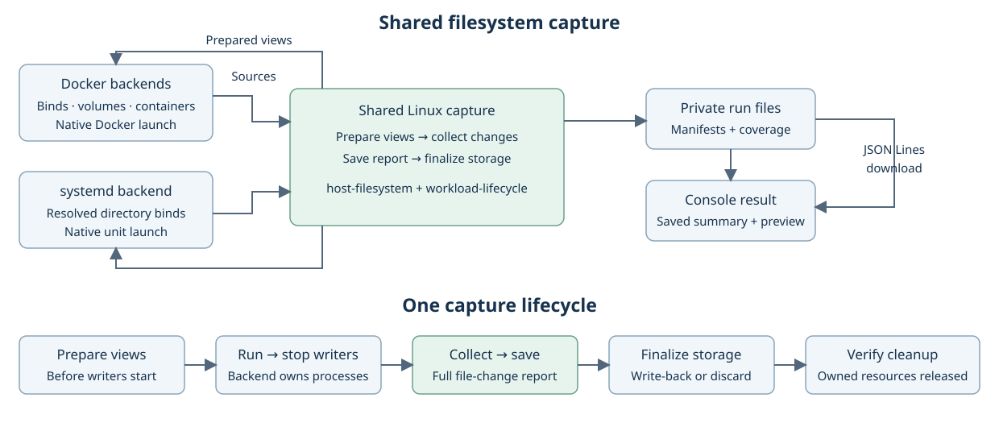

# File changes in Console

Created November 10, 2026. Updated November 11, 2026. Architecture agreed, including the keep-with-the-run policy; implementation pending.
[Implementation plan](111026-file-change-report-impl.md).

Docker runs already create private filesystem views, collect file changes and finalize
writes. Console drops that report. Systemd has no equivalent tracked-directory workflow.
Reuse the existing filesystem mechanism for both and expose one report in Console.

## Agreed behavior

- Capture the host folders behind a launch's declared writable mounts: directory binds,
  declared output directories and a declared working directory the program sees at its host path.
- Show counts, coverage and a bounded file preview on current and past run results.
- Download the complete collected list as JSON Lines.
- Offer a choice of where written files end up: written back to their source, or kept with the run.
- Keep host `/dev/shm` observation separate. Preserve native device and shared-memory access.
- Keep launch fingerprints and machine observations in their existing roles.

This extends the [Compose/Holoscan capture design][outputs]. Holoscan keeps its own
CLI launch integration. This change does not implement the Holoscan runner.

## Keeping a run's files

The file-change report is a list. It records that a file changed and leaves the
file's contents to the write policy. Today Console always writes back, so a
later run can overwrite an earlier run's output.

A third policy keeps each run's written files with that run.

| Policy | Written files go to | Source folder | Run keeps |
| --- | --- | --- | --- |
| Write back (default) | The source folder | Modified | The list |
| Keep with the run | A folder inside the run | Untouched | The list and the files |
| Discard | Nowhere | Untouched | The list |

Keep with the run reuses write back's steps: unmount the view, read the upper
layer into a list of removals and transfers, then copy the transfers. Only the
destination differs. Removals are recorded and applied nowhere. The views are
mounted so that every file in the upper layer is complete, so kept files stand
on their own.

One Console setting selects the policy for the whole project. Write back stays
the default, so existing projects behave as before. This setting is approved.

Limits:

- It covers host folders. Docker writable layers and named volumes keep their
  existing behavior.
- With keep, the next run starts from the unchanged source. State an application
  carries between runs resets.
- Run folders grow, and Console has no pruning of old runs. That is separate
  follow-up work.
- A per-folder policy is left out.

Program logs follow the same route. Console dumps each program's full output
from the host journal into a run-owned output folder at the end of the run, as
tracked in [Cutuy/doramcap#314](https://github.com/Cutuy/doramcap/pull/314).
The dump is then one more set of run files.

## Shared mechanism

| Owner | Responsibility |
| --- | --- |
| `host-filesystem` | Existing Linux directory views, metadata collection, manifest records, upper-layer interpretation, write-back and discard. |
| `workload-lifecycle` | Shared capture steps and ordering, from prepared storage through saved file-change report and finalization. |
| Docker backends / `docker-engine` | Resolve binds and volumes, wire views into native launch, verify Docker visibility, collect Engine layer/volume observations and own Docker resources. |
| systemd backend | Resolve effective directory binds, wire views through systemd, stop units and verify their mount references are released. |
| Console | Persist the report reference and summary, build a preview and stream the complete download. |

Extract the existing Linux implementation from `docker-engine`; carry its tests and
persisted formats. Use the current crates and dependencies. Keep Docker Engine calls
and service-manager calls with their backends. The shared run sequence calls the same
capture/finalization operations for each backend; it does not infer writes from launch
fingerprints or machine-state comparisons.

## Run sequence

1. **Review:** show capture sources and known exclusions from the resolved launch.
2. **Start preparation:** revalidate the launch, prepare sources and shared views, and
   save the file baseline before any application writer starts.
3. **Launch:** each backend maps the returned views at the original application targets.
4. **Stop:** stop every attempted writer, including after partial startup or cancellation.
5. **Collect:** read tracked views and backend observations; save the manifests and
   file-change report while the views and stopped Docker containers remain available.
6. **Finalize:** apply the existing write-back/discard policy, release view references,
   unmount views, and remove owned runtime resources after required collection succeeds.

The report records observation, write disposition and cleanup separately. Collection
must precede destructive storage finalization. Systemd unit mount references must be
released before strict unmount; a busy view remains owned and blocks verified cleanup.
Machine-observation timing remains unchanged.

## Capture scope

Every launch has two views of the filesystem:

- **App view:** the paths the program sees, including its working directory.
- **Host view:** where those files live on the machine.

Console captures host folders. A program reaches a host folder only through a
writable mount in its app view, so the capture sources are the host sources of
those mounts. The user declares them in the launcher's own format and Console reads them.

| Launch | Writable mounts |
| --- | --- |
| Compose, Holoscan in Docker | Each service's host folder mounts. |
| Typed systemd program | Its writable binds into its private root, plus a same-path bind of its working directory when no declared bind covers it. |
| Native systemd unit | Its effective binds. Without a root change, it sees the host tree at the same paths. |

The working directory is an app-view path. It leads to a host folder like any other path:

| Working directory sits | Capture |
| --- | --- |
| Under a writable mount | Already captured through that mount. It adds no source. |
| At its host path: a same-path bind, or a unit without a root change | That host folder is a source. |
| Under a read-only mount, or inside a root Console does not bind | Listed with the reason and left uncaptured. |

Dora's coordinator and daemon run in `/runtime`, which their run-owned output bind
covers, so they add no source. A native unit that sets `RootDirectory=`,
`RootImage=` or its own binds is resolved through those settings. A container's
working directory follows the first or the last row.

For a working directory that reaches the host at its own path:

- Capture only an explicitly declared one that names an ordinary folder. A unit
  that declares none keeps its native behavior and is listed as outside coverage.
- A working directory that is the filesystem root or a home directory shorthand
  is listed with the reason and left uncaptured.
- Units that share or nest working directories follow the existing rules for
  shared and overlapping trees.
- State, log and cache directories a unit declares are listed at Review as
  declared and uncaptured. Capturing them is later work.

Console's project root is the scope for admission. It is no capture source by itself.

## Sources and native behavior

| Source | Behavior |
| --- | --- |
| Supported persistent directory binds | Reuse shared OverlayFS views; preserve destinations, shared aliases and access flags. Both backends follow the project's write policy, which defaults to write back. |
| Fresh run-owned output directories | Retain their existing private paths; collect through the common file mechanism. Exclude controller-owned records. A shared run root without separable application output has explicit partial coverage. |
| Docker writable layers / named volumes | Preserve existing Engine diff, metadata and volume-retention behavior. |
| Read-only aliases into a tracked tree | Preserve the alias relationship and read-only access using the same view mapping. |
| Devices, live shared memory and unsupported private storage | Preserve native access and list the exclusion. No filesystem-content capture claim. |
| Declared working directory at its host path | Reuse shared OverlayFS views at that path through the same-path bind, an owned drop-in or a property. A working directory under a mount adds no source. |
| Arbitrary native-unit writes outside resolved sources | Outside capture coverage; retain native unit semantics. |

Systemd reads effective bind properties through the service manager and retains native
optional-source, target, ordering and access semantics. Review identifies sources that
cannot be resolved until runtime preparation as unknown. Start resolves them before
writers start and records the actual inventory. An application-visible path is never
silently redirected to its original source after planned view creation fails.

Keep current restrictions on overlay backing, overlapping roots, nested mounts and
hardlinks. Validate capture constraints before launch. Do not overlay the entire host
filesystem or add user-selected roots or environment inputs.

## Failure and recovery

| Event | Result |
| --- | --- |
| Expected file writes | Informational counts and records. |
| Excluded or incompletely scanned source | Explicit scope/reason; observed counts cover successful sources only. Infer no deletions from a failed scan. Preserve existing named-volume retention rules. |
| Planned view setup fails | Do not launch writers; clean up only newly owned views, retaining failed cleanup state. |
| Writers remain active | Do not claim a final file list or remove their storage. |
| Required collection or saving the file-change report fails | Retain runtime resources needed for recovery, report the failure and block verified cleanup. Apply this existing Docker preservation rule to systemd capture. |
| Write-back fails or original files changed externally | Preserve remaining upper data and diagnostics. Do not replay writes automatically. |
| Controller stops unexpectedly | The next admission stops owned writers before the existing reset/discard path. Salvage is best effort; an interrupted report remains unavailable or explicitly incomplete. |

A saved file-change report means change manifests, counts and coverage were recorded.
It contains metadata; native recording validity has its own outcome. Final write-back
is non-atomic and keeps its existing metadata-fidelity limitations.

## Console and persistence

Run-private manifests are the authoritative file list. A completed checkpoint names
only synced manifests inside that run and is published atomically. Console saves its
reference and summary with the run transaction, and includes the section in
`console-report.json`. The preview is derived
from those records; refresh, History and restart use the same report.

Show storage category, source, consumers, path, change kind and available before/after
metadata. Counts describe metadata transitions, not distinct file contents. Display
coverage and download availability independently of execution and recording outcomes.
Old runs without a report read as unavailable. A complete zero-change observation
reads as zero; a missing report never does.

Keep all records on disk. Bound the preview to the existing transport and saved-detail
budgets, label it as a preview, and retain access to every collected record through the
authenticated artifact route. Preserve raw Unix path bytes in the download and show a
readable escaped form in the browser. Stream JSON Lines with backpressure and explicit
export completion; malformed or missing manifests cannot produce a complete export.

Traversal and export stream records. The existing metadata comparison retains
before/after maps for one source, so memory grows with that tree. This extraction
preserves that cost. The report describes observed final changes rather than a
complete history of writes.

### Files in the run folder

The run folder is the one place Console owns: `runs/<run id>/` in its data
folder. It holds Console's records, declared recordings, log dumps and, under
keep with the run, the files the run wrote. Console controls this folder, so it
is where size and file-count limits will apply. Those limits are later work;
nothing bounds the folder today.

Each kept file and log dump has a download action through the existing
authenticated artifact route. The browser names a kept file by its entry in the
run's saved change list and a log dump by its program; it never sends a path. The
server reads the entry's raw name bytes and opens the file only inside the run's
kept-files or log folder, so Console's own records stay private. Names need not be
UTF-8: the open takes the raw bytes, and the download name carries an encoded form
with a plain fallback. Files are always sent as downloads and never shown inline.

| Policy | Downloadable through Console |
| --- | --- |
| Write back | Log dumps, recordings and the report. Written files sit in their source folders and appear as text. |
| Keep with the run | Log dumps, recordings, the report and every file the run wrote. |

Paths outside the run folder stay text. The location of the run folder is shown
for bulk transfer by other means.

Use the current run retention and private-file permissions. Do not add a filesystem
search API, pagination, run-comparison fields or new history-list columns in this work.
The original tracking PR is [#312](https://github.com/Cutuy/doramcap/pull/312).

## Qualification

This is a design, based on source inspection. Shared Linux capture exists for Docker;
its extraction, systemd mount visibility and end-to-end Console delivery remain untested.
The implementation plan covers real Compose/systemd runs, failure preservation,
restart, full download readback and ARM64. GPU and Holoscan qualification remain separate.

Applicable rules: D-01 through D-14; I-03 through I-07 and I-09.

[outputs]: https://github.com/Cutuy/doramcap/blob/90fb3d1766ffbf4f4e6eb66d0f90cb0c999a5933/libs/workload-holoscan/docs/110926-holoscan-outputs.md
