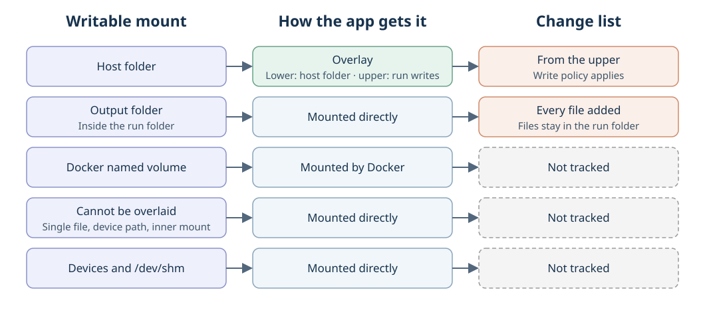
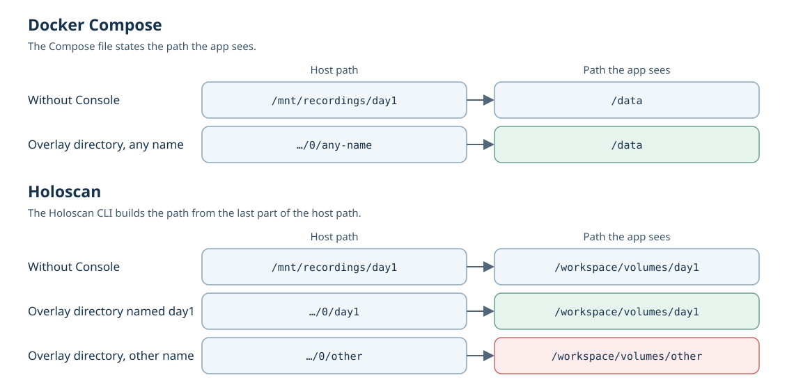
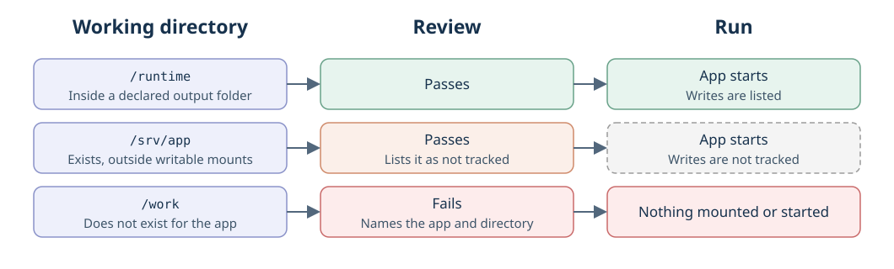
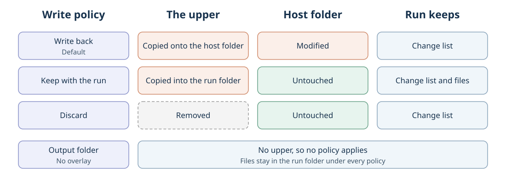
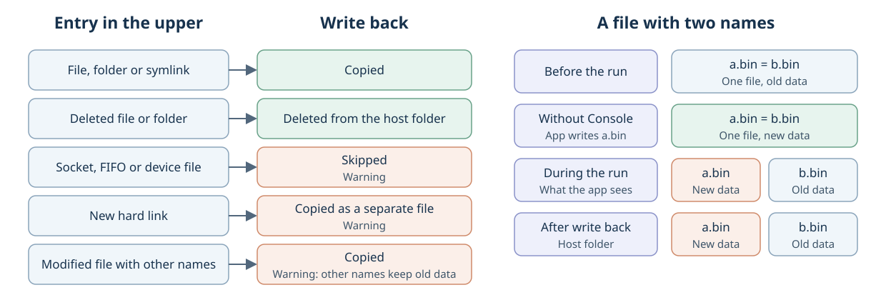
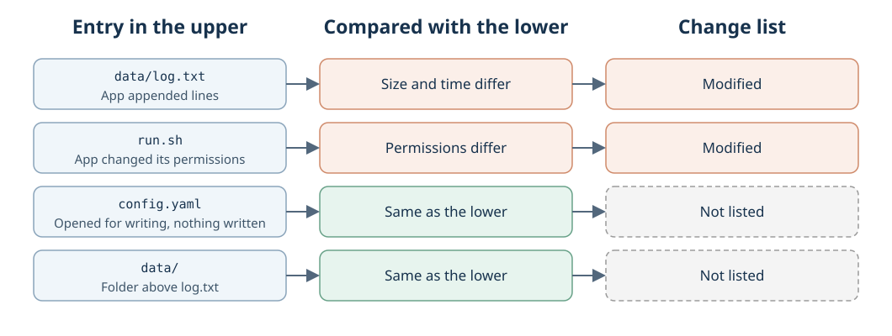

# Overlays for writable mounts

Created November 10, 2026. Updated November 11, 2026: decisions from the plan review recorded.
Status: architecture agreed; milestones 1 and 3 implemented in review, the rest pending.
[Implementation plan](111026-file-change-report-impl.md).

Console puts an overlay on every host folder a launch mounts as writable. After the
apps stop, the overlay's upper holds everything the run wrote there. Console reads it
for the change list, applies the write policy to it and reports both.

## Terms

These documents use only these terms.

| Term | Meaning |
| --- | --- |
| Host folder | A folder on the machine that a launch mounts into an app. |
| Path the app sees | Where that folder appears to the app. |
| Writable mount | A mount the launch declares as writable. |
| Overlay | A kernel OverlayFS mount that Console creates for one writable mount. |
| Lower | The host folder under an overlay. The run never changes it. |
| Upper | The directory that receives the run's writes. |
| Overlay directory | The directory the overlay is mounted on. The app is given this in place of the host folder. |
| Run folder | `runs/<run id>/`, the one place Console owns. |
| Output folder | A folder inside the run folder that Console creates for a run and mounts into an app. |
| Change list | Added, modified and deleted records for a run. |
| Write policy | What happens to an upper after the run: write back, keep with the run, or discard. |
| Not tracked | Storage an app can write that has no overlay and no change list. |

## Goal

1. **Console overlays the writable mounts a launch declares.** Compose services,
   services Console creates, your own unit files and Holoscan launches each declare
   mounts in their own format. Console adds none.
2. **Each of those mounts gets one overlay.** The host folder is the lower.
3. **The change list is read from the uppers** after the apps stop.
4. **The write policy acts on the uppers.**
5. **Everything else an app can write is not tracked,** and Review says so.

Machine snapshots and input copies keep their current owners and are outside this design.

## What each writable mount gets

| Writable mount | Overlay | Change list | Write policy |
| --- | --- | --- | --- |
| Host folder | Yes | From the upper | Applies |
| Output folder | No, mounted directly | Every file listed as added | Files are already in the run folder |
| Docker named volume | No | Not tracked | Docker keeps the volume |
| Host folder that cannot be overlaid | No, mounted directly | Not tracked | Writes go straight to the host folder |
| Devices and `/dev/shm` | No, mounted directly | Not tracked | None |

- **Output folder.** It starts empty and already lives in the run folder, so its files
  survive a Console crash and need no copy. Console lists the folder directly and skips
  its own records there. When an app mounts the whole run folder, Console's records are
  skipped and the report marks that mount as partly listed. Giving output folders an
  overlay too, so one mechanism covers every write, remains an option to revisit.
- **Named volume.** Docker creates and manages it. Replacing it with an overlay would
  stop Docker filling a new volume from the image and break volume drivers.
- **Cannot be overlaid.** The mount is a single file, sits under `/proc`, `/sys` or
  `/dev`, or contains another mount point. The run starts anyway.
- Review and the result list every mount that is not tracked, with the reason.

Read-only mounts are mounted directly. A read-only mount that contains a writable one
shares that mount's overlay, so it shows the run's writes.

Known gap: a mount that is not tracked reports nothing about what the app wrote.
Recording basic metadata for it without walking the whole folder is later work.

## What each launch declares

| Launch | Writable mounts Console overlays | Not tracked |
| --- | --- | --- |
| Compose service | Host folders in the Compose file | Named volumes. The container's own filesystem is read through Docker's diff as today. |
| Service Console creates | Host folders in the app's settings | Nothing else is writable for it. |
| Your own unit file | Host folders in `BindPaths=` | Writes anywhere else on the host. |
| Holoscan | The project folder and extra data folders | Mounts the project sets in its own Docker options. |

Compose reads the user's Compose file and works on its own copy for the run. In that
copy each writable host folder is replaced by its overlay directory. The user's file is
never changed.

### The path the app sees

Console keeps the path the app sees unchanged.

- **Compose and systemd** write that path out next to the host folder. Swapping the
  host folder for the overlay directory changes nothing for the app.
- **Holoscan** builds the path from the last part of an extra data folder's path. The
  Holoscan CLI starts the container, so Console cannot set the path itself. The overlay
  directory for such a folder therefore carries the host folder's name. The project
  folder always appears at the same path and needs no special name.

### Working directory

A working directory is only the path an app starts in. It declares no mount and gets no
overlay.

- Console no longer mounts a working directory that the app's settings do not declare.
- Console checks that a declared working directory exists where the app will run: when
  Review is produced, and again before anything is mounted or started. A missing one
  fails there, naming the app and the directory.
- A unit that writes `WorkingDirectory=-/path` accepts a missing directory, and Console
  skips the check. Compose needs no check; Docker creates a missing working directory.
- When a working directory is writable and outside every writable mount, Review lists
  it as not tracked and suggests declaring it. The user makes that change.

Console's Dora coordinator and daemon use `/runtime`, their declared output folder.

## Write policy

| Policy | Upper goes to | Host folder | Run keeps |
| --- | --- | --- | --- |
| Write back (default) | The host folder | Modified | The change list |
| Keep with the run | A folder inside the run folder | Untouched | The change list and the files |
| Discard | Nowhere | Untouched | The change list |

One Console setting selects one of the three policies for the project. Write back stays
the default, so existing projects behave as before. This setting is approved.

- With keep, the next run starts from the unchanged host folder; state an app carries
  between runs resets.
- Run folders grow, and Console has no pruning yet. That is separate work.
- A policy acts on an upper. An output folder has none, so its files stay in the run
  folder under every policy.
- A mount that is not tracked ignores the policy. Its writes land where the app put them.

### Write back

Write back copies each entry in the upper onto the host folder. It never fails the run.
Execution, the change list and write back each report their own outcome.

| Entry in the upper | Change list | Write back |
| --- | --- | --- |
| File, folder or symlink | Recorded | Copied |
| Deleted file or folder | Recorded | Deleted from the host folder |
| Socket, FIFO or device file | Recorded | Skipped, with a warning |
| New hard link | Recorded | Copied as a separate file, with a warning |
| Modified file that has other names | Recorded | Copied, with a warning that the other names keep the old contents |

A file with two names is one file. An overlay copies it into the upper under the name
the app wrote, so the app already sees the two names differ during the run. Write back
leaves the host folder the same way.

**Changes from outside the run.** Console does not check whether the host folder changed
during a run. When something outside the run and the run itself both change the same
path, write back keeps the run's version.

- **Inside the run:** any write through a declared mount, whichever app made it. Apps
  that mount the same host folder share one overlay. The record names the folder and
  the apps that mount it.
- **Outside the run:** a process that is not part of the run, or a service from your own
  unit file writing to a host path it did not declare.

## One run

1. **Check** each declared working directory.
2. **Mount an overlay** for every writable host folder before any app starts.
3. **Launch** each app with the overlay directories in place of the host folders.
4. **Stop** every app that was started, including after partial startup or cancellation.
5. **Read each upper** and each output folder into the change list. Reading needs no mount.
6. **Save the report:** sync the change list, then publish its checkpoint atomically.
7. **Unmount** the overlays.
8. **Apply the write policy** to each upper.
9. **Clean up** what the run owns.

The change list is saved before the write policy runs. An overlay that stays busy keeps
its saved change list, waits for its write policy and blocks verified cleanup.

## Change list

- **Added:** in the upper, absent from the lower.
- **Modified:** in both, and its type, permissions, owner or modification time differs
  from the lower. A file or symlink is also modified when its size differs. "Before"
  comes from the lower, "after" from the upper.
- **Deleted:** removed by the run. A deleted folder produces one record for each path
  under it in the lower.

The kernel copies a file into the upper when an app opens it for writing, and creates
every folder on the way to a changed file. Such entries match the lower and are left out
of the list. A folder's size is ignored, because a folder in the upper holds only the
entries the run touched. The comparison reads no file contents.

The list records metadata and paths with their raw Unix bytes. It holds the final state
of each upper and no history of writes. Listing cost follows the size of the upper.

## Report and downloads

Console saves the report reference and an 8 KiB preview with the run, shows them on the
Result and History pages, and streams the full change list as JSON Lines. Old runs
without a report read as unavailable; a complete zero-change run reads as zero.

The run folder holds Console's records, recordings, program log dumps
([Cutuy/doramcap#314](https://github.com/Cutuy/doramcap/pull/314)) and, with keep with the
run, the kept files.

Each file the change list names inside the run folder has a download action through the
authenticated artifact route: kept files, output folder files and log dumps. The browser
names a kept file or an output folder file by its entry in the saved change list and a
log dump by its program; it never sends a path. The server opens the file only inside
the run's kept-files folder, the entry's output folder or the log folder, by its raw
name bytes. Console's own records are never served this way. Files are always sent as
downloads.

## Owners

| Part | Owner |
| --- | --- |
| Declared mounts, launching and stopping apps | `workload-docker`, `workload-systemd`, `workload-holoscan` |
| Overlays, change list, write policy | `host-filesystem`, ordered by `workload-lifecycle` |
| Container filesystem diff, Docker resources | `docker-engine` |
| Report, preview, downloads | Console |

The shared overlay step takes a host folder and returns its overlay directory. The path
the app sees stays with the launch that declares it.

## Failure and recovery

| Event | Result |
| --- | --- |
| A declared working directory is missing | Review or Start fails; nothing is mounted or started. |
| Overlay setup fails | No app starts; only newly created overlays are cleaned up. |
| Apps remain active | No final change list; their overlays stay mounted. |
| Reading or saving the change list fails | Uppers are kept for recovery; the failure is reported and blocks verified cleanup. |
| Write back cannot copy an entry | A warning names the entry. The change list is complete and the run outcome is unchanged. |
| Write back stops on an I/O error | The remaining upper is kept with diagnostics. Writes are never replayed automatically. |
| Console stops unexpectedly | The next admission stops the apps it owns, then discards leftover overlays as today. Output folders stay in the run folder. |

## Limits

- An overlay needs backing storage that supports it. This is checked before launch.
- When one writable host folder contains another, both share the outer folder's overlay.
- The whole host filesystem is never overlaid.
- A file copied into the upper loses its link to its other names for the run and after
  write back.
- A change from outside the run to a path the run also wrote is overwritten at write back.
- Named volumes and mounts that cannot be overlaid are not tracked.
- A file rewritten to the same size with its modification time set back is left out of
  the change list.

## Qualification

This is a design. Milestone 1 (the code move) and milestone 3 (the Console report) are
implemented and in review. The rest is unbuilt; the implementation plan lists its checks.
The Holoscan path rule comes from a test of the real CLI with a fake Docker; no real
container has run with an overlay directory.

Applicable rules: D-01 through D-04, D-06 through D-09, D-11 through D-13; I-03, I-04,
I-06 and I-07.
