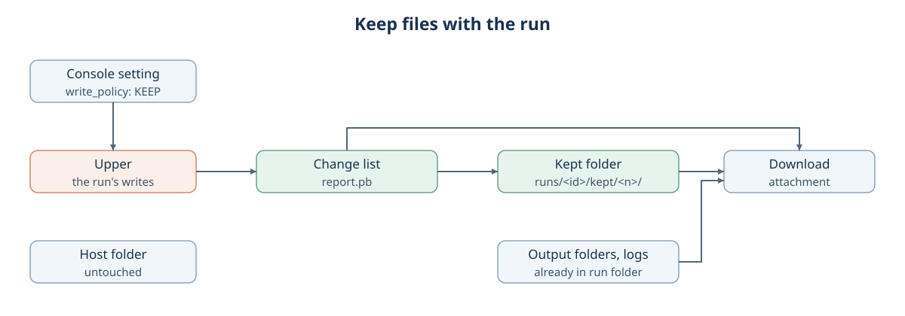

# Keep files with the run

Created November 13, 2026. Status: implemented; sibling integrations pending.
[Implementation plan](111326-keep-files-with-run-impl.md) ·
[Overlays for writable mounts](111026-file-change-report.md), milestone 5.

Console gains the third write policy, keep with the run, and a download action for the
files a run holds in its run folder. The agreed behavior is in the overlay design's
[write policy](111026-file-change-report.md#write-policy) and
[report and downloads](111026-file-change-report.md#report-and-downloads) sections.
Terms follow its [term list](111026-file-change-report.md#terms).

## Behavior

- **Keep with the run:** after the change list is saved, Console copies each upper's
  added and modified entries into the run folder. The host folder stays untouched.
  Deletions appear in the change list only.
- **Setting:** one Console setting selects write back, keep with the run or discard.
  Write back stays the default. The setting is approved.
- **Review** shows the policy. **Result** shows the policy and the kept location.
- **Downloads:** kept files and output folder files get a download action in the change list.

## Kept folder

| Path | Holds |
| --- | --- |
| `runs/<run id>/kept/<n>/` | Entries from the upper of overlaid host folder `n`, at their paths inside that folder |
| `runs/<run id>/filesystem/report.pb` | The change list, with the policy and each host folder `n` maps to |

Numbering keeps host folder names, which may be any bytes, out of kept paths.
`kept/` is reserved in the run folder, like `filesystem/` and `overlays/`: the output list
leaves it out, and keep fails with the upper intact when an app has already created it.

## Copy

The copy reuses write back's plan: the same entries, the same skips and warnings for
sockets, FIFOs and device files, and hard links copied as separate files. Only the
destination differs. The upper and the run folder may sit on different filesystems.

Console trusts successful `rsync` completion, then syncs the kept files and directories
before removing the upper. It adds no separate type, size or content comparison.
A failed or interrupted copy or sync keeps the upper and blocks verified cleanup.

## Downloads

| Request names | Server opens, by raw name bytes |
| --- | --- |
| A kept entry in the saved change list | The entry inside `kept/<n>/` |
| An output folder entry in the saved change list | The entry inside its output folder |

The browser never sends a path. The server resolves the request against the saved
report, opens the file beneath its folder without following symlinks, and always sends
it as an attachment with an encoded filename. Console's own records are never served.

`GET /api/artifacts/<run id>/run-file.download?change=<position>` names a zero-based position
across the report's categories in saved order. The complete JSON Lines list includes
each position; the bounded preview keeps those positions when it interleaves categories.
Each request uses saved category counts to locate the relevant manifest and reads only
through its selected entry. The opened regular file has a single hard-link name and
no symlink components. Its current contents are served, including when the size has
changed or another copy failed. File availability is independent of `overlays/results.json`.

References survive refresh and restart through the existing SQLite run status and saved
run files. Their positions remain stable while the published manifests remain unchanged.
The complete JSON Lines export validates all records and counts through EOF.

## Owners

| Part | Owner |
| --- | --- |
| Keep policy, copy and syncing | `host-filesystem` |
| Passing the policy to Compose and systemd runs | `compose-apps`, `workload-systemd` |
| Setting, Review and Result display, download route | Console |

## Approved decisions

| Decision | Owner's choice |
| --- | --- |
| Kept destination | Fixed `kept/<n>/` layout inside each run. |
| Verification input | Superseded by trusting rsync; the transfer plan retains paths only. |
| Copy success | Successful rsync completion, then durability syncing before upper removal. |
| Policy owner | One filesystem-owned `WritePolicy` in ConsoleConfig and RunPlan. |
| systemd before overlays | Reject keep/discard at Review until overlay integration. |
| File opener prerequisite | Separate commit in this PR; preserve raw Unix path bytes. |
| Download selector | Saved change-list position; server resolves paths from run records. |
| Position lookup | Scan the selected category to its entry; add no persistent index. |
| Hard-link aliases | Refuse downloads of files with multiple hard-link names. |
| Journal placeholder | Remove it; add program-ID downloads with the journal integration. |
| File availability | Serve each authorized available file independently of overall copy completion. |
| Route name | `run-file.download`, outside the recording-ID namespace. |
| Download size | Serve the current file without comparison to its saved size. |

## Follow-ups

- Prefix all `ArtifactKind` values together in a separate PR; this PR uses `RUN_FILE = 3`.
- Journal export adds the program-ID selector, saved-log resolver and download actions together.
- A separate PR will replace the filesystem finalization summary `overlays/results.json`
  with protobuf (`.pb`).

## Limits

- Run folders grow; Console has no pruning yet.
- State an app carries between runs resets, because each run starts from the unchanged host folder.
- Output files with multiple hard-link names have no download action.

Applicable rules: D-01 to D-03, D-06 to D-08, D-11 to D-13; I-03, I-04, I-06, I-07.
