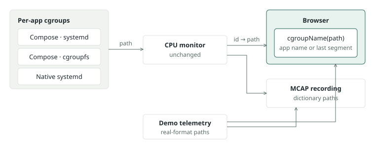

# Service names in Top CPU consumers

Created: 2026-11-13. [Implementation](111326-service-names-in-cpu-consumers-impl.md).
Builds on [per-app cgroups](../../libs/workload-lifecycle/docs/111226-per-app-cgroups.md).

Top CPU consumers labels each group with its last cgroup path segment, so Compose
containers read `docker-<id>.scope`. Per-app cgroups put each app's name in the path;
the browser reads it from there. The CPU monitor and the telemetry format stay
unchanged, so recordings carry the names through the paths they already store.

## Names

| Layout | Path ends in | Shown |
| --- | --- | --- |
| Compose, systemd | `doramcap-compose-‹repo›-‹run›-‹role›-my\x2dapp.slice/docker-<id>.scope` | `my-app` |
| Compose, cgroupfs | `/doramcap-compose-‹repo›/‹run›/‹role›/my-app/<id>` | `my-app` |
| Native systemd | `doramcap-‹repo›-my-app.service` | `my-app` |
| Anything else | `/system.slice/sshd.service` | `sshd.service` |

- `‹repo›` and `‹run›` are 12 lowercase hex characters; `‹role›` is `system` or `user`.
- User services with their own `cgroup_parent`, and host cgroups, keep today's label.
- Rows stay keyed by cgroup ID; replicas and restarts show as separate rows with one name.
