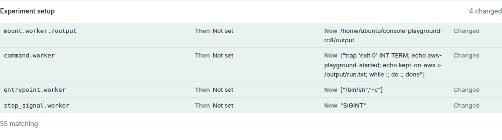
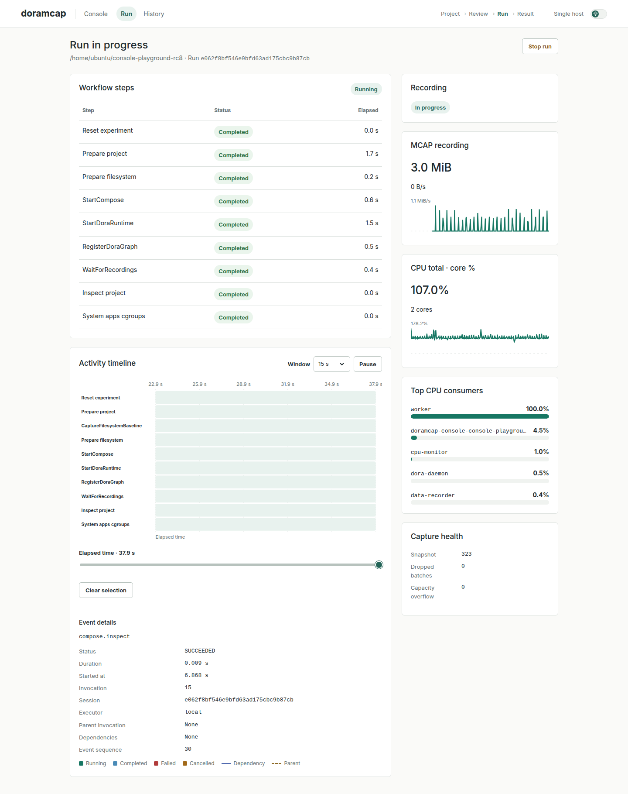

# Console rc7 on a customer VM: ROS 2 chatter

Created 11/14/26. A customer-style drive of [Console 0.0.1-rc7](https://github.com/Cutuy/doramcap/releases/tag/console-v0.0.1-rc7)
on the ARM64 test VM, using only the public installer and an open-source ROS 2 project.

[ARM64 rc8 follow-up, 11/15/26](#arm64-rc8-follow-up).

## Setup

| Item | Value |
| --- | --- |
| Host | Ubuntu 24.04 ARM64 (Neoverse-N1), 2 vCPU, 904 MiB RAM, no swap, Docker 29.9 |
| Project | `talker` and `listener` from [ros2/demos](https://github.com/ros2/demos) `demo_nodes_cpp` (ROS 2 Jazzy), a 200 Hz `ros2 topic pub` on `/scan`, and `ros2 bag record` into `./bags` |
| Console options | Defaults plus **Data recorder** (CPU topics) |
| Access | `doramcap-console start --ssh …` and the printed SSH tunnel; headless Chromium drove the UI |

The project uses `compose.yaml` and a one-line Dockerfile adding
`ros-jazzy-demo-nodes-cpp` to `ros:jazzy-ros-base`; run 2 added `/scan`.

## Customer journey

| Step | Result |
| --- | --- |
| Install | `sh install.sh` verified and installed in 3.4 s; `doctor` passed all 10 checks |
| Start | Printed the tunnel command and an access link that signed the browser in |
| Review | Ready in 7 s. Listed services, image digests, the `./bags` overlay with write-back, machine configuration |
| Run 1 | Live CPU, MCAP size and capture health. Stop → finished in about 45 s; the page stays on Run activity with **View result** |
| Result 1 | Banner: **Killed: talker (exit 137), listener (exit 137)**. `./bags` received the rosbag2 MCAP |
| Run 2 | Added `/scan` and `stop_signal: SIGINT`. Still killed |
| Run 3 | **Run again** from History with direct node binaries. No kills; run 31 s shorter |
| Compare | Duration 92.6 s → 61.1 s and recording size; **0 setup changes** |

## What Console found in the project

### `ros2 run` never stops cleanly in a container

Result named the killed services, and the 30 s grace period showed up in run duration.
Tracing it outside Console:

| Command | Stop signal | Outcome |
| --- | --- | --- |
| `ros2 run demo_nodes_cpp talker` | SIGTERM | exit 137 after the grace period |
| same, with `init: true` and `stop_signal: SIGINT` | SIGINT | exit 137 after the grace period |
| `/opt/ros/jazzy/lib/demo_nodes_cpp/talker` | SIGTERM | exit 0 in 0.28 s |

The `ros2 run` Python wrapper does not pass the signal on to its node child. Launching
the node binary directly fixes it. Console's banner warned that final messages could be
missing, so the customer gets the right warning about losing data at shutdown.

### The ROS CLI writes Python bytecode into the image layer

Container layers showed 254–433 added files per run. Grouping the downloaded
`file-changes.jsonl` for run 3:

| Service | Change |
| --- | --- |
| `scan` (`ros2 topic pub`) | 175 `__pycache__` files plus 29 directories under `/opt/ros` |
| `bag` (`ros2 bag record`) | 106 `__pycache__` files plus 19 directories under `/opt/ros` |
| each ROS service | a log under `/root/.ros/log` |

That is avoidable startup work on every run. Precompile in the Dockerfile or set
`PYTHONDONTWRITEBYTECODE=1`, and send ROS logs to a volume when they matter.

### Recordings

| File | Contents |
| --- | --- |
| `cpu.mcap` | 430 messages over 40.9 s on `doramcap/cpuacct` and its dictionary |
| `messages.mcap` | 860 messages: the same two topics plus Dora metadata channels |
| `bags/rosbag2_*/…_0.mcap` | The customer's own ROS data, written back to the host folder |

Both Console recordings decode with a streaming reader. Every run ended with cleanup
**Verified** and no containers left behind. Available memory stayed above 390 MiB.

## Findings for Console

Ordered by customer impact. Each item was observed on this VM unless marked otherwise.

| # | Finding | Evidence |
| --- | --- | --- |
| 1 | **Compare ignores service commands.** `command`, `entrypoint` and `stop_signal` are absent from Experiment setup, so the fix showed "0 changed" | Run 2 vs 3 setup: 52 keys, images, Console env vars and mounts only |
| 2 | **Monitoring costs more CPU than this workload.** Run CPU was 96–98% of 200%; `talker` used 0.4% | Top consumers: `containerd` 21–28%, `live-bridge` ~21%, `docker` 14–16% |
| 3 | **200 ms readiness healthchecks drive that cost.** CPU monitor, data recorder and live bridge each `docker exec` every 200 ms for the whole run | Three idle containers with the same healthcheck: 55% of 200% host CPU |
| 4 | New run drops the previous system-app choice; Review then compares against a run with different apps | Data recorder unchecked after **New run**; **Run again** keeps it |
| 5 | Generated names leak into the UI: `dc-78508a5992c636a1-experiment/bag` in writable folders and logs | Review, Result |
| 6 | File changes mix Console's own files with the customer's: run-folder records under Host folders, `/config` and `/usr/sbin` in system-app layers | Result, `file-changes.jsonl` |
| 7 | Compare shows no per-service exits or CPU, so a "killed" run and a clean one differ only by duration | Compare run 2 vs 3 |
| 8 | Machine condition marks equal-looking values as **Changed** (`21.2 GiB → 21.2 GiB`, `0.4 → 0.4 hours`) | Result |
| 9 | Console MCAPs have no summary or index; `@mcap/core`'s indexed reader rejects them ("File is not indexed") | Matches the planned index-free baseline in the [writer design](../../libs/storage-persistence/docs/101826-mcap-writer-design.md) |
| 10 | The service journal logs every file change at `warning` level | Hundreds of lines per run |
| 11 | Logs list system apps and customer services together in start order | Result |
| 12 | rc7 shipped with a one-line release note | Fixed after publishing |

Live run view, with system apps leading Top CPU consumers:

Compare after the fix, with only duration and size changed:

## What worked

- Install, `doctor`, `start --ssh` and the auto sign-in link took a few minutes with no guesswork.
- Review showed which host folder the run can write, and how, before anything started.
- A YAML mistake in `compose.yaml` stopped at Review with Compose's own parse error.
- The killed-service banner pointed straight at a real defect in the project, and duration confirmed the fix.
- File changes exposed hidden writes inside images that `docker compose` alone never shows.
- History, **Run again** and downloads (recordings, report, file changes, per-service logs) worked from a fresh browser.

## ARM64 rc8 follow-up

Updated 11/15/26. Installed [Console 0.0.1-rc8](https://github.com/Cutuy/doramcap/releases/tag/console-v0.0.1-rc8)
from the public installer on the customer's ARM64 AWS instance. Chromium drove
its real playground through the printed SSH tunnel. The original rc7 installation,
ROS 2 project and History were preserved; this test used a separate playground project.

| Item | Follow-up setup |
| --- | --- |
| Release | `ecfcaec9`; public ARM64 archive and digest-pinned system-app images |
| Host | Ubuntu 24.04.5, Linux 7.0.0-1014-aws, 2 vCPU, 904 MiB RAM, no swap; Docker 29.9.3, Compose 5.7.0 |
| Workload | Bundled `cpu-burn`, then command/signal and writable-folder variations |
| System apps | Defaults plus Data recorder; the final run also enabled Fault Watchdog |
| SPA | Same-source production build hosted locally; its Console walkthrough uses sample data |

### Installation issue

The installer verified the archive and announced success, but inherited `umask 077`:
release and launcher directories were mode `0700`. The normal-user launcher failed
with **Permission denied** (exit 126). Restoring public read/execute access on the
installed release files made the launcher usable; all ten `doctor` checks passed.
The installer needs to set its release permissions independently of the caller's umask.

### Real AWS journey

| Step | Observed result |
| --- | --- |
| Normal run | Live CPU and recording data; Stop to Result in 4.31 s; Completed / Saved / cleanup Verified |
| Command change | Review and History Compare showed `command`, `entrypoint`, `stop_signal` and the new mount; selection survived refresh |
| Saved choices | Data recorder survived New run and refresh; History's Run again restored apps and the saved file policy |
| Keep with the run | Host folder stayed empty; `run.txt` downloaded from the retained run with its expected contents |
| Write back and restart | Stopping Console during a run copied the file back and cleaned up; after restart, History retained recordings and the killed-worker warning (exit 137); the old session returned HTTP 401 |
| Discard | `discard.txt` remained listed as evidence, had no download link, and was absent from the host folder |
| Failure | Intentional exit 7 named the worker and its error; report, logs and file changes remained available; recordings were Unavailable and cleanup Verified |
| Cancellation | Stop during startup produced Cancelled, recording Unknown and cleanup Verified, with a report; file changes were explicitly unavailable |
| Input errors | Stale Review prevented Start; malformed YAML stopped at Review and corrected input recovered |
| Watchdog | Four sources connected, no active faults, zero dropped batches and zero capacity overflow in the live view |

The completed runs left no containers. File changes distinguished **Used by User
apps** from **Run files · Used by System apps**. The first run's bounded host-folder
preview showed 16 of 18 changes; the complete export contained all 48 changes across
categories and its terminal completion record.

Both AWS MCAP downloads reached their footer with an independent `@mcap/core`
streaming reader: `cpu.mcap` held 480 messages and `messages.mcap` held 954.
The indexed reader rejected both with “File is not indexed”.

### CPU observation

Ten-second `/proc/stat` and process-tick samples on this instance, with EC2 steal
time reported separately. CPU is core percent: 100% is one core; this VM has 200%.
The control used the same pinned busy-worker image with the Console services idle.

| Sample | Host busy CPU | Worker CPU | Steal |
| --- | --- | --- | --- |
| Plain Compose control | 105.3% | 100.0% | 0.9% |
| Console, CPU monitoring and Data recorder | 111.0% | 99.8% | 0.7% |

The system-monitor process used 1.2% in the Console sample. Available memory was
333 MiB in a running snapshot. These short playground samples do not remeasure the
original ROS 2 workload. Docker inspection confirmed no healthcheck on CPU monitor,
Data recorder or live bridge; the repeated 200 ms probes are gone.

### Status of the original findings

| # | ARM64 follow-up |
| --- | --- |
| 1 | **Improved:** the three command/signal fields are compared. `stop_grace_period` still has no row: changing only 1 s to 5 s flagged an unrelated Hidden live-bridge mount, with no shutdown-grace difference. |
| 2 | **Improved in the sampled playground:** about six extra core-percentage points over the control; original ROS 2 overhead remains unmeasured. |
| 3 | **Verified fix:** the running ARM64 system apps have no repeated readiness healthchecks. |
| 4 | **Verified fix:** New run, refresh and Run again retained the expected choices. |
| 5 | **Still present:** generated Compose prefixes appear in writable folders and logs. |
| 6 | **Improved:** User/System associations and run-file labels are visible; system records remain in the same category. |
| 7 | **Still present:** comparing the killed and clean runs shows no per-service exit or CPU comparison. |
| 8 | **Verified fix:** small disk differences use exact bytes; uptime uses seconds. |
| 9 | **Still present:** the real recordings stream successfully and have no index. |
| 10 | **Verified fix:** the journal has aggregate filesystem summaries and coverage warnings, without a warning for every changed file. |
| 11 | **Still present:** system and user logs share one list. |
| 12 | rc8 has substantive release notes and was installed and exercised on ARM64. |

### Local SPA check

The locally hosted SPA completed its simulated run and early Stop, retained Data
recorder after New run, opened History by deep link, and downloaded its built-in
recording (71 messages, fully decoded). Mobile History fit a 390 px viewport, app
filters survived refresh, and all five images in this report loaded. Supplementary
x86_64 Console runs also covered file writes, failure, cancellation and recording
readback; the installation and journey above were tested on AWS ARM64.
