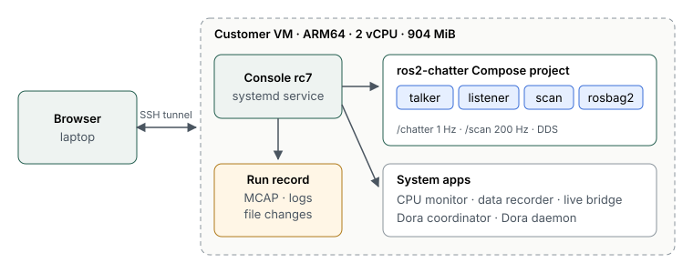
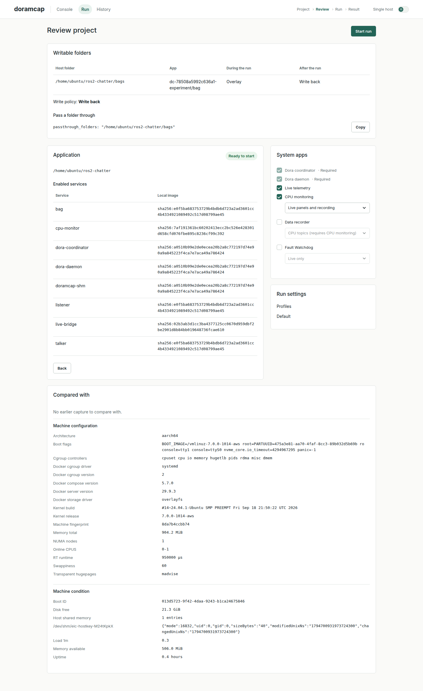
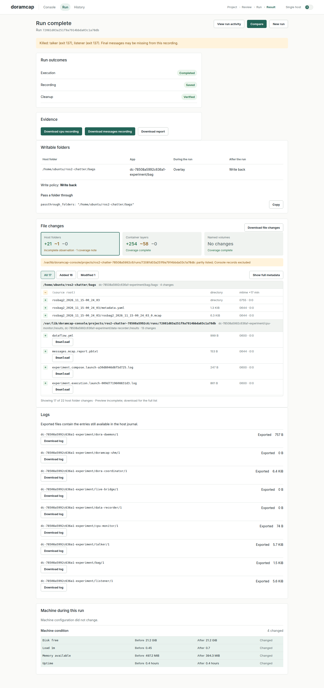
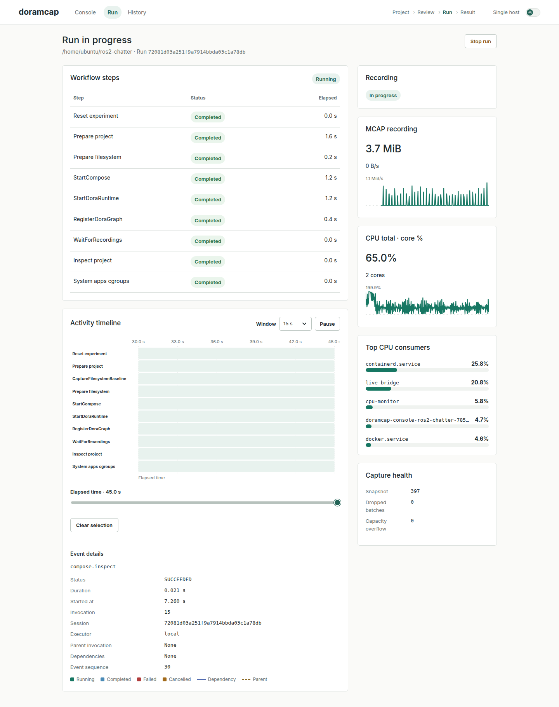
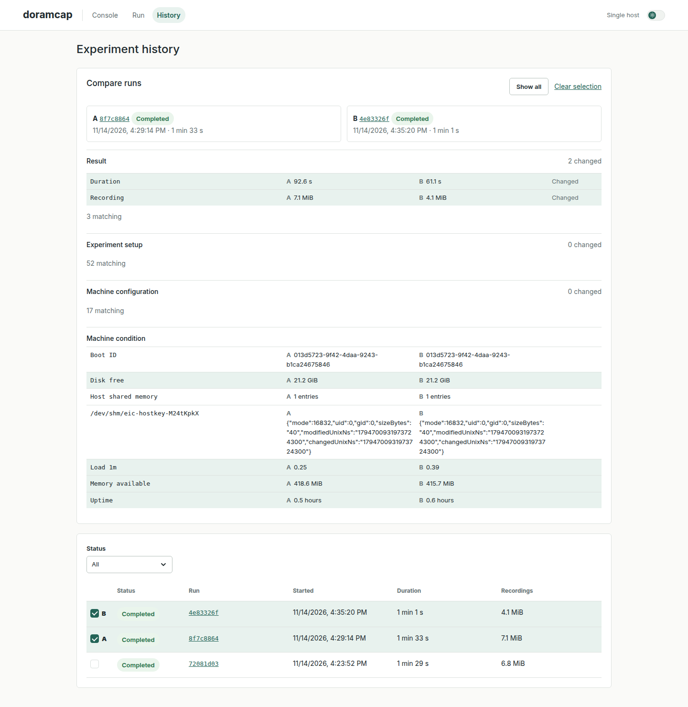

# Console rc7 on a customer VM: ROS 2 chatter

Created 11/14/26. A customer-style drive of [Console 0.0.1-rc7](https://github.com/Cutuy/doramcap/releases/tag/console-v0.0.1-rc7)
on the ARM64 test VM, using only the public installer and an open-source ROS 2 project.

## Setup

| Item | Value |
| --- | --- |
| Host | Ubuntu 24.04 ARM64 (Neoverse-N1), 2 vCPU, 904 MiB RAM, no swap, Docker 29.9 |
| Project | `talker` and `listener` from [ros2/demos](https://github.com/ros2/demos) `demo_nodes_cpp` (ROS 2 Jazzy), a 200 Hz `ros2 topic pub` on `/scan`, and `ros2 bag record` into `./bags` |
| Console options | Defaults plus **Data recorder** (CPU topics) |
| Access | `doramcap-console start --ssh …` and the printed SSH tunnel; headless Chromium drove the UI |

The project is a plain `compose.yaml` with a one-line Dockerfile that adds
`ros-jazzy-demo-nodes-cpp` to `ros:jazzy-ros-base`. The first version had only talker,
listener and rosbag2; run 2 added `/scan`.

## Customer journey

| Step | Result |
| --- | --- |
| Install | `sh install.sh` verified and installed in 3.4 s; `doctor` passed all 10 checks |
| Start | Printed the tunnel command and an access link that signed the browser in |
| Review | Ready in 7 s. Listed services, image digests, the `./bags` overlay with write-back, machine configuration |
| Run 1 | Live CPU, MCAP size and capture health. Stop → Result in about 45 s |
| Result 1 | Banner: **Killed: talker (exit 137), listener (exit 137)**. `./bags` received the rosbag2 MCAP |
| Run 2 | Added `/scan` and `stop_signal: SIGINT`. Still killed |
| Run 3 | **Run again** from History with direct node binaries. No kills; run 31 s shorter |
| Compare | Duration 92.6 s → 61.1 s and recording size; **0 setup changes** |

## What Console found in the project

### `ros2 run` never stops cleanly in a container

Result named the killed services, and the 30 s grace period showed up in run duration.
Tracing it outside Console:

| Command | Stop signal | Outcome |
| --- | --- | --- |
| `ros2 run demo_nodes_cpp talker` | SIGTERM | exit 137 after the grace period |
| same, with `init: true` and `stop_signal: SIGINT` | SIGINT | exit 137 after the grace period |
| `/opt/ros/jazzy/lib/demo_nodes_cpp/talker` | SIGTERM | exit 0 in 0.28 s |

The `ros2 run` Python wrapper does not pass the signal on to its node child. Launching
the node binary directly fixes it. Console's banner warned that final messages could be
missing, so the customer gets the right warning about losing data at shutdown.

### The ROS CLI writes Python bytecode into the image layer

Container layers showed 254–433 added files per run. Grouping the downloaded
`file-changes.jsonl` for run 3:

| Service | Change |
| --- | --- |
| `scan` (`ros2 topic pub`) | 175 `__pycache__` files plus 29 directories under `/opt/ros` |
| `bag` (`ros2 bag record`) | 106 `__pycache__` files plus 19 directories under `/opt/ros` |
| each ROS service | a log under `/root/.ros/log` |

That is avoidable startup work on every run. Precompile in the Dockerfile or set
`PYTHONDONTWRITEBYTECODE=1`, and send ROS logs to a volume when they matter.

### Recordings

| File | Contents |
| --- | --- |
| `cpu.mcap` | 430 messages over 40.9 s on `doramcap/cpuacct` and its dictionary |
| `messages.mcap` | 860 messages: the same two topics plus Dora metadata channels |
| `bags/rosbag2_*/…_0.mcap` | The customer's own ROS data, written back to the host folder |

Both Console recordings decode with a streaming reader. Every run ended with cleanup
**Verified** and no containers left behind. Available memory stayed above 390 MiB.

## Findings for Console

Ordered by customer impact. Each item was observed on this VM unless marked otherwise.

| # | Finding | Evidence |
| --- | --- | --- |
| 1 | **Run page stays on "Stopping…" after the run finishes.** Result appears only after reload | Runs 2 and 3: server finished within ~50 s of Stop; the open page was still stale after 180 s and 90 s |
| 2 | **Compare ignores service commands.** `command`, `entrypoint` and `stop_signal` are absent from Experiment setup, so the fix showed "0 changed" | Run 2 vs 3 setup: 52 keys, images, Console env vars and mounts only |
| 3 | **Monitoring costs more CPU than this workload.** Run CPU was 96–98% of 200%; `talker` used 0.4% | Top consumers: `containerd` 21–28%, `live-bridge` ~21%, `docker` 14–16% |
| 4 | **200 ms readiness healthchecks drive that cost.** CPU monitor, data recorder and live bridge each `docker exec` every 200 ms for the whole run | Three idle containers with the same healthcheck: 55% of 200% host CPU |
| 5 | New run drops the previous system-app choice; Review then compares against a run with different apps | Data recorder unchecked after **New run**; **Run again** keeps it |
| 6 | Generated names leak into the UI: `dc-78508a5992c636a1-experiment/bag` in writable folders and logs | Review, Result |
| 7 | File changes mix Console's own files with the customer's: run-folder records under Host folders, `/config` and `/usr/sbin` in system-app layers | Result, `file-changes.jsonl` |
| 8 | Compare shows no per-service exits or CPU, so a "killed" run and a clean one differ only by duration | Compare run 2 vs 3 |
| 9 | Machine condition marks equal-looking values as **Changed** (`21.2 GiB → 21.2 GiB`, `0.4 → 0.4 hours`) | Result |
| 10 | Console MCAPs have no summary or index; `@mcap/core`'s indexed reader rejects them ("File is not indexed") | Matches the planned index-free baseline in the [writer design](../../libs/storage-persistence/docs/101826-mcap-writer-design.md) |
| 11 | The service journal logs every file change at `warning` level | Hundreds of lines per run |
| 12 | Logs list system apps and customer services together in start order | Result |
| 13 | rc7 shipped with a one-line release note | Fixed after publishing |

Live run view, with system apps leading Top CPU consumers:

Compare after the fix, with only duration and size changed:

## What worked

- Install, `doctor`, `start --ssh` and the auto sign-in link took a few minutes with no guesswork.
- Review showed which host folder the run can write, and how, before anything started.
- A YAML mistake in `compose.yaml` stopped at Review with Compose's own parse error.
- The killed-service banner pointed straight at a real defect in the project, and duration confirmed the fix.
- File changes exposed hidden writes inside images that `docker compose` alone never shows.
- History, **Run again** and downloads (recordings, report, file changes, per-service logs) worked from a fresh browser.
