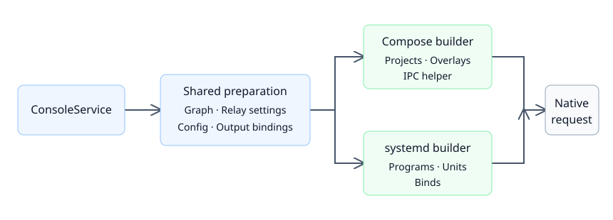

# Backend run preparation

Created November 15, 2026.

Console resolves app selection, the Dora graph and relay settings before building
one native run request. Compose and systemd builders share config and output
binding resolution. Compose renders those bindings into service overlays; systemd
renders them into program binds.

Each builder owns its native launch inputs. Compose includes its IPC helper and
preserves service-specific mount targets. Systemd collects project unit files and
binds Dora outputs beneath the run's runtime directory. Rust executes the existing
shared RunPlan and backend plan.

[Implementation](111526-backend-run-preparation-impl.md).
