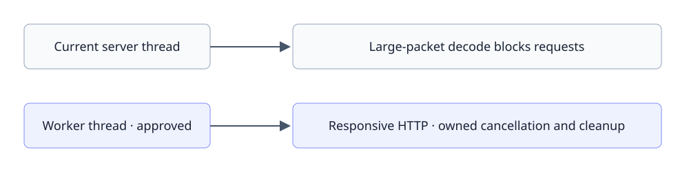

# Compare analytics implementation log

Created: 2026-11-15.

## Work

| Item | Link / owner |
| --- | --- |
| Approved architecture and milestones | [Plan #426](https://github.com/Cutuy/doramcap/pull/426) |
| Existing CPU implementation source | [PR #404](https://github.com/Cutuy/doramcap/pull/404) |
| Implementation | `codex/pr426-compare-analytics`, agent `implement_pr426` |
| CPU evidence review | Agent `review_cpu_evidence` |
| Coordination and independent review | [Log #428](https://github.com/Cutuy/doramcap/pull/428), parent agent |

The implementation follows the plan's shared rows, request-owned analysis tasks,
CPU module and responsiveness milestones. Existing CPU code is reused on the new
implementation branch. The original CPU branch remains available.

## Decisions

### 1. Isolate CPU analysis in a worker thread

Context: supported CPU packets can contain enough counters for decoding to block
other Console requests. Yielding between recording messages leaves that decoding
on the server thread.

Options: retain the current thread and document its latency, or use a request-owned
worker thread. The worker was recommended to keep saved-fact requests responsive.

Choice: the owner explicitly approved the worker thread on 2026-11-15. Analysis
stays in the Console process, with cancellation and reader cleanup owned by its
task. No worker pool, new configuration input or dependency is required.

## Events

- 2026-11-15: Read plan, repository guides, existing CPU implementation and pool state.
- 2026-11-15: Assigned the plan to one implementation agent with an exclusive lease.
- 2026-11-15: Independent review identified exact-ratio comparison and per-run file scoping fixes.
- 2026-11-15: Owner approved worker isolation after the supported-packet responsiveness probe.

## Left for the owner

- Review the completed implementation and orchestration PRs before merging.
