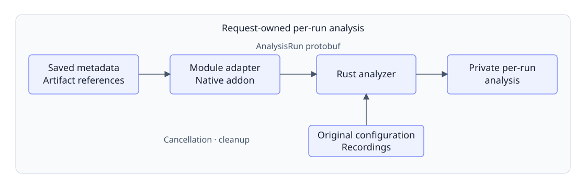

# Compare saved facts and recording analyses

Created: 2026-11-15. [Implementation](111526-compare-service-outcomes-impl.md).

The default materialized analysis displays saved configuration, machine captures and outcomes immediately.
The user chooses recording analyses to run; each adds its own completed section.
Saved facts stay visible during analysis, failure, cancellation and retry.

## Ownership

| Component | Responsibility |
| --- | --- |
| Materialized module | Extract and compare saved facts, Review settings and live machine observations. |
| Recording module | Analyze each run, then compare its private recording measurements. |
| Registry | Register the materialized default and optional recording modules. |
| Task runner | Analyze A/B concurrently and own cancellation through cleanup. |
| Records | Persist and read original evidence. |
| Console service | Resolve inputs and transport module responses. |
| Shared renderer | Display supplied labels, values, outcomes and per-side evidence. |

Every comparison uses the registry and runner. Each module owns its fact extraction,
normalization, masking, precision, labels, values, evidence and comparer.
Analyze A and Analyze B produce that module's private results; its comparer
produces common rows. Exact values compare before formatting. Missing and partial
evidence remain explicit. Ordered sides and their run lists retain their existing
contract; execution currently supports one run on each of two sides.

## Per-run native analysis

The service supplies an explicit per-run protobuf containing saved metadata or
resolved launch state, capture and references to original evidence beneath the
authorized directory. Capture-only inputs represent live machine observations. Recording references come from saved recording declarations. Original
configuration stays authoritative; comparison-normalized configuration is excluded.

A module adapter can invoke Rust through the existing native addon. Native analysis
runs outside the HTTP event loop and opens original evidence beneath the authorized
run directory. A request owns cancellation and readers until cleanup completes.
The native input describes one run; the module's comparer retains comparison policy.

## Delivery and lifetime

Materialized analysis runs automatically for History, Review and live changes.
Recording analysis runs when selected. Each invocation owns an independent task
in the Console process.
Completion follows reader and worker cleanup. Changing selection or leaving Compare
cancels outstanding tasks, and stale responses cannot replace the active selection.
Completed results belong to the active view and are recomputed on another invocation.

Rows retain stable keys, explicit presentation, withholding and bounded-result
semantics. An analysis error belongs to its own section. Recording traversal stays
incremental; resource growth and exhaustion belong to the implementing module.
