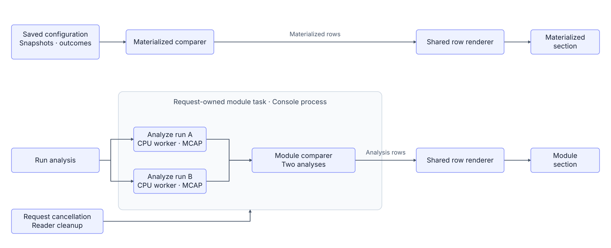
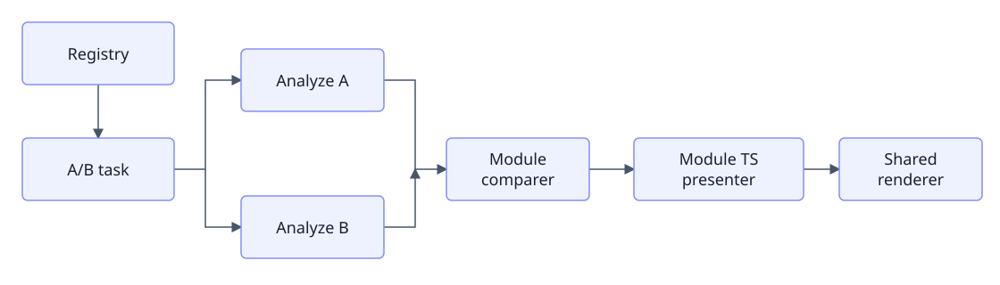
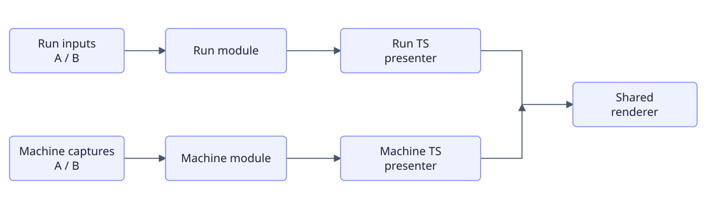

# Compare saved runs and recording analyses

Created: 2026-11-15. [Implementation](111526-compare-service-outcomes-impl.md).

History compares saved setup, outcomes and machine captures. Review compares a
saved baseline with the prepared launch and shows current machine condition.
During a run, machine comparison shows before/after changes and capture errors.
File changes remain a per-run report with their existing preview and downloads.

The framework lands first with an empty production registry. Follow-up PRs migrate
run and machine comparisons, then add CPU recording analysis, selection and controls.

## Framework ownership

| Owner | Responsibility |
| --- | --- |
| Registry | Register module definitions and select one by identity. |
| Runner | Invoke parallel A/B analysis; own cancellation through cleanup. |
| Module | Extract private measurements and compare exact values. |
| Console service | Resolve authorized inputs; choose results and bound transport. |
| Module TS presenter | Supply labels, formatting and display policy. |
| Shared renderer | Display the supplied view model. |

A task completes after both analyzers release their resources. Failure cancels its
sibling. Independent requests retain independent cancellation and results. Modules
supply comparison values and evidence; presentation belongs to TypeScript.

## Existing comparison migration

| Workflow | Inputs | Module work | Presentation |
| --- | --- | --- | --- |
| History | Two saved runs | Run setup/outcomes; machine configuration/condition | Comparison sections |
| Review | Saved baseline and prepared launch | Run setup; machine observations | Configuration differences; current condition |
| During run | Before/after captures | Machine observations | Changes and capture errors |
| File changes | One collected report | Existing file-change owner | Preview, export and downloads |

The run and machine modules have separate inputs, measurements and comparers.
Console selects the relevant results for each workflow. Recording modules add
independent sections; saved comparisons stay visible during analysis and failure.

## Per-run native analysis

Each module receives an explicit protobuf containing saved History or prepared
Review state, capture and original artifact references beneath an authorized run
directory. Machine-only observations supply capture. Snapshot alternatives are
named `snapshot_history` and `snapshot_current`.

A module adapter may invoke Rust through the native addon. Native work stays off
the HTTP event loop and returns the module's protobuf measurements after cleanup.
Comparison policy stays with that module's comparer. Missing and partial evidence
remain explicit. Recording traversal and resource limits belong to its module.
