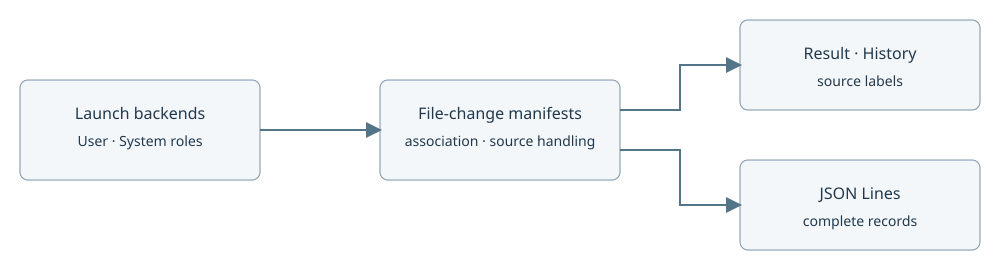

# File-change associations

Created November 15, 2026. [Implementation](111526-file-change-associations-impl.md).
Addresses finding 6 of the [rc7 report](111426-rc7-ux-report.md).

File changes retain two independent facts: the apps associated with their source and
how that source is observed. Console labels both beside each source on Result and
History. Every captured change remains available in the JSON Lines download.

## Behavior

| Fact | Values |
| --- | --- |
| App association | Project, Console, shared, unknown |
| Source handling | Existing `SourceKind`, including run output and overlay |

Association describes apps using the source. It does not identify the writer of an
individual file. Read-only aliases remain consumers. A source shared between Project
and Console apps is labeled shared; any unavailable association keeps it unknown.
Customer artifacts inside the run directory can remain Project-associated.

Launch backends assign associations from resolved service roles before formatting
consumer IDs. Host-filesystem combines source associations and supplies source
handling. Docker preserves the backend's association on its layer observations.

## Persistence and scope

The existing `FileChange` stores both facts as additive protobuf fields. Published
manifests own the saved facts across navigation, restart and configuration changes.
Older records keep unknown association and source handling. No names or paths are
used to infer app association.

Storage categories, counts, coverage, record order, download positions and private
record exclusions keep their existing meaning. The bounded preview includes the new
fields in its existing byte budget; its incomplete label and full download remain.
Source headers group only records with the same source, facts and consumer list.

No dependency, environment input, metadata index or endpoint is added.

Applicable rules: D-03, D-07, D-08, D-13, D-15; I-03, I-06, I-07, I-09.
