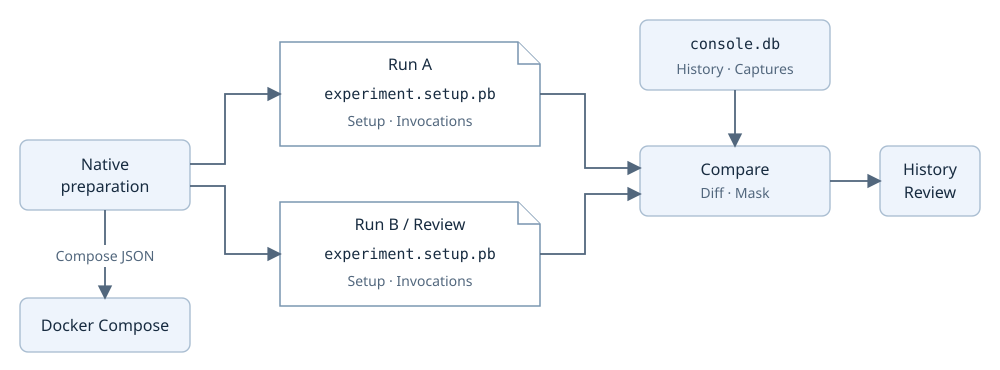

# Service invocation comparison

Created 11/15/26. [Implementation](111526-invocation-comparison-impl.md).

History and Review compare each service's `command`, `entrypoint` and `stop_signal`.
The native configuration snapshot owns normalization: generated Dora ports and runtime
paths become stable labels; configured arguments remain exact. Its canonical model
supplies both the reviewed identity and a three-field comparison copy.

The private `experiment.invocation.json` stays beside the run or review's existing
input record. It contains every service, including system apps, and keeps native JSON
values. Missing fields, `null`, empty strings and empty argument lists remain distinct.

Publication uses a mode-0600 temporary file and atomic rename after syncing its bytes.
The copy survives navigation, refresh and Console restart with the other run files;
review/run directory retention owns its lifetime. It is excluded from application file
changes. A save failure leaves execution available and logs the error. Missing,
unreadable, oversized or incomplete copies make invocation comparison unavailable.

Older runs keep their captured invocation text visible with an **Unavailable** verdict.
The server never guesses which historical ports were generated. Other setup facts
continue comparing through their existing evidence.

Ordinary invocation text is visible. Commands containing names matching the existing
sensitive-value masks, assignment flags or credential URLs are withheld in full on
both sides. Values compare before masking and the existing 512-character display
bound. Masks recognize names and URLs; arbitrary positional secrets have no name to
classify. Copies use the existing 4-MiB safe-read bound and comparison row budget.
