# PR 386 fixes: orchestration log

Created 11/15/26. Scope: findings 1, 4, 6, 7, 8 and 10 from
[the rc7 report](111426-rc7-ux-report.md), [PR 386](https://github.com/Cutuy/doramcap/pull/386).
Each finding received a separate implementation agent and fix PR, initially based on
the report branch.

## Assignments

Agents use GPT-6.1 Sol with xhigh reasoning. The launcher exposes no speed setting
and permits three active subagents. Assignments continue in the same agent after decisions.

| Finding | Implementation agent | Fix PR |
| --- | --- | --- |
| 1: service commands in Compare | `finding_1` | [396](https://github.com/Cutuy/doramcap/pull/396) |
| 4: system-app choice on New run | `finding_4` | [392](https://github.com/Cutuy/doramcap/pull/392) |
| 6: file-source association | `finding_6` | [402](https://github.com/Cutuy/doramcap/pull/402) |
| 7: service exits and CPU in Compare | `finding_7` | [404](https://github.com/Cutuy/doramcap/pull/404) |
| 8: rounded machine values | `finding_8` | [393](https://github.com/Cutuy/doramcap/pull/393) |
| 10: file-change warning noise | `finding_10` | [395](https://github.com/Cutuy/doramcap/pull/395) |

Report head: `fe886a0841ce2bcb27a5876b9aa35fb2c2f77ea8`.
Implementation baseline: `9e18b12a6f70a79919f4dfbc6e2811d6ce0a4674`.
The governing guides are `docs/impl-guide.md` and `docs/design-guide.md` at that baseline.

## Decisions

Important decisions are raised one at a time. Choices record explicit owner answers;
superseded proposals are marked.

### 1. Worktree capacity — keep seven slots

Context: four of seven pool slots were leased by existing tasks when work began.
Problem: six isolated fixes plus this log require seven additional leases if retained together.

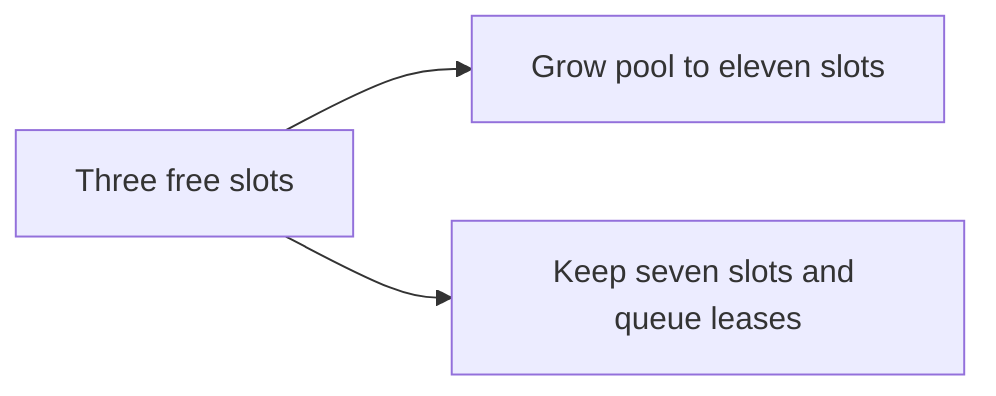

- Options: grow to eleven slots, or keep seven and wait for releases.
- Recommendation: grow to eleven so each fix and the log can retain its own checkout.
- Choice: keep seven slots and use the slots the owner freed. The owner cleared slots 1 and 2; their availability was verified. This task performed no pool growth.

### 2. New run system-app choice — browser cache

Context: New run clears app IDs and launch profiles; Run again restores historical choices.
Problem: a new run silently returns to configured defaults.

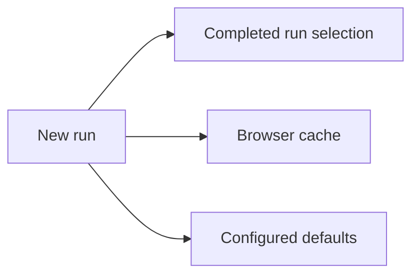

- Options: carry the completed run, browser persistence, or configured defaults.
- Initial recommendation: use the completed run without adding a preference store.
- Choice: the owner requested browser cache. Remember app IDs and launch profiles in localStorage, scoped by browser origin, page/base path and project. Run again uses the selected historical run; legacy omission uses configured defaults.
- Reason: preserve the owner's browser preference across new runs while keeping historical reruns authoritative.

### 3. Rounded machine values — show exact units on collisions

Context: exact values differ, but formatting can show `0.4 hours` on both sides.
Problem: a visible Changed result has no visible difference.

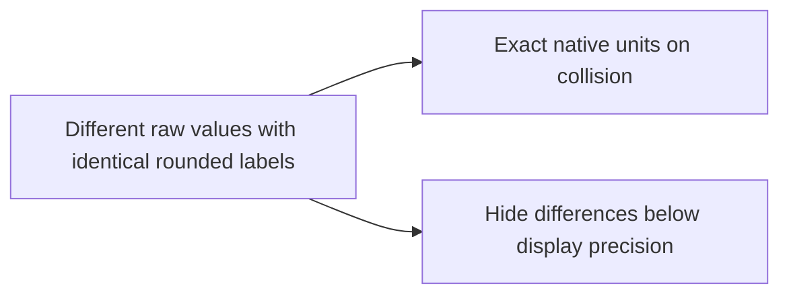

- Recommendation and choice: show exact units on collisions, preserving the stored comparisons.
- Reason: the underlying difference stays inspectable without introducing measurement thresholds. Changing condition verdicts is outside this approved fix.

### 4. File-change journal output — retain informational summary

Context: ordinary file changes receive warning-prefixed detail and category summaries.
Problem: routine evidence appears as a warning.

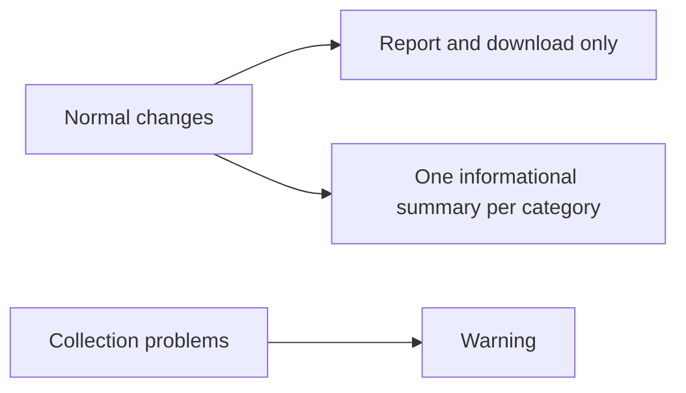

- Recommendation: remove routine per-file output and warn only for incomplete collection or coverage notes.
- Choice: the owner said, "Also keep one routine informational summary." Remove per-file journal lines and keep warnings for collection or coverage problems. Records and counts remain available in the saved evidence. Decision 11 confirms one summary per category.

### 5. File-change source labels — retain all records

Context: Project and Console apps can consume the same sources; run files include customer artifacts too.
Problem: the presentation mixes consumer association with source location.

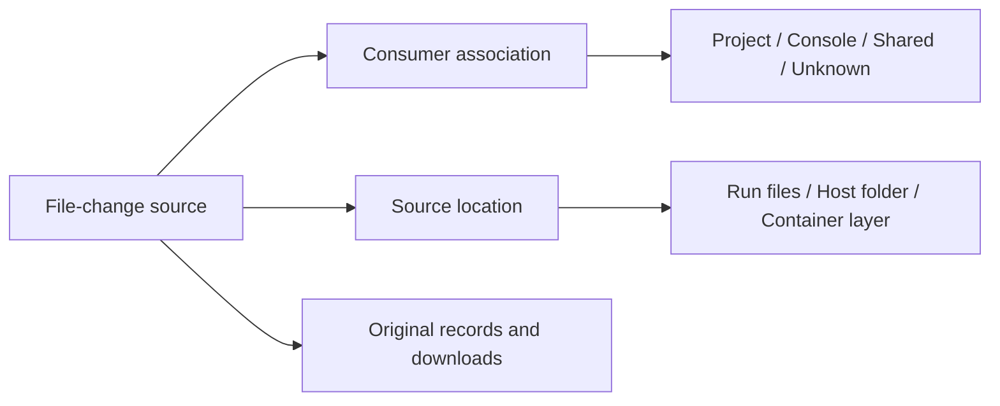

- Options: preserve records with separate source labels, or suppress Console-related records.
- Recommendation and choice: persist consumer associations separately from location. Keep all records, counts, order, original positions and downloads. Existing records remain Unknown when authoritative metadata is absent.
- Reason: consumers explain source association; that association does not establish which app wrote a file.

### 6. Command visibility — show ordinary commands

Context: commands and entrypoints can contain credentials.
Problem: comparison must expose useful changes while honoring sensitive-value withholding.

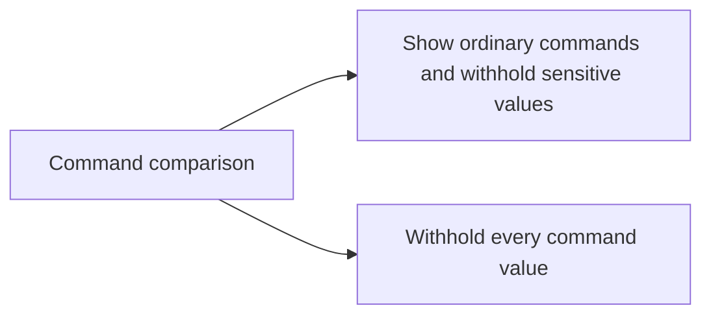

- Recommendation and choice: show ordinary commands and entrypoints, withholding an entire value when the existing sensitive-name or URL rules match. Hidden values still compare.
- Comparison copy: approved in decision 8; historical commands lack authoritative automatic-port flags.

### 7. CPU comparison — intermediate preference, superseded

Context: Compare is a static view; per-service CPU is absent from saved run metrics.
Problem: reducing the recording on every comparison repeats work.

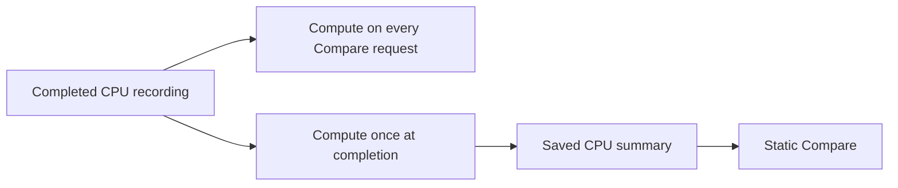

- Initial recommendation: incrementally read finalized recordings when Compare opens, with no new store.
- Owner response: Compare is static; check the understanding first, with a preference for computing and saving at completion.
- Status: superseded by decision 10. The term streaming described bounded-memory file reading, not live telemetry; the owner ultimately chose on-demand calculation from saved recordings.

### 8. Invocation comparison copy — approved

Context: preparation knows which Dora ports and paths it generated; saved history retains only the normalized model hash.
Problem: comparing captured arguments directly would count generated runtime differences as setup changes.

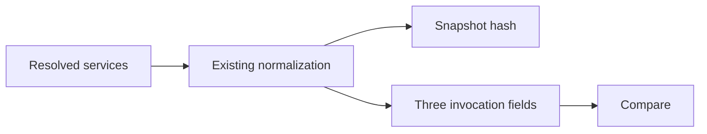

- Options: save the comparison copy, or compare raw captured arguments including generated differences.
- Recommendation and choice: save command, entrypoint and stop signal from the existing canonical model. User-configured arguments remain exact; executed commands are unchanged.
- Legacy behavior: show safely masked captured values with comparison unavailable when the comparison copy is absent.

### 9. Static CPU summary persistence — superseded before implementation

Context: the owner prefers fixed saved results for Compare.
Problem: per-service CPU must be derived once and retained independently of execution outcomes.

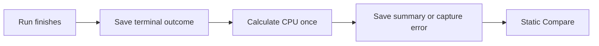

- Recommendation: add a typed summary to the existing saved Status; use the existing SQLite transaction and recovery path.
- Behavior: preserve terminal outcomes and finish time, make CPU errors independent, and let the next Prepare wait for calculation. Pending summaries interrupted by controller restart become unavailable.
- Historical runs: no automatic backfill; missing summaries show CPU unavailable.
- Dependency proposal: promote already-locked official `@mcap/core` 2.4.0 to the TypeScript server runtime. Primary API/release evidence was checked.
- Choice: not implemented. The owner asked about index-free MCAP compatibility, then explicitly preferred calculating during comparison; decision 10 supersedes this proposal.

### 10. CPU calculation during Compare — approved

Context: after considering completion-time persistence, the owner said, "Hold on, i'd prefer live computing it during comparison."
Problem: Compare needs per-service CPU evidence, and the owner questioned whether the reader supports Console files without indexes or summaries.

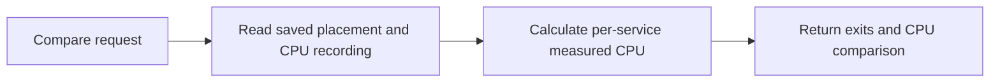

- Choice: calculate from the saved recording during comparison; no persisted CPU summary or new finalization work.
- Dependency condition satisfied: the coordinator read the downloaded rc7 `cpu.mcap` using official `@mcap/core` 2.4.0. The file has summary offset zero and no index records; all 430 messages decoded, with complete framing and no remaining bytes. The indexed reader reproduced "File is not indexed" on the same file.
- Preserve saved per-service exits, CPU seconds, average core percent, observed duration and coverage. Use inclusive parent CPU once; ambiguous attribution and missing evidence remain unavailable. Incremental file parsing bounds working memory; the Compare result is based on the saved recording.

### 11. Routine summary scope — keep one per category

Context: the owner requested one routine informational summary; #395 emits a summary per source category.
Problem: one summary could mean a combined run total or a separate total for each category.

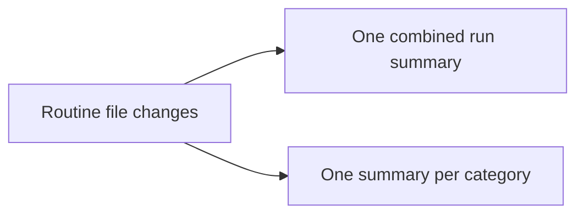

- Options: combine routine counts into one run summary, or retain category summaries.
- Recommendation at clarification: one combined run summary.
- Choice: the owner said, "Keep one per category". Retain the category summaries in #395.
- Reason: the explicit clarification confirms the existing category scope; no follow-up PR is needed.
