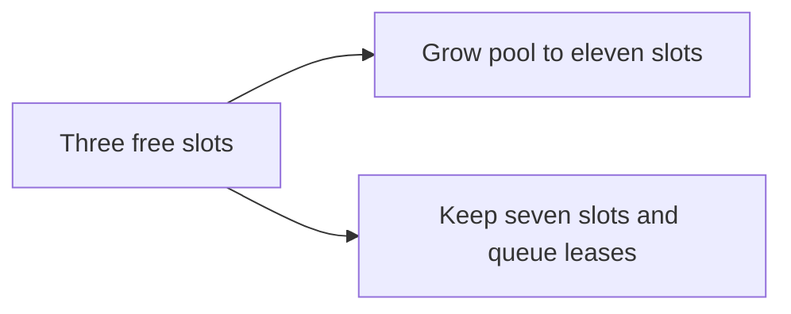
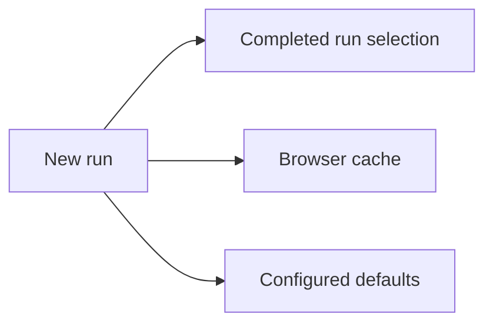
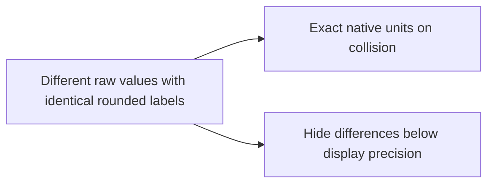
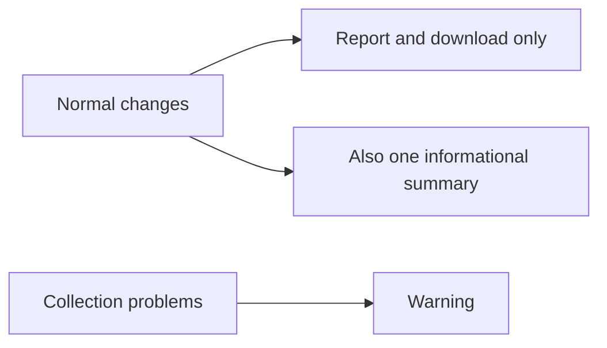
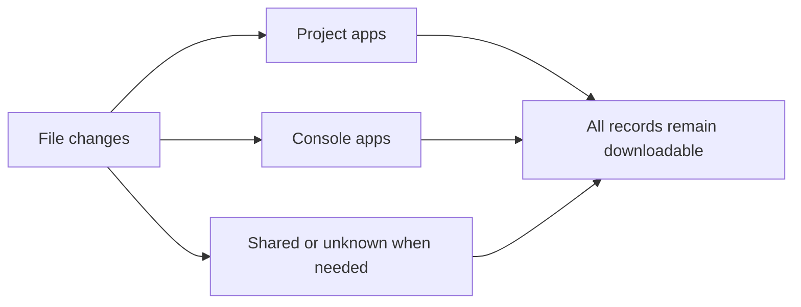
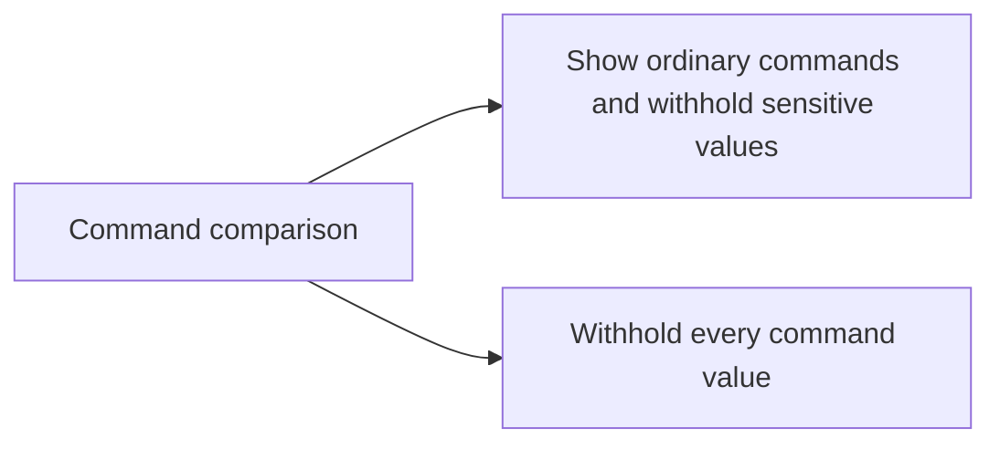
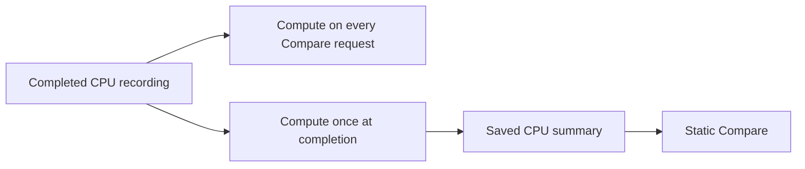
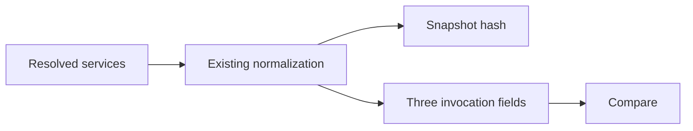
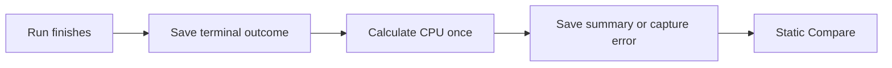
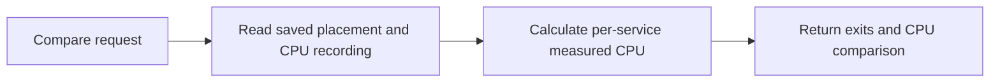

# PR 386 fixes: orchestration log

Created 11/15/26. Scope: findings 1, 4, 6, 7, 8 and 10 from
[the rc7 report](111426-rc7-ux-report.md), [PR 386](https://github.com/Cutuy/doramcap/pull/386).
Each finding has a separate agent and fix PR based on the report branch. Nothing is merged.

## Assignments

Agents use GPT-6.1 Sol with xhigh reasoning. The launcher exposes no speed setting
and permits three active subagents. Assignments continue in the same agent after decisions.

| Finding | Agent | Fix PR | State |
| --- | --- | --- | --- |
| 1: service commands in Compare | `finding_1` | [396](https://github.com/Cutuy/doramcap/pull/396) | Published; final validation and coordinator review in progress |
| 4: system-app choice on New run | `finding_4` | [392](https://github.com/Cutuy/doramcap/pull/392) | Verified, ready, lease released |
| 6: ownership of file changes | `finding_6` | Pending | Implementing in released slot 4 |
| 7: service exits and CPU in Compare | `finding_7` | Pending | Implementing in released slot 1 |
| 8: rounded machine values | `finding_8` | [393](https://github.com/Cutuy/doramcap/pull/393) | Verified, ready, lease released |
| 10: file-change warning noise | `finding_10` | [395](https://github.com/Cutuy/doramcap/pull/395) | Verified, ready, lease released |

Report head: `fe886a0841ce2bcb27a5876b9aa35fb2c2f77ea8`.
Implementation baseline: `9e18b12a6f70a79919f4dfbc6e2811d6ce0a4674`.
The governing guides are `docs/impl-guide.md` and `docs/design-guide.md` at that baseline.

## Decisions

Important decisions are raised one at a time. Choices below are explicit owner answers.

### 1. Worktree capacity — keep seven slots

Context: four of seven pool slots were leased by existing tasks when work began.
Problem: six isolated fixes plus this log require seven additional leases if retained together.

- Options: grow to eleven slots, or keep seven and wait for releases.
- Recommendation: grow to eleven so each fix and the log can retain its own checkout.
- Choice: keep seven slots and use the slots the owner freed. The owner cleared slots 1 and 2; their availability was verified. No pool growth was performed.

### 2. New run system-app choice — browser cache

Context: New run clears app IDs and launch profiles; Run again restores historical choices.
Problem: a new run silently returns to configured defaults.

- Options: carry the completed run, browser persistence, or configured defaults.
- Initial recommendation: use the completed run without adding a preference store.
- Choice: the owner requested browser cache. Remember app IDs and launch profiles in browser storage; Run again continues to use the selected historical run. Browser scoping and failure handling are part of implementation review.

### 3. Rounded machine values — show exact units on collisions

Context: exact values differ, but formatting can show `0.4 hours` on both sides.
Problem: a visible Changed result has no visible difference.

- Recommendation and choice: show exact units on collisions, preserving the stored comparisons.
- Reason: the underlying difference stays inspectable without introducing measurement thresholds. Changing condition verdicts is outside this approved fix.

### 4. File-change journal output — retain informational summary

Context: ordinary file changes receive warning-prefixed detail and category summaries.
Problem: routine evidence appears as a warning.

- Recommendation: remove routine per-file output and warn only for incomplete collection or coverage notes.
- Choice: the owner requested one routine informational summary. Remove per-file journal lines, retain compact counts without a warning prefix, and keep warnings for collection or coverage problems. Records and counts remain available in the saved evidence.

### 5. File-change source labels — retain all records

Context: project and Console changes share storage categories; run files include customer artifacts too.
Problem: the presentation mixes app association with source location.

- Options: preserve records with separate source labels, or suppress Console-related records.
- Recommendation: keep evidence and persist source associations; identify run files independently of which apps use the source.
- Choice: the owner approved separate labels and retaining all records. Existing records remain unknown when authoritative metadata is absent.

### 6. Command visibility — show ordinary commands

Context: commands and entrypoints can contain credentials.
Problem: comparison must expose useful changes while honoring sensitive-value withholding.

- Recommendation and choice: show ordinary commands, withholding an entire value when sensitive-value rules match. Hidden values still compare.
- Remaining architecture choice: persist the three invocation fields from existing canonicalization; historical commands lack authoritative automatic-port flags.

### 7. CPU comparison — intermediate preference, superseded

Context: Compare is a static view; per-service CPU is absent from saved run metrics.
Problem: reducing the recording on every comparison repeats work.

- Initial recommendation: incrementally read finalized recordings when Compare opens, with no new store.
- Owner response: Compare is static; check the understanding first, with a preference for computing and saving at completion.
- Status: superseded by decision 10. The term streaming described bounded-memory file reading, not live telemetry; the owner ultimately chose on-demand calculation from saved recordings.

### 8. Invocation comparison copy — approved

Context: preparation knows which Dora ports and paths it generated; saved history retains only the normalized model hash.
Problem: comparing captured arguments directly would count generated runtime differences as setup changes.

- Options: save the comparison copy, or compare raw captured arguments including generated differences.
- Recommendation and choice: save command, entrypoint and stop signal from the existing canonical model. User-configured arguments remain exact; executed commands are unchanged.
- Legacy behavior: show safely masked captured values with comparison unavailable when the comparison copy is absent.

### 9. Static CPU summary persistence — superseded before implementation

Context: the owner prefers fixed saved results for Compare.
Problem: per-service CPU must be derived once and retained independently of execution outcomes.

- Recommendation: add a typed summary to the existing saved Status; use the existing SQLite transaction and recovery path.
- Behavior: preserve terminal outcomes and finish time, make CPU errors independent, and let the next Prepare wait for calculation. Pending summaries interrupted by controller restart become unavailable.
- Historical runs: no automatic backfill; missing summaries show CPU unavailable.
- Dependency proposal: promote already-locked official `@mcap/core` 2.4.0 to the TypeScript server runtime. Primary API/release evidence was checked.
- Choice: not implemented. The owner asked about index-free MCAP compatibility, then explicitly preferred calculating during comparison; decision 10 supersedes this proposal.

### 10. CPU calculation during Compare — approved

Context: after considering completion-time persistence, the owner said, "Hold on, i'd prefer live computing it during comparison."
Problem: Compare needs per-service CPU evidence, and the owner questioned whether the reader supports Console files without indexes or summaries.

- Choice: calculate from the saved recording during comparison; no persisted CPU summary or new finalization work.
- Dependency condition satisfied: the coordinator read the downloaded rc7 `cpu.mcap` using official `@mcap/core` 2.4.0. The file has summary offset zero and no index records; all 430 messages decoded, with complete framing and no remaining bytes. The indexed reader reproduced "File is not indexed" on the same file.
- Preserve measured interval/coverage semantics, exact service attribution and unavailable evidence. Incremental file parsing bounds working memory; the Compare result is based on the saved recording.

## Investigation notes

All six findings have independent agents. The coordinator inspected the relevant
comparison, selection, file collection and logging paths, plus the report screenshot.
Validation status is recorded in the assignment table; remaining checks concern findings 1, 6 and 7.

- Finding 1: comparison omits command, entrypoint and stop signal. Automatic Dora ports require authoritative normalization.
- Finding 4: New run explicitly clears the app selection; saved run status already contains the selection and launch profiles.
- Finding 6: run artifacts share the Host folders category, and container changes lack persisted app ownership. Preserve evidence while clarifying ownership and origin.
- Finding 7: saved exits are available; stored recording metrics contain no service CPU measurements. Historical CPU needs a source and statistic contract.
- Finding 8: exact differences are rounded into identical labels. Displaying exact native units on collisions preserves the captured facts.
- Finding 10: rc7 already limits detail to ten records per category. Ordinary changes still receive `warning:` prefixes; the report's every-file volume and journald priority are unverified.

## Events

- 11/15/26: Read the report, both guides, and the orchestrator, worktree-pool and Scanner skills.
- 11/15/26: Started findings 1, 4 and 6 independently; finding 4 returned its design proposal and finding 7 started.
- 11/15/26: Requested pool growth. Acquired an existing free slot for this log and stacked it on PR 386.
- 11/15/26: Published this log as [draft PR 390](https://github.com/Cutuy/doramcap/pull/390).
- 11/15/26: Started findings 8 and 10 as earlier investigations completed. All six assignments now exist.
- 11/15/26: Another existing task acquired the remaining free pool slot. The pool remains at seven slots; completed leases are released before later work acquires them.

- 11/15/26: Coordinator verified #392 source/API attribution and browser evidence, #393 source and desktop/mobile rendering, and #395 source plus persisted-record/stderr fixtures. Marked those PRs ready; their agents released leases.
- 11/15/26: Findings 6 and 7 reused the released slots. Finding 1 published #396 and incorporated review hardening for malformed comparison copies and exact configured text.

## Left for the owner

- Review the six fix PRs after implementation and validation.
- Choose integration after the fixes are ready; this task does not merge them.
