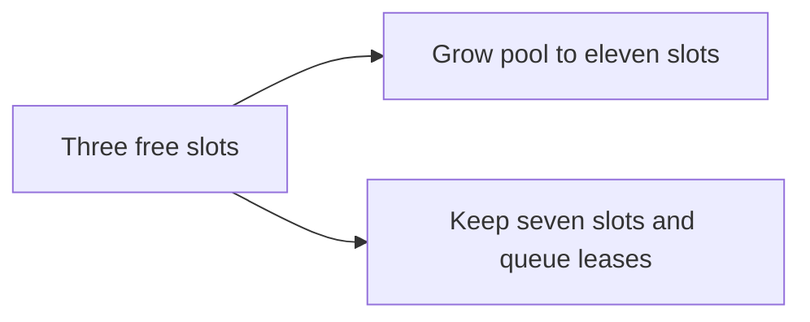
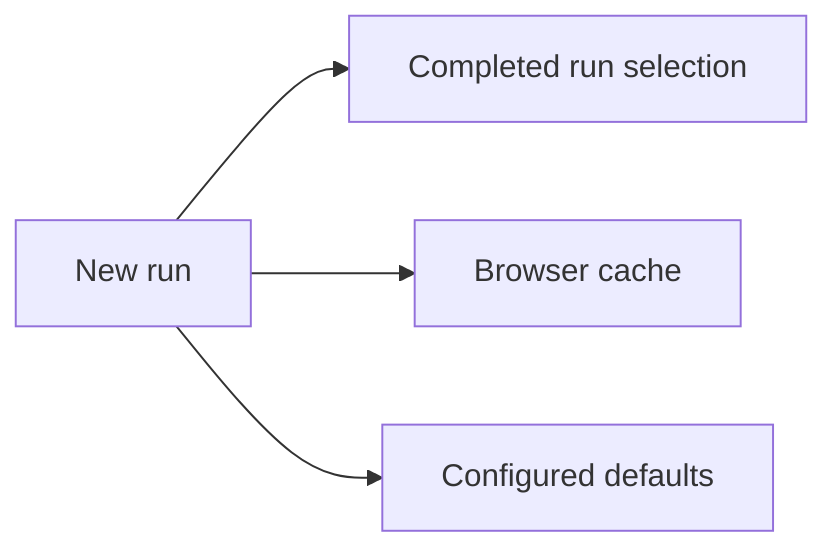
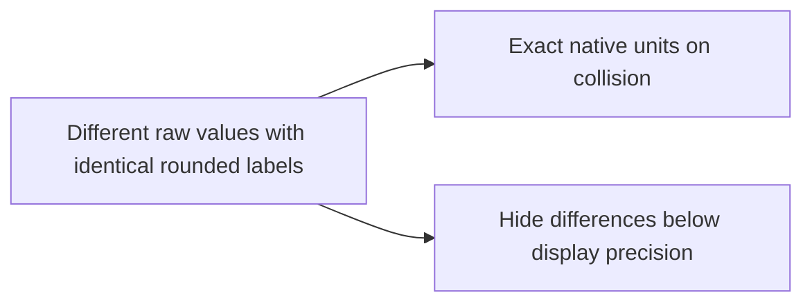
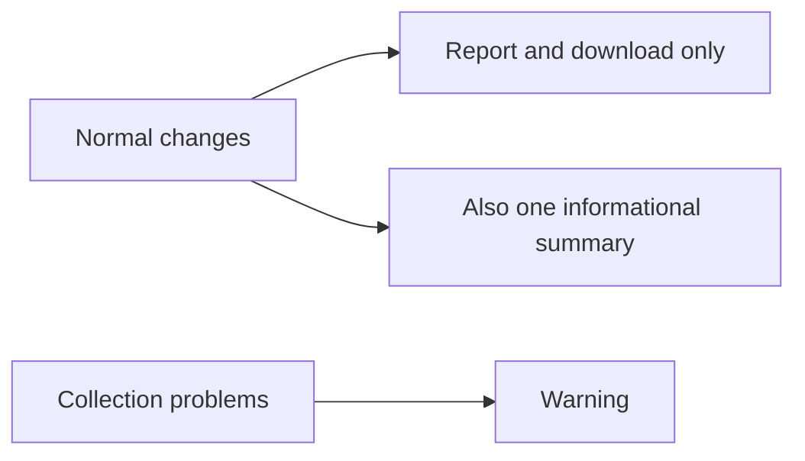
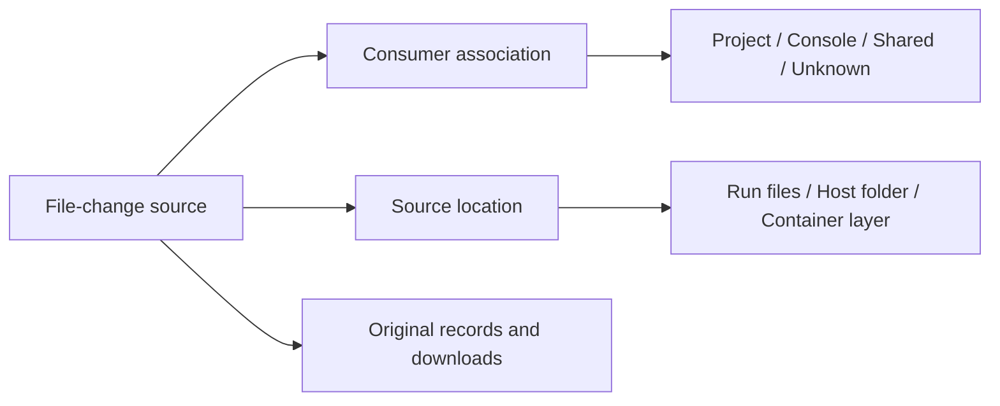
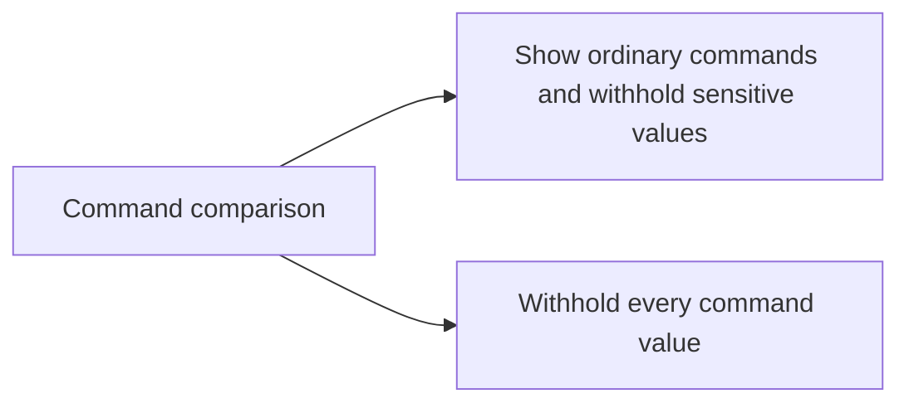
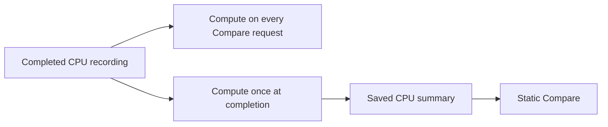
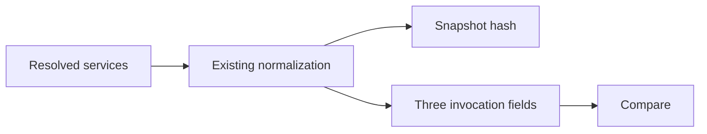
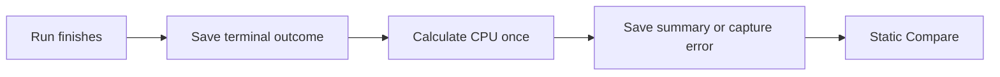
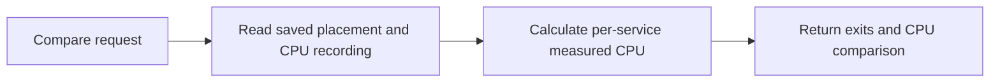

# PR 386 fixes: orchestration log

Created 11/15/26. Scope: findings 1, 4, 6, 7, 8 and 10 from
[the rc7 report](111426-rc7-ux-report.md), [PR 386](https://github.com/Cutuy/doramcap/pull/386).
Each finding received a separate implementation agent and fix PR, initially based on
the report branch. This orchestration task has performed no merges. External merges
and the current review state are recorded below.

## Assignments

Agents use GPT-6.1 Sol with xhigh reasoning. The launcher exposes no speed setting
and permits three active subagents. Assignments continue in the same agent after decisions.

| Finding | Implementation agent | Fix PR |
| --- | --- | --- |
| 1: service commands in Compare | `finding_1` | [396](https://github.com/Cutuy/doramcap/pull/396) |
| 4: system-app choice on New run | `finding_4` | [392](https://github.com/Cutuy/doramcap/pull/392) |
| 6: file-source association | `finding_6` | [402](https://github.com/Cutuy/doramcap/pull/402) |
| 7: service exits and CPU in Compare | `finding_7` | [404](https://github.com/Cutuy/doramcap/pull/404) |
| 8: rounded machine values | `finding_8` | [393](https://github.com/Cutuy/doramcap/pull/393) |
| 10: file-change warning noise | `finding_10` | [395](https://github.com/Cutuy/doramcap/pull/395) |

Report head: `fe886a0841ce2bcb27a5876b9aa35fb2c2f77ea8`.
Implementation baseline: `9e18b12a6f70a79919f4dfbc6e2811d6ce0a4674`.
The governing guides are `docs/impl-guide.md` and `docs/design-guide.md` at that baseline.

## Decisions

Important decisions are raised one at a time. Choices record explicit owner answers;
superseded proposals are marked.

### 1. Worktree capacity — keep seven slots

Context: four of seven pool slots were leased by existing tasks when work began.
Problem: six isolated fixes plus this log require seven additional leases if retained together.

- Options: grow to eleven slots, or keep seven and wait for releases.
- Recommendation: grow to eleven so each fix and the log can retain its own checkout.
- Choice: keep seven slots and use the slots the owner freed. The owner cleared slots 1 and 2; their availability was verified. This task performed no pool growth.

### 2. New run system-app choice — browser cache

Context: New run clears app IDs and launch profiles; Run again restores historical choices.
Problem: a new run silently returns to configured defaults.

- Options: carry the completed run, browser persistence, or configured defaults.
- Initial recommendation: use the completed run without adding a preference store.
- Choice: the owner requested browser cache. Remember app IDs and launch profiles in localStorage, scoped by browser origin, page/base path and project. Run again uses the selected historical run; legacy omission uses configured defaults.
- Reason: preserve the owner's browser preference across new runs while keeping historical reruns authoritative.

### 3. Rounded machine values — show exact units on collisions

Context: exact values differ, but formatting can show `0.4 hours` on both sides.
Problem: a visible Changed result has no visible difference.

- Recommendation and choice: show exact units on collisions, preserving the stored comparisons.
- Reason: the underlying difference stays inspectable without introducing measurement thresholds. Changing condition verdicts is outside this approved fix.

### 4. File-change journal output — retain informational summary

Context: ordinary file changes receive warning-prefixed detail and category summaries.
Problem: routine evidence appears as a warning.

- Recommendation: remove routine per-file output and warn only for incomplete collection or coverage notes.
- Choice: the owner requested one routine informational summary. Remove per-file journal lines, retain compact counts without a warning prefix, and keep warnings for collection or coverage problems. Records and counts remain available in the saved evidence.

### 5. File-change source labels — retain all records

Context: Project and Console apps can consume the same sources; run files include customer artifacts too.
Problem: the presentation mixes consumer association with source location.

- Options: preserve records with separate source labels, or suppress Console-related records.
- Recommendation and choice: persist consumer associations separately from location. Keep all records, counts, order, original positions and downloads. Existing records remain Unknown when authoritative metadata is absent.
- Reason: consumers explain source association; that association does not establish which app wrote a file.

### 6. Command visibility — show ordinary commands

Context: commands and entrypoints can contain credentials.
Problem: comparison must expose useful changes while honoring sensitive-value withholding.

- Recommendation and choice: show ordinary commands and entrypoints, withholding an entire value when the existing sensitive-name or URL rules match. Hidden values still compare.
- Comparison copy: approved in decision 8; historical commands lack authoritative automatic-port flags.

### 7. CPU comparison — intermediate preference, superseded

Context: Compare is a static view; per-service CPU is absent from saved run metrics.
Problem: reducing the recording on every comparison repeats work.

- Initial recommendation: incrementally read finalized recordings when Compare opens, with no new store.
- Owner response: Compare is static; check the understanding first, with a preference for computing and saving at completion.
- Status: superseded by decision 10. The term streaming described bounded-memory file reading, not live telemetry; the owner ultimately chose on-demand calculation from saved recordings.

### 8. Invocation comparison copy — approved

Context: preparation knows which Dora ports and paths it generated; saved history retains only the normalized model hash.
Problem: comparing captured arguments directly would count generated runtime differences as setup changes.

- Options: save the comparison copy, or compare raw captured arguments including generated differences.
- Recommendation and choice: save command, entrypoint and stop signal from the existing canonical model. User-configured arguments remain exact; executed commands are unchanged.
- Legacy behavior: show safely masked captured values with comparison unavailable when the comparison copy is absent.

### 9. Static CPU summary persistence — superseded before implementation

Context: the owner prefers fixed saved results for Compare.
Problem: per-service CPU must be derived once and retained independently of execution outcomes.

- Recommendation: add a typed summary to the existing saved Status; use the existing SQLite transaction and recovery path.
- Behavior: preserve terminal outcomes and finish time, make CPU errors independent, and let the next Prepare wait for calculation. Pending summaries interrupted by controller restart become unavailable.
- Historical runs: no automatic backfill; missing summaries show CPU unavailable.
- Dependency proposal: promote already-locked official `@mcap/core` 2.4.0 to the TypeScript server runtime. Primary API/release evidence was checked.
- Choice: not implemented. The owner asked about index-free MCAP compatibility, then explicitly preferred calculating during comparison; decision 10 supersedes this proposal.

### 10. CPU calculation during Compare — approved

Context: after considering completion-time persistence, the owner said, "Hold on, i'd prefer live computing it during comparison."
Problem: Compare needs per-service CPU evidence, and the owner questioned whether the reader supports Console files without indexes or summaries.

- Choice: calculate from the saved recording during comparison; no persisted CPU summary or new finalization work.
- Dependency condition satisfied: the coordinator read the downloaded rc7 `cpu.mcap` using official `@mcap/core` 2.4.0. The file has summary offset zero and no index records; all 430 messages decoded, with complete framing and no remaining bytes. The indexed reader reproduced "File is not indexed" on the same file.
- Preserve saved per-service exits, CPU seconds, average core percent, observed duration and coverage. Use inclusive parent CPU once; ambiguous attribution and missing evidence remain unavailable. Incremental file parsing bounds working memory; the Compare result is based on the saved recording.

## Initial investigation notes

All six findings have independent agents. The coordinator inspected the relevant
comparison, selection, file collection and logging paths, plus the report screenshot.
The coordinator reviewed the initial implementation revisions and their focused evidence,
then marked all six fix PRs ready. The independent pass below reviews and corrects them again.

- Finding 1: comparison omits command, entrypoint and stop signal. Automatic Dora ports require authoritative normalization.
- Finding 4: New run explicitly clears the app selection; saved run status already contains the selection and launch profiles.
- Finding 6: run artifacts share the Host folders category, and container changes lack persisted consumer associations. Preserve evidence while separating association from location.
- Finding 7: saved exits are available; stored recording metrics contain no service CPU measurements. Historical CPU needs a source and statistic contract.
- Finding 8: exact differences are rounded into identical labels. Displaying exact native units on collisions preserves the captured facts.
- Finding 10: rc7 already limits detail to ten records per category. Ordinary changes still receive `warning:` prefixes; the report's every-file volume and journald priority are unverified.

## Events

- 11/15/26: Read the report, both guides, and the orchestrator, worktree-pool and Scanner skills.
- 11/15/26: Started findings 1, 4 and 6 independently; finding 4 returned its design proposal and finding 7 started.
- 11/15/26: Requested pool growth. Acquired an existing free slot for this log and stacked it on PR 386.
- 11/15/26: Published this log as [draft PR 390](https://github.com/Cutuy/doramcap/pull/390).
- 11/15/26: Started findings 8 and 10 as earlier investigations completed. All six assignments now exist.
- 11/15/26: Another existing task acquired the remaining free pool slot. At that point the pool had seven slots; completed leases were released before later work acquired them.

- 11/15/26: Coordinator verified #392 source/API attribution and browser evidence, #393 source and desktop/mobile rendering, and #395 source plus persisted-record/stderr fixtures. Marked those PRs ready; their agents released leases.
- 11/15/26: Findings 6 and 7 reused the released slots. Finding 1 published #396 and incorporated review hardening for malformed comparison copies and exact configured text.

- 11/15/26: Finding 6 published #402; coordinator reviewed producer roles, legacy defaults, record preservation and source grouping. Finding 1 published its malformed-copy and exact-text follow-up.

- 11/15/26: Coordinator verified #396 final source, malformed-copy recovery and desktop/mobile browser evidence, then marked it ready. Its agent released slot 5. Finding 7 published #404 and continued validation, including rotated recordings and cancellation.

- 11/15/26: Coordinator verified #402 final producer/compatibility changes, saved-position download evidence and desktop/mobile component rendering. Coordinator verified #404 final reader, real-recording readback, authenticated App rendering and cancellation. Both PRs were marked ready and their agents released the remaining fix leases.

- 11/15/26: The implementation pass finished. A pool audit found an unrelated eighth slot; this task performed no resize.
- 11/15/26: External activity squash-merged #386 as `67910f09`, retargeted all seven PRs to main, and merged #395 as `bc5f69f7` and #393 as `c9627fb4`. This task did not perform those actions.
- 11/15/26: Fresh Scanner agents corrected #396, #402 and #404. Their reports identify the corrections and remaining qualification gaps. #392 is correcting historical rerun and cache recovery behavior. #393 and #395 continue independent review after their external merges.
- 11/15/26: The log review corrected stale PR/lease statements and clarified the approved browser, consumer-association and CPU contracts. The coordinator delegated exclusive use of its retained log lease to `scan_390` for these edits.

## Initial implementation revisions

| Finding | PR | Reviewed head |
| --- | --- | --- |
| 1 | 396 | `d968933dbab6de29a93861adb04e8a1eee6e6188` |
| 4 | 392 | `d1a1205a312159cbd0e20df8aa3614862dbcecf6` |
| 6 | 402 | `9626146dc481bff95d28df8259a5fe1bd23ccf94` |
| 7 | 404 | `cde3071931bccd3f7b9e9dfc26f2ed7f447287d9` |
| 8 | 393 | `4aea63586f74c63adbe1159300ed064f7c6c2a38` |
| 10 | 395 | `7102e71ab4871937c63ac4a3b4b81d8c6c76f5f2` |

## Independent Scanner pass

Requested 11/15/26 after the implementation pass. Each PR receives a new agent
context using GPT-6.1 Sol with xhigh reasoning. Reviewers inspect source and
contracts independently, fix confirmed issues on the existing PR, and raise new
important design decisions before implementation. Existing owner choices remain
in force. The launcher supports three active subagents and no speed selector.

Current snapshot, 11/15/26. Heads and merge states come from GitHub; review and lease
states come from the coordinator and reviewers. This log review does not repeat their
code validation.

| PR | New reviewer | Head | State |
| --- | --- | --- | --- |
| 396 | `scan_396` | `0373ec2df0ace9db49d3f451aac1f275143cda04` | Corrections published; lease released |
| 392 | `scan_392` | `9b040a582d7b62e81c2ceaa299fc134306b098fa` | Rerun correction published; cache recovery correction underway |
| 402 | `scan_402` | `322894abfa5add5481df93e8c87c6735361d2892` | Corrections published; lease released |
| 404 | `scan_404` | `6458776cded56eca4f7db3f752e426e8229cd606` | Correction published; lease released |
| 393 | `scan_393` | `4aea63586f74c63adbe1159300ed064f7c6c2a38` | Externally merged; static review complete, executable review queued |
| 395 | `scan_395` | `7102e71ab4871937c63ac4a3b4b81d8c6c76f5f2` | Externally merged; independent review underway |
| 390 | `scan_390` | This log | Preliminary correction pass |

Code reviewers acquire fresh leases and publish corrections to the existing PR heads
by fast-forward push. Lease release follows coordinator verification. The log reviewer
resumes this active task's retained lease. Scanner reports keep detailed guide coverage
and validation evidence outside this log.

## Integration notes

The PRs now target main after the external retarget. A read-only overlap check of the
initial implementation heads found textual conflicts between #396 and #404 in
`compare.ts`, the `service.ts` import and appended `tests/compare.test.ts` tests.
Any integration must retain both invocation and CPU inputs, invocation setup rows,
CPU outcome rows and both test sets. The changed heads need a fresh integration check.
This task has performed no integration.

Each reviewer reports its own coverage and remaining gaps. In particular, component
rendering differs from full App navigation, GitHub ARM64 checks differ from a native
worker submission, and separate PR checks do not qualify a combined revision or a
packaged workload. Final review and qualification are still underway.

Implementation-pass leases were released; the Scanner pass uses fresh leases.
This task did not resize the pool or change another task's checkout or lease. The
coordinator retains slot 7 for this log, which the orchestrator skill requires to
stay draft. Temporary exclusive delegation to the log reviewer preserves that lease.

## Left for the owner

- Resolve any new design decisions surfaced by the independent Scanner pass.
- Review the corrected PRs after the Scanner pass.
- Choose integration for the remaining fixes and any post-merge corrections; this task does not merge them.
