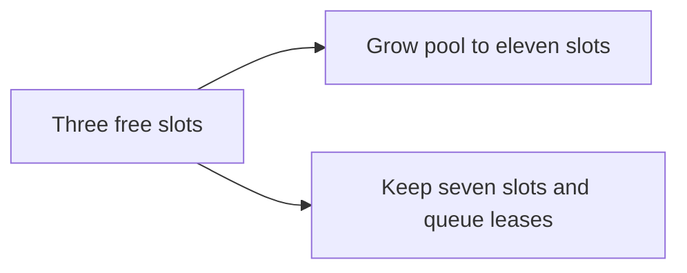

# PR 386 fixes: orchestration log

Created 11/15/26. Scope: findings 1, 4, 6, 7, 8 and 10 from
[the rc7 report](111426-rc7-ux-report.md), [PR 386](https://github.com/Cutuy/doramcap/pull/386).
Each finding has a separate agent and fix PR based on the report branch. Nothing is merged.

## Assignments

Agents use GPT-6.1 Sol with xhigh reasoning. The launcher exposes no speed setting
and permits three active subagents. Assignments continue in the same agent after decisions.

| Finding | Agent | Fix PR | State |
| --- | --- | --- | --- |
| 1: service commands in Compare | `finding_1` | Pending | Confirmed; command visibility and normalization choices queued |
| 4: system-app choice on New run | `finding_4` | Pending | Design proposed; owner decision queued |
| 6: ownership of file changes | `finding_6` | Pending | Confirmed; evidence-preserving grouping proposed |
| 7: service exits and CPU in Compare | `finding_7` | Pending | Confirmed; historical CPU source under design |
| 8: rounded machine values | `finding_8` | Pending | Confirmed; exact values on rounding collisions proposed |
| 10: file-change warning noise | `finding_10` | Pending | Confirmed with narrower scope; logging choice queued |

Report head: `fe886a0841ce2bcb27a5876b9aa35fb2c2f77ea8`.
Implementation baseline: `9e18b12a6f70a79919f4dfbc6e2811d6ce0a4674`.
The governing guides are `docs/impl-guide.md` and `docs/design-guide.md` at that baseline.

## Decisions

No product decisions have been made for the owner. Important decisions are raised one at a time.

### 1. Worktree capacity — awaiting owner

Context: four of seven pool slots were leased by existing tasks when work began.
Problem: six isolated fixes plus this log require seven additional leases if retained together.

- Options: grow to eleven slots, or keep seven and wait for releases.
- Recommendation: grow to eleven so each fix and the log can retain its own checkout.
- Choice: pending. The worktree-pool skill requires approval before pool initialization or growth.

## Investigation notes

All six findings have independent agents. The coordinator inspected the relevant
comparison, selection, file collection and logging paths, plus the report screenshot.
Runtime reproduction and fix validation remain pending.

- Finding 1: comparison omits command, entrypoint and stop signal. Automatic Dora ports require authoritative normalization.
- Finding 4: New run explicitly clears the app selection; saved run status already contains the selection and launch profiles.
- Finding 6: run artifacts share the Host folders category, and container changes lack persisted app ownership. Preserve evidence while clarifying ownership and origin.
- Finding 7: saved exits are available; stored recording metrics contain no service CPU measurements. Historical CPU needs a source and statistic contract.
- Finding 8: exact differences are rounded into identical labels. Displaying exact native units on collisions preserves the captured facts.
- Finding 10: rc7 already limits detail to ten records per category. Ordinary changes still receive `warning:` prefixes; the report's every-file volume and journald priority are unverified.

## Events

- 11/15/26: Read the report, both guides, and the orchestrator, worktree-pool and Scanner skills.
- 11/15/26: Started findings 1, 4 and 6 independently; finding 4 returned its design proposal and finding 7 started.
- 11/15/26: Requested pool growth. Acquired an existing free slot for this log and stacked it on PR 386.
- 11/15/26: Published this log as [draft PR 390](https://github.com/Cutuy/doramcap/pull/390).
- 11/15/26: Started findings 8 and 10 as earlier investigations completed. All six assignments now exist.
- 11/15/26: Another existing task acquired the remaining free pool slot. The pool is full; eleven total slots still permit three implementation agents and this log, with completed leases released before later work.

## Left for the owner

- Decide pool capacity, followed by the queued product decisions.
- Review the individual fix PRs after implementation and validation.
- Choose integration after the fixes are ready; this task does not merge them.
