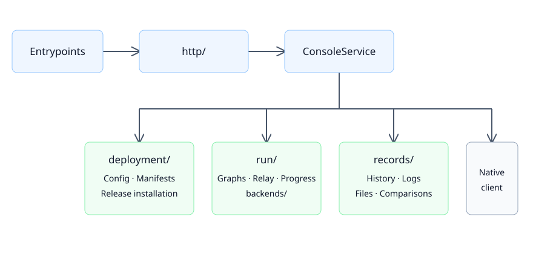

# Console server source layout

Created November 15, 2026.

Entrypoints and ConsoleService coordinate the application at the source root.
The native client, shared file writer and generated bindings keep their existing
locations. Responsibility groups hold the implementation:

| Directory | Responsibility |
| --- | --- |
| `deployment/` | Configuration, manifests and release installation |
| `run/` | App selection, graphs, run requests, live relay and progress |
| `run/backends/` | Compose inputs/images and systemd inputs |
| `records/` | Store, history, comparisons, logs, file changes and source facts |
| `http/` | HTTP routes, artifact streaming and browser access |

Imports point directly to the owning module. Built JavaScript preserves this tree;
release tooling imports the corresponding compiled modules. CLI/server entrypoints
and the native addon path retain their locations.

[Implementation](111526-server-source-layout-impl.md).
