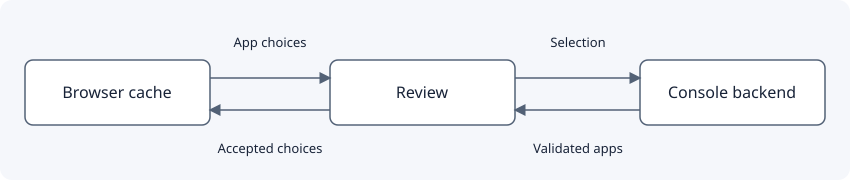

# Browser system-app preferences

Created 11/15/26. [Implementation](111526-system-app-preferences-impl.md).

New run prefills the system apps and launch profiles accepted by the most recent
Review in this browser. Run again explicitly loads its historical run's choices;
an accepted Review then becomes the browser preference.

The browser keeps one localStorage record per origin, page path, embedded Console
path and project directory. The record survives navigation, refresh and browser
restart until site data is cleared. A versioned key isolates future incompatible
formats. Saved runs remain authoritative for historical facts.

Review saves accepted choices in one write. Attempted or rejected changes leave
the preference intact. Storage failures retain the accepted choice for the tab's
lifetime. Malformed records use configured defaults. A cached app or launch profile
rejected with the `system_apps` check is forgotten; Continue lets the user choose
again. Other project errors preserve the cache. Historical runs without saved app
choices use configured defaults.

The normal preparation validates cached choices against current configuration
after a server restart or upgrade. No server preference store is added.
