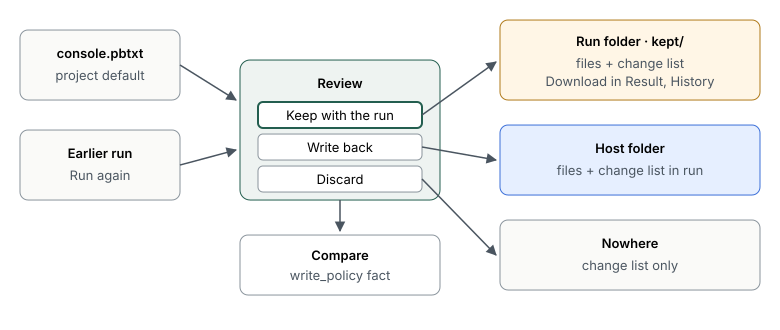

# Choose the write policy at Review

Created November 15, 2026. Status: proposed.
[Implementation plan](111526-write-policy-choice-impl.md) ·
[Overlays for writable mounts](111026-file-change-report.md#write-policy) ·
[Keep files with the run](111326-keep-files-with-run.md)

New projects default to **keep with the run**, and Review lets the user pick the policy
for each run. Terms follow the overlay design's [term list](111026-file-change-report.md#terms).

## Problem

The rc7 customer drive ([Cutuy/doramcap#386](https://github.com/Cutuy/doramcap/pull/386)) recorded ROS bags into an
overlaid `./bags` folder. Console wrote them back to the host folder, so the run kept
only their change list, with no download.

| Today | Effect |
| --- | --- |
| Write back is the default | A run's files live only in the host folder; History cannot return them, and the next run builds on them |
| `write_policy` is set only in the generated, root-owned `console.pbtxt` | Changing it needs `sudo`, a hand edit and a restart |
| [Configuration](configuration.md) and release notes never mention it | Customers cannot discover the other two policies |
| Review shows `Write policy: Write back` as plain text | No choice, and no word on what happens to the files |

## Behavior

- **Default:** the release template sets `write_policy: WRITE_POLICY_KEEP`, so new
  projects keep their files with the run. Each run starts from the unchanged host folder.
- **Review:** a three-option choice beside Writable folders, preselected from the project
  default, or from the earlier run on **Run again**. Each option states its result:

  | Option | Shown text |
  | --- | --- |
  | Keep with the run | Files stay with this run for download. The host folder is unchanged. |
  | Write back | Files are copied into the host folder after the run. |
  | Discard | Files are listed, then removed. The host folder is unchanged. |

- Changing the choice prepares the run again, as a system app change does. The reviewed
  policy is the one that runs.
- **Result and History** show the policy that ran, as today. Kept files are downloadable.
- **Compare** shows `write_policy` as a setup fact.
- **Hidden when unused:** with no overlaid folder, Review shows no choice.
- `passthrough_folders` remains the way to give an app live access to a host folder.

## Existing projects

A project's `console.pbtxt` is written once and pinned. Configs without `write_policy`
keep meaning write back, so upgrading never changes where existing projects' files go.
Their Review shows the same choice, defaulting to write back.

## Tradeoffs

| Choice | Gain | Cost |
| --- | --- | --- |
| Keep as default | Each run is self-contained, downloadable and repeatable | State an app carries between runs resets; run folders grow with no pruning yet |
| One policy per run | One control, one fact to compare | Mixed needs per folder wait for per-folder choice |
| Choice at Review | Visible before anything runs; recorded with the run | Changing it prepares again |

Run-folder pruning stays separate work. Review already shows free disk space.

## Owners

| Part | Owner |
| --- | --- |
| Policy enum and its effect | `host-filesystem` |
| Release default, per-run choice, Review, Compare | Console |
