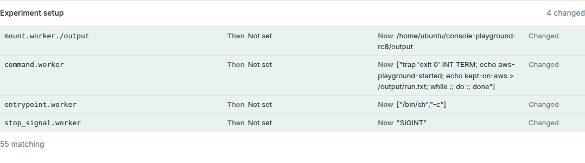

# Console rc7 → rc8

Created 11/16/26. Follow-up to the [rc7 field report](111426-rc7-ux-report.md).
[rc8](https://github.com/Cutuy/doramcap/releases/tag/console-v0.0.1-rc8)
(`ecfcaec9`) was installed publicly and exercised through Chromium on 11/15/26,
on the same ARM64 AWS VM: 2 vCPU, 904 MiB RAM. rc7 used ROS 2 chatter;
rc8 used the bundled playground. Both enabled Data recorder. The ROS 2 CPU
comparison remains unmeasured.

Numbers match the original report's findings.

| Finding | rc7 | rc8 |
| --- | --- | --- |
| 1. Setup comparison | Commands and signals absent; shutdown fix showed “0 changed”. | **Fixed.** Review and History Compare show changed values for `command`, `entrypoint` and `stop_signal`; the screenshot below shows all three. |
| 2. CPU overhead | 96–98 core %, with `talker` at 0.4%. | **Not verified.** The original ROS 2 workload was not rerun. The playground added 5.7 core-percentage points over plain Compose (111.0% versus 105.3%, worker ~100% in both); this does not establish whether the original issue is fixed. |
| 3. Readiness probes | Three system apps ran `docker exec` every 200 ms. | **Fixed.** Docker inspection found no healthchecks on CPU monitor, Data recorder or live bridge, removing their repeated readiness probes during runs. |
| 4. Saved choices | New run dropped Data recorder. | **Fixed.** Data recorder stayed selected after New run and refresh. History's Run again restored the saved app choices and file policy. |
| 5. Generated names | Compose prefixes visible. | **Not fixed.** Writable folders and logs still display generated names such as `dc-79c5023c4a740b74-experiment/worker`. |
| 6. File changes | Customer and Console files mixed. | **Not fixed.** Console run files, including `dataflow.yml` and launch logs, remain in the Host folders category alongside customer output. User/System and Run files labels identify them but do not separate the lists. |
| 7. Run comparison | No per-service exits or CPU. | **Not fixed.** Comparing killed and clean runs still has no per-service exit-status or CPU rows; duration and recording size do not explain the service failure. |
| 8. Machine condition | Equal-looking rounded values marked Changed. | **Fixed.** Small disk-space changes show exact byte values, and uptime shows seconds, so values marked Changed have visible differences. |
| 9. MCAP indexing | Streaming reads worked; indexed reader rejected files. | **Not fixed.** Both rc8 downloads lack an index. The independent indexed reader rejects each with “File is not indexed”; successful streaming reads do not resolve this. |
| 10. Journal noise | Warning per changed file. | **Fixed.** The service journal uses aggregate filesystem summaries and coverage warnings; the observed runs no longer produced a warning for every changed file. |
| 11. Log list | System and customer logs mixed. | **Not fixed.** The same log list contains the customer worker alongside Dora, CPU monitor, Data recorder and live bridge. |
| 12. Release notes | One line at publication. | **Fixed.** rc8's published notes describe the changes since rc7, installation steps and known issues. |

CPU figures are ten-second samples; 100% is one core. EC2 steal was 0.7% with
Console and 0.9% for the control. [rc8 live run](111526-playground-run.png).

## Other rc8 issues

| Issue | rc8 | Merged fix after rc8 |
| --- | --- | --- |
| Shutdown-grace comparison | **Not fixed in rc8.** Changing only `stop_grace_period` from 1 s to 5 s showed no shutdown-grace difference and flagged an unrelated hidden live-bridge mount. | #433 saves and compares shutdown grace in Review and History Compare. |
| Restrictive installer permissions | **Not fixed in rc8.** With `umask 077`, release directories were `0700` and the launcher exited 126; manual permission repair restored access. | #432 gives installed release files their required permissions independently of the caller's umask. |

## Additional rc8 coverage

| Area | Observed result |
| --- | --- |
| File policies | Keep retained a download; Write back copied to host; Discard left evidence without a download or host file. |
| Stop and restart | Normal Stop → Result in 4.31 s. Service stop wrote files back and cleaned up; restart retained History, recordings and the killed-worker warning. Old session returned HTTP 401. |
| Failure and cancellation | Exit 7 named the worker; startup Stop produced Cancelled. Reports survived and cleanup was Verified; recording was Unavailable / Unknown, respectively. |
| Input and evidence | Stale Review blocked Start; corrected YAML recovered. Preview showed 16/18 host changes; full export contained all 48 changes across categories. |

rc8 comparison now shows the command, entrypoint, signal and mount changes:

