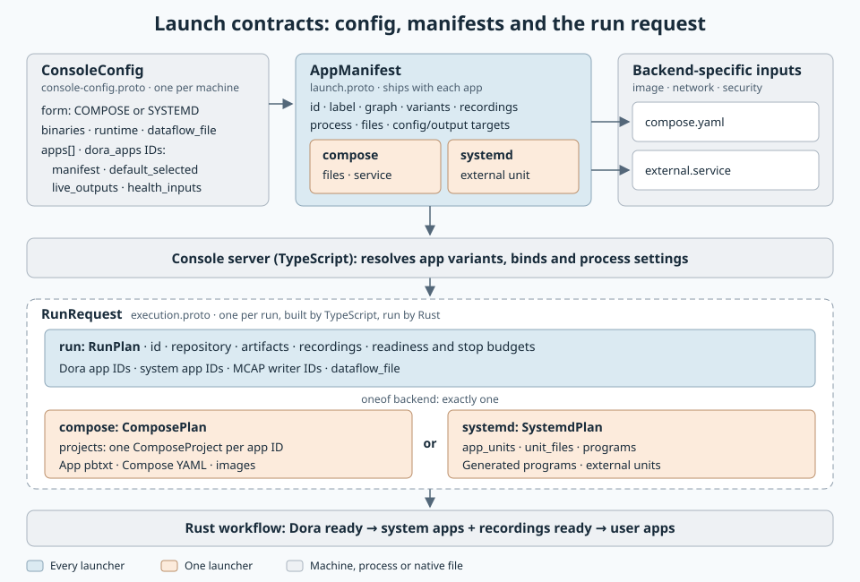

# Console configuration

Console loads protobuf text from the command-line configuration file. Compose uses
`download_missing_images: true` to download selected missing images before Review;
otherwise those images must exist locally. Systemd uses the configured host binaries. Configured Dora apps join every run.

Optional apps ship common settings in app-named pbtxt files. The
[release template](../release/console.pbtxt) lists the shipped apps.

## App manifests

`<app-name>.pbtxt` uses [`AppManifest`](../../libs/workload-lifecycle/proto/launch.proto)
for the command, working directory, resource limits, shutdown settings, shared files,
graph, config/output targets and variants. Variant files use the app's own protobuf
schema, such as `cpu-monitor-record.pbtxt` and `cpu-monitor-live.pbtxt`.
Paths resolve beside the manifest. Executable basenames resolve through the image's
PATH or the systemd deployment's `binaries` directory.

Compose YAML supplies image, container identity, network, IPC, security and healthcheck
settings. Existing Compose preparation applies common settings from pbtxt. Console's
systemd builder creates `Program` inputs from those same settings; the runner creates
the units. An external unit uses `systemd.unit` separately and supplies its own process
settings. Combining it with `process` is rejected.

Project `.service` files keep their native filesystem and environment rules. Dora
participants must make the injected host Zenoh path readable to their service user
and leave the runtime daemon-port and overlay variables unoverridden by
`EnvironmentFile` or `UnsetEnvironment`. An explicit node ID is preserved.



The Console entry then names the manifest and keeps only Console settings:

```protobuf
form: COMPOSE
apps {
  manifest: "/absolute/system-apps/cpu-monitor/cpu-monitor.pbtxt"
  default_selected: true
  live_outputs { source: "cpu-monitor/snapshots" kind: CPU_ACCOUNTING }
}
```

`form` selects how every app launches: `COMPOSE`, or `SYSTEMD` with an absolute `binaries`
directory holding `dora` and the executables named by each app's `process.argv`, built
with the release features. `SYSTEMD` runs need root and the system service manager;
leave `docker_socket` unset. Inline definitions, as below, remain valid.

```protobuf
apps {
  id: "cpu-monitor"
  label: "CPU monitoring"
  input { directory: "/absolute/release/system-apps/cpu-monitor" files: "compose.yaml" manifest: "cpu-monitor.pbtxt" }
  graph: "/absolute/release/system-apps/cpu-monitor/flow.yml"
  output_mounts { service: "cpu-monitor" target: "/results" }
  recordings { id: "cpu" path: "cpu.mcap" stream: "cpu.pb" cpu: true }
  live_outputs { source: "cpu-monitor/snapshots" kind: CPU_ACCOUNTING }
  live_outputs { source: "cpu-monitor/dictionary" kind: CPU_ACCOUNTING }
}
apps {
  id: "fault-watchdog"
  label: "Fault Watchdog"
  input { directory: "/absolute/doramcap/apps/fault-watchdog/deploy/standalone" files: "compose.yaml" }
  graph: "/absolute/doramcap/apps/fault-watchdog/deploy/standalone/flow.yml"
  output_mounts { service: "fault-watchdog" target: "/results" }
  live_outputs { source: "fault-watchdog/faults" kind: FAULT_PUBLICATION }
  config_mount { service: "fault-watchdog" target: "/etc/fault-watchdog/watchdog.pbtxt" }
  launch_profiles { id: "live" label: "Live only" config: "/absolute/doramcap/apps/fault-watchdog/deploy/standalone/config/watchdog.pbtxt" }
  launch_profiles {
    id: "mcap"
    label: "Live and MCAP"
    config: "/absolute/doramcap/apps/fault-watchdog/deploy/standalone/config/watchdog-mcap.pbtxt"
    recordings { id: "faults" path: "faults.mcap" }
  }
  launch_profiles { id: "otel" label: "Live and OTLP" config: "/absolute/doramcap/apps/fault-watchdog/deploy/standalone/config/watchdog-otel.pbtxt" }
}
apps {
  id: "live-bridge"
  label: "Live telemetry"
  default_selected: true
  input { directory: "/absolute/doramcap/console/release/system-apps/live-bridge" files: "compose.yaml" manifest: "live-bridge.pbtxt" }
  config_mount { service: "live-bridge" target: "/config/bridge.pbtxt" }
  live_relay {}
}
```

## Launch profiles

`launch_profiles` lets the user choose how an app launches during Review. Console
mounts the chosen `config` read-only at `config_mount`; the first profile is the
default. A profile's `recordings` and `live_outputs` add to the app's own. Only the
chosen file is mounted and frozen for the run, so each `config` must be self-contained,
without `include`.

```protobuf
config_mount { service: "cpu-monitor" target: "/config/monitor.pbtxt" }
launch_profiles {
  id: "record"
  label: "Live panels and recording"
  config: "/absolute/monitor.pbtxt"
  recordings { id: "cpu" path: "cpu.mcap" stream: "cpu.pb" cpu: true }
}
launch_profiles { id: "live" label: "Live panels only" config: "/absolute/live.pbtxt" }
```

A profile's `graph` is a Dora dataflow file that replaces the app's `graph`. Console
merges it with `dataflow_file` and the other selected apps' graphs. Mount schema files
explicitly. Example: [user-messages](../examples/user-messages/console.pbtxt).

Apps publish [ReporterPublication](../../libs/fault/schema/proto/reporter.proto)
messages on `health` outputs. `health_inputs: true` subscribes the app's graph node
(same ID) to other selected nodes' health outputs using bounded `drop_oldest` queues.
Watchdog supports zero inputs; its profiles reserve one of 16 source slots for local
diagnostics and allow 32 conditions per source.

## Live bridge

`live_relay` marks the one system app that relays the selected apps' `live_outputs`.
Console generates its Dora node and its `BridgeConfig`, mounted read-only at
`config_mount`; it runs only when at least one output is declared.
Kinds select the browser decoder and panel: `CPU_ACCOUNTING` or `FAULT_PUBLICATION`.
The bridge listens on loopback `live_relay.port`; omit it to select a free port at startup, so several Consoles can run on one host. Build its image from [console/bridge](../bridge/README.md).

Service users must match the configured Dora participant identity. Output mounts
bind the current run's artifact directory; recording paths are relative to it.
Services of recording apps get `seccomp=unconfined` for io_uring and a memlock limit automatically.
The runtime requires stream growth before workload launch.

`dataflow_file` supplies the workload graph. Selected app graphs add nodes; duplicate
node IDs or conflicting graph settings reject preparation. Source graphs are read
again on Start. Console never injects demo producers. Reusable deployments must
supply healthchecks for subscriber/sink readiness before their producers start.

The monitor publishes BPF root CPU records, per-cgroup counters and capture health.
The browser derives total core utilization from root runtime deltas in relayed frames. The workflow finalizes recordings and exposes them by ID. Absent or invalid
display metadata never bypasses the workflow's repository controller and reset.

## Browser access

Each launch generates an access link and an HTTP-only browser session. The link
exchanges its fragment token before the UI loads and removes the fragment from
browser history. Sessions expire when the process exits. Keep access links private.
`access_secret_file` optionally supplies a stable token; omit it for release launches.

The launcher binds `127.0.0.1`. `listen_address` selects the first candidate port;
`--port` requires an exact port. `--browser-port` selects the browser-facing port
and origin for SSH forwarding. Startup prints the effective URL and forwarding
command when `--ssh user@host` is supplied.

### Dora apps

`dora_apps` selects the coordinator and daemon app IDs for the first startup phase.
Their common commands, memory limits, files and output targets live in
[`dora-coordinator.pbtxt`](../release/system-apps/dora-coordinator/dora-coordinator.pbtxt)
and [`dora-daemon.pbtxt`](../release/system-apps/dora-daemon/dora-daemon.pbtxt).
Both backends select per-run ports when the command's port arguments are `0`.
Explicit coordinator ports must agree in both commands; the daemon's listen port
must differ. The workflow waits for daemon readiness, then registers the merged graph.

Project Explorer registrations pass these same app manifests to existing Compose
preparation. Its identity overlays contain Docker user IDs.
