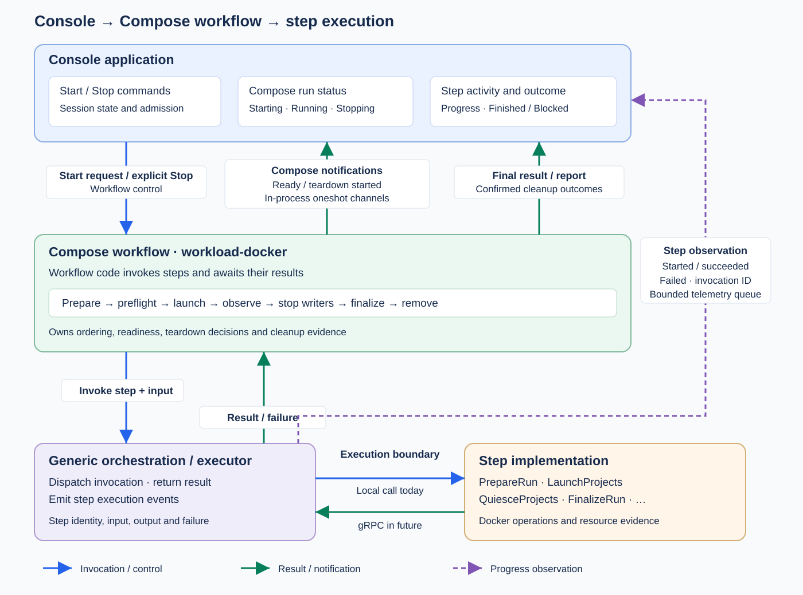

# Console backend

TypeScript owns configuration, app selection, reviews, request coordination,
progress views and persistence. A native bridge runs the existing Compose workflow
on its owner thread and exposes bounded events and safe OS handles.



```sh
npm --prefix console/server ci
npm --prefix console/server run build:native
npm --prefix console/server run build
sudo node console/server/dist/main.js /absolute/console.pbtxt /absolute/frontend/dist
```

Build unprivileged; run with sudo on the Docker host for mount-namespace inspection
and OverlayFS isolation (`CAP_SYS_ADMIN`). See [Console setup](../README.md).

The [execution contract](../proto/execution.proto) carries explicit Compose inputs,
configuration snapshots and execution facts. The workflow owns repository admission,
reset, preflight and cleanup. Console builds the browser-facing status in TypeScript.

[HTTP contract](../contract/transport.ts) · [Configuration](../docs/configuration.md) · [Recovery](../docs/recovery.md) ·
[Process boundary](../docs/102926-console-boundary.svg) ·
[Command flow](../docs/102926-console-interop.svg)

Run `npm --prefix console/server test` for server, native transport and OS-helper
checks. The opt-in `console/server/tests/real-compose.ts` exercises two real
start/stop cycles; build unprivileged and use the repository capability-test procedure.

The [native client](src/native.ts) accepts and returns generated protobuf messages.
It keeps N-API byte serialization private; application code uses the
[typed interface](native/index.d.ts).
