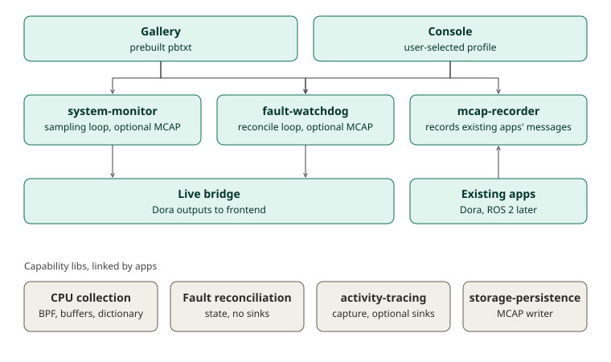

# Capability libs and standalone apps

Created: 2026-11-01.

- **Libs:** one capability each, plus basic logging or telemetry integration.
- **Apps:** standalone executables, each in its own container, launched with a pbtxt.
- **Recording:** an app that emits data writes its own MCAP when its pbtxt asks for it.
- **Live data:** apps can publish to Dora; the live bridge relays those outputs to the frontend.
- **Gallery and Console:** launch the same apps. Gallery uses prebuilt pbtxt; Console offers profiles.
- **`mcap-recorder`:** records existing apps' messages from Dora, and ROS 2 later.

## Milestone 1: Generic recorder (PR 34)

**Work items**
- [x] Remove CPU validation and CPU protocol dependencies from `mcap-recorder`.
- [x] Fold `telemetry-mcap` into `mcap-recorder`.
- [x] Remove the recorder's gallery deployment and bundled monitor.
- [x] Record gallery CPU data inside `system-monitor`.

**Validation**
- [x] Recorder, System Monitor, workload lifecycle and Project Explorer tests pass; Docker test targets build.
- [x] Strict Clippy, formatting and dependency boundaries pass.
- [x] Real Dora recording equality passes.
- [x] Docker gallery and shared-Dora tests pass.

Evidence: `cargo test --release --locked` for the listed packages passes. With `CLANG=clang-18` on x86_64: Dora equality 24/24 snapshots, `validate_dora.py` 2/2 sessions, CPU Viewer gallery deployment, `compose-e2e.py` 10/10 cases and `native_recorded_workflow` pass.

## Milestone 2: CPU app configuration

**Work items**
- [x] Add `system-monitor --config FILE.pbtxt`, with optional `recording` and `dora` sections.
- [x] Replace CPU flags and `recording.proto` with that configuration; keep `--check` probes.
- [x] Move cgroup dictionary state into `monitor-core`; keep the sampling loop in the app.

**Validation**
- [x] Config tests cover Dora-only, MCAP-only and combined launches.
- [x] Native recording and Dora equality checks pass.

Evidence: `cargo test --release --locked` passes for System Monitor, `monitor-core`, `telemetry-protocol`, `workload-supervisor`, `cpu-viewer` and `mcap-recorder`. With `CLANG=clang-18` on x86_64: `validate_native.py`, including Supervisor scenarios, and the embedded rotation test pass. Strict Clippy, formatting, boundaries and `docker compose config` pass.

## Milestone 3: Lib boundaries

**Work items**
- [x] Make the `activity-tracing` MCAP sink an optional feature; apps select sinks.
- [x] Move the watchdog engine into `fault-reconciliation`; keep sinks in the app.
- [x] Remove `fault-demo`'s dependency on the `fault-watchdog` app.
- [x] Add boundary rules that keep MCAP out of capability libs, except the tracing feature.

**Validation**
- [x] Feature combinations for `activity-tracing` build and pass.
- [x] Fault lib, watchdog and demo tests pass.
- [x] Boundary checks reject a planted violation.

Evidence: `cargo test --release --locked` passes for `activity-tracing` with no features, `mcap` and all features; for the fault libs, `fault-demo` and `fault-watchdog` with and without `mcap,otel`; and for the demos using tracing. All five gallery deployments pass in Docker on rebuilt fault images. Planted `mcap` and `fault-watchdog` dependencies fail the boundary check. `apps/fault-demo/tests/validate_dora.py` still uses the control wiring from before #45, so it does not run.

## Milestone 4: Watchdog variants

**Work items**
- [x] Use one watchdog Compose file and registration.
- [x] Express the MCAP and OTLP variants as pbtxt files.

**Validation**
- [x] Gallery deployment tests cover each pbtxt variant.

Evidence: `gallery_dora_deployments` passes all five deployments in Docker on x86_64, with the default, MCAP and OTLP watchdog configurations. The MCAP case produces `faults.mcap`, the others do not, and the OTLP collector receives logs. Standalone watchdog config tests pass. The watchdog now keeps `seccomp=unconfined` in every configuration until the scoped [io_uring profile](../console/docs/110126-io-uring-seccomp.md) lands.

## Milestone 5: Console profiles

**Work items**
- [x] Add `launch_profiles` to `SystemAppDefinition`: label, pbtxt, recordings and live outputs.
- [x] Add per-app profile selection to prepare and run requests.
- [x] Add a profile picker to the System apps panel.
- [x] Mount the selected pbtxt read-only into the app container.

**Validation**
- [x] Server tests cover default, valid and rejected profile selections.
- [x] Frontend tests cover the picker and review state.
- [x] A Console run records and streams data according to the selected profile.

Evidence: Console server (68 tests, 1 skipped) and frontend (50) suites pass. A real Compose run through Chromium on x86_64 used the release system apps: the record profile wrote an 8.5 MB `cpu.mcap` and offered its download; the live profile wrote no recording and showed live CPU panels with 0 dropped batches; History's Run again restored the live profile. ARM64 was skipped by request.

Evidence: full local CI passes on x86_64 with every open PR combined: boundaries, formatting, default and all-feature Clippy and workspace tests (387 passed with all features), storage without default features, example and binary builds, snapshot synchronization and Console suites. `compose-e2e.py` passes all cases, including selected Compose profiles, and `validate_dora.py --sinks` passes on those fresh builds.
