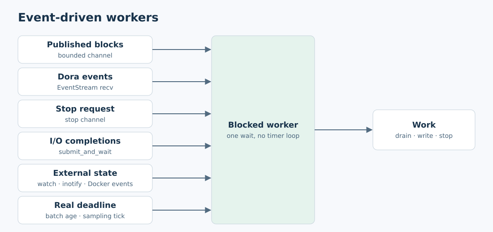
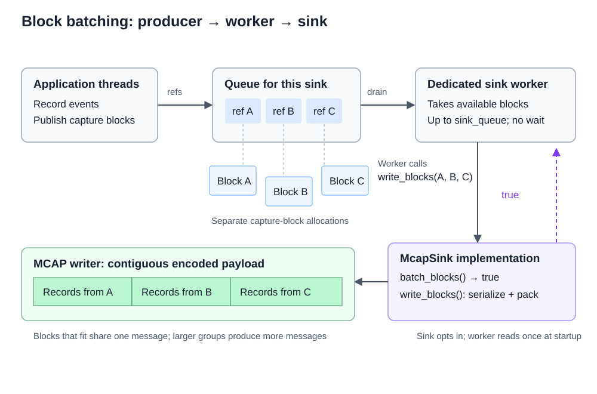

# Event-driven waits

Replace Rust sleep, timed-park and yield loops used to poll for state changes outside tests with explicit event-driven signaling. Timers may implement sampling schedules, pacing and real deadlines.

## Plan

- One implementation PR per milestone. Milestones 2–4 are independent of milestone 1.
- Scope: Rust code. Preserve sampling schedules, simulated work and stability deadlines; record each retained timer's purpose in its milestone.
- Present third-party crates for evaluation before adding any.
- Bring any wait without an event source to the user before keeping a timer.
- ARM64 validation is waived by the user for this implementation. Keep local and cloud results separate.

## Milestone 1: Activity tracing

**Work items**

- [x] Follow up on merged #122 and #123: replace sink worker `park_timeout` in `libs/activity-tracing/src/pipeline.rs` with bounded channel signaling and `select!` for work, shutdown and active deadlines.
- [x] Remove the 10 ms merge window. Merge already queued blocks and use the existing 100 ms writer flush deadline only while data is buffered.
- [x] Reuse `McapWriter::flush_written()` at the flush deadline; add no public wait API.

**Validation**

Evidence: release locked tests passed with default features (24) and all features (30), including zero-allocation capture, startup failure, sink error/panic, idle wake and deadline regressions. Strict Clippy passed for both configurations; formatting, library boundaries and whitespace checks passed. `strace -ff -e futex,clock_nanosleep` showed two indefinite worker waits spanning the idle intervals, with work and shutdown wakes. Paced throughput (100,000 events, 1,000 us/64) delivered 1,564 batches with no drops; three unpaced runs delivered 930–1,329 and counted 235–634 sink drops. These are post-change measurements, not a before/after comparison.

Named-constant follow-up: timing call sites in the output tests use named durations; the writer uses `MAX_BATCH_AGE` for its flush deadline. Release locked output tests passed with default features (9) and all features (12); MCAP roundtrip tests passed (6). Capability-required executables ran with sudo after unprivileged builds. Formatting and whitespace checks passed.

Approved design: bounded block channels and a shared shutdown channel; no 10 ms merge window. Buffered data uses the existing 100 ms flush deadline and `flush_written()`.

- [x] Idle workers make no periodic wake-ups, verified by kernel wait tracing with `strace`.
- [x] A new block and a stop request each wake an idle worker. Shutdown drains accepted blocks.
- [x] Sink build failure, write failure and panic release blocks and allow shutdown to finish.
- [x] Record zero-allocation capture and `throughput` results in this milestone's implementation PR.

- [x] Cloud CI finishes successfully: Rust CI [41765714665](https://github.com/Cutuy/doramcap/actions/runs/41765714665) and Node CI [41765714525](https://github.com/Cutuy/doramcap/actions/runs/41765714525) passed on PR #128's final head `aab868c`. ARM64 validation is waived by the user. Dora/CUDA checks belong to later milestones.

## Milestone 2: System monitor

**Work items**

- [x] Add a blocking receive to the `monitor-core` handoff, and use it at `apps/system-monitor/src/main.rs:431`.
- [x] Forward Dora terminal events from a cancelable receiver thread into the control channel, replacing `stop_requested` polling.
- [x] Keep the sampling deadline at `main.rs:262`, waiting on a stop channel so stopping is immediate.
- [x] Signal collector completion and errors to the publishing loop; drain queued snapshots before exit and join the Dora receiver on shutdown.

Approved design: retain synchronous collection/publication with `crossbeam-channel` snapshot and stop/error waits. The Dora receiver uses `futures` cancellation and is joined on finish/drop. Both dependencies reuse locked versions already in the repository. Recording uses its existing buffered-data flush deadline.

**Validation**

- Release locked default tests pass (17); Dora-feature tests plus the adapter pass (20). Strict Clippy passes for default and Dora-feature configurations.
- Dora in-process tests verify stop notification and cancellation before a scheduled 30-second event. The sampling test verifies stop before a 30-second tick.
- Zero-allocation handoff, overload recovery, selected receive and producer-disconnect drain tests pass. `strace` shows an indefinite selected wait until the control signal.
- All-feature compilation and strict Clippy pass with `CLANG=/usr/bin/clang-18`. The privileged native recording/rotation test passes: 24 samples, zero drops, valid dictionary checkpoints. ARM64 is waived.

- [x] Ctrl-C and Dora stop wake waits without waiting for the next sampling tick.
- [x] Collector completion, failure and producer disconnect wake the publisher; queued snapshots drain before exit.
- [x] The idle publishing loop makes no periodic wake-ups.
- [x] System Monitor tests and its recording checks pass.
- [x] Full-workspace cloud CI finishes successfully: Rust CI [41766188922](https://github.com/Cutuy/doramcap/actions/runs/41766188922) and Node CI [41766188935](https://github.com/Cutuy/doramcap/actions/runs/41766188935) passed on PR #129's final head `819c50c`.

## Milestone 3: Demo apps

Approved CUDA design: use a completion stream and CPU stream synchronization. Keep returns asynchronous; add no CUDA host callbacks or helper threads. GPU waits pause producer event handling until completion.

Approved message-wait design: select Dora `recv_async()` against `futures-timer::Delay`, using the next real deadline. This is separate from CUDA completion and uses the version already locked through Dora.

Approved exporter design: coalesced Collector notifications and collector-replacement messages use the existing workspace `crossbeam-channel` dependency.

Approved dataflow design: use the existing Tokio runtime to select on Dora events, activity batches, shutdown and real deadlines on the existing worker threads.

**Work items**

- [x] `apps/dataflow-tracing-demo/server/src/pipeline.rs`: use Tokio selection for input, activity, stop and real deadlines.
- [x] Replace `control_idle` with a readiness channel and `drained` with activity-channel closure.
- [x] `apps/storage-demo/src/main.rs`: wait with `recv_deadline` on commands until the next publish, and pace bursts on writer backpressure.
- [x] `apps/storage-demo/src/observation.rs`: notify from the collector.
- [x] Reuse tracing's `NoSubscriber` on sink workers so their storage trace points stay silent without disabling application capture.
- [x] `apps/cuda-shm-demo/src/main.rs`: select Dora asynchronous receive against the next real deadline in both producer and consumer.
- [x] `apps/cuda-shm-demo/src/main.rs`: enqueue Ready/Done waits on a completion stream after every consumer returns a generation, then synchronize the stream and reclaim its slots.

**Validation**

- Real CUDA/Dora qualification passes for one-byte, partial-block, cross-page, large-tail and asynchronous GPU-only payloads, CPU/GPU corruption rejection, and stalled-reader timeout without reuse, including the final asynchronous message-wait implementation. Release locked CUDA library/demo tests pass (8/4); strict demo Clippy passes. Duplicate-return qualification passes with the approved acceptance of duplicate or stale-generation rejection after reclamation. CUDA frontend/runner tests pass (11).
- Storage HTTP/readback, rotation, stop/restart and blocked-exporter checks pass, including 256 zero-interval probes. Three interleaved baseline/current runs with activity capture disabled show median probe-record timestamp spans of 13.72/13.55 ms; dashboard refresh timing is coarser.
- Real dataflow validation passes with four nodes in one process, a separate monitor, exact latency pairs, activity delivery, bounded retention and orderly shutdown.
- The worker-first regression failed before the fix: a recorder's first use of a shared trace point disabled the application's later span. The approved `NoSubscriber` guard fixes it while recorder spans remain disabled. Release locked activity tests pass with default/all features (26/32), including zero-allocation capture; strict all-feature Clippy passes. Ten consecutive real Storage Demo activity runs pass with 17 closed spans, every required path and zero recorded loss, including `storage.combining`.
- Final focused strict Clippy passes for Storage Demo (all features), Dataflow Tracing, CUDA SHM Demo and the CUDA library. Formatting, dependency boundaries and whitespace checks pass. Cloud CI remains pending publication; ARM64 is waived.
- On rebased milestone commit `26f158d`, release locked all-feature tests for the five changed packages pass (51 tests; three CUDA mapping tests remain ignored). Strict all-target Clippy, formatting, boundaries and whitespace checks also pass. Published as [PR #138](https://github.com/Cutuy/doramcap/pull/138); full-workspace cloud CI is pending.
- PR #138 timeout follow-up: producer handles the received peer message and checks completion before enforcing the run deadline. Release locked demo tests pass (4), strict all-target Clippy and formatting pass, and native CUDA/Dora normal completion (12 frames, three consumers) and stalled-reader timeout without reuse pass. Full workspace CI and ARM64 were not rerun for this focused change.
- Retained timers: dataflow source cadence (50/100 ms), 1 s status, configured delayed reports and simulated compute; storage 5 ms heartbeats, 40 ms dashboard publication, configured probe/session deadlines and 100 ms buffered writer flush. CUDA transport timers retain handshake/statistics/trace-flush and overall run deadlines.

- [x] Preserve dataflow simulated-work delays and storage publish pacing.
- [x] Each app's existing tests pass; native dataflow shutdown, storage stop/restart and CUDA timeout/rejection checks pass with event-driven waits.
- [x] CUDA SHM Demo passes on a CUDA-capable host.
- [x] Storage Demo bursts retain baseline throughput in the recorded comparison.

- [x] Remove CUDA Dora message polling after reviewing the separate transport-wait design; keep CUDA completion independent of Dora.
- [ ] Final focused lint/tests and cloud CI pass on the published milestone revision.

## Milestone 4: Orchestration

File-watch choice: stable `notify` 8.2.1, selected under the user's maintenance criterion; its Linux backend uses inotify. Reuse the existing Bollard dependency for Docker events.

Approved Console design: reuse the lifecycle's existing `Notify` for cleanup completion; add no status watch channel.

**Work items**

- [ ] `libs/workload-supervisor/src/steps.rs:430`: wait on `cgroup.events` with `inotify`.
- [ ] `steps.rs:289`: wait for `control.sock` and Supervisor exit.
- [ ] `libs/workload-lifecycle/src/recording.rs:87`: wait on recording file changes with `inotify`.
- [ ] `libs/workload-docker/src/compose/adapter/project.rs:220`, `workflows/recorded_compose/execution.rs:62`, `:135`: use Docker's event stream.
- [ ] `libs/workload-docker/src/workflows/dora.rs:121`: find a Dora daemon connection signal.
- [ ] `apps/project-explorer/server/src/runtime.rs`: await cleanup completion through the existing lifecycle notification.

**Validation**

- [ ] Subscribe before inspecting state; recheck readiness after notifications and handle event-stream closure.
- [ ] Readiness and stop timeouts still fail on their deadlines.
- [ ] Preserve or explicitly revise the recording footer stability deadline and system-app readiness stabilization interval.
- [ ] Dora end-to-end and Console tests pass.
- [ ] A final audit of Rust code outside tests finds no timer-driven state polling; retained timers have documented sampling, pacing or deadline behavior.

## Open decisions

- Whether the Dora CLI offers any connection event.
