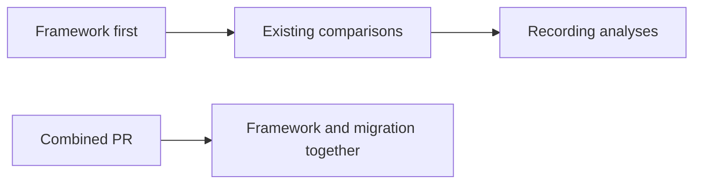
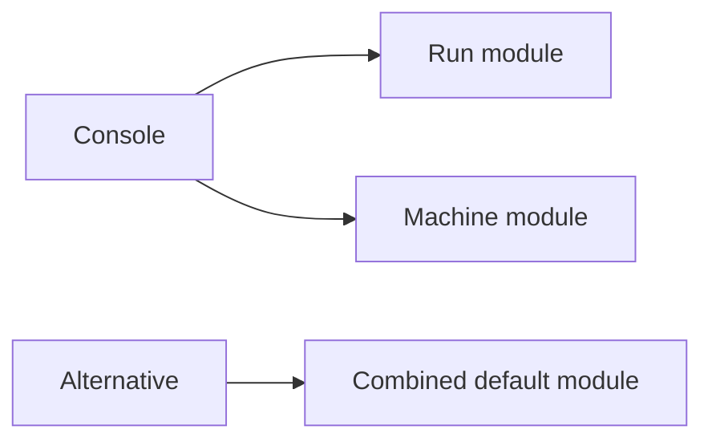
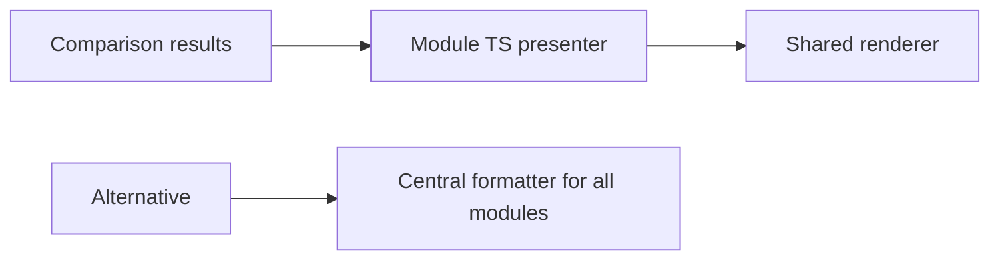
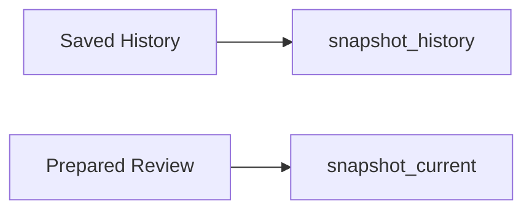

# Comparison framework rollout

Created: 2026-11-16. [Plan](../console/docs/111526-compare-service-outcomes-impl.md).

| Work | PR | Agent |
| --- | --- | --- |
| Registration and execution | [434](https://github.com/Cutuy/doramcap/pull/434) | Root |
| Run and machine migration | [453](https://github.com/Cutuy/doramcap/pull/453) | comparison_migration |
| CPU analysis | [436](https://github.com/Cutuy/doramcap/pull/436) | recording_stack |
| Server selection | [437](https://github.com/Cutuy/doramcap/pull/437) | recording_stack |
| Frontend controls | [438](https://github.com/Cutuy/doramcap/pull/438) | recording_stack |

## 1. Framework before migration

Context: PR 434 combined generic execution with existing comparison migrations.
That made the framework depend on concrete workflow policy.

Owner choice: framework first, then implement the follow-ups. This keeps the
production registry empty in PR 434 and gives migrations separate review boundaries.

## 2. Separate run and machine modules

Context: the combined module chose History, Review or live policy from its input.
Those workflows use different subsets of the same run and machine evidence.

Owner choice: separate modules. Console selects inputs and result sections;
file changes keep their existing owner and API.

## 3. TypeScript presenters per module

Context: protobuf rows included labels, formatted values and visibility policy.
These belong to the browser view model.

Owner choice: module presenters. The server retains comparison, masking and
withholding; each presenter supplies its module's labels and display values.

## 4. Explicit snapshot names

Context: `detail` and `current` did not identify the snapshot alternatives.

Owner choice: `snapshot_history` and `snapshot_current`, retaining tags 2 and 5.
The alternative was retaining the ambiguous names.

## Implementation notes

Console selects workflow results before applying transport bounds. Internal
runner results remain complete, avoiding an additional row-selection callback.
Both analyzers start concurrently; errors cancel siblings and await cleanup.

## Events

- 2026-11-16: Framework-only implementation published in PR 434.
- 2026-11-16: Separate agents started the existing-comparison migration and recording stack updates.
- 2026-11-16: Run/machine migration published as PR 453, stacked on PR 434.
- 2026-11-16: Native GitHub stack 454 now orders 426, 434, 453, 436, 437, 438; existing PRs and reviews retained.
- 2026-11-16: Original presenter work and previous follow-up heads preserved before rework.

## Left for the owner

- Review and merge the ready PRs in their dependency order.
