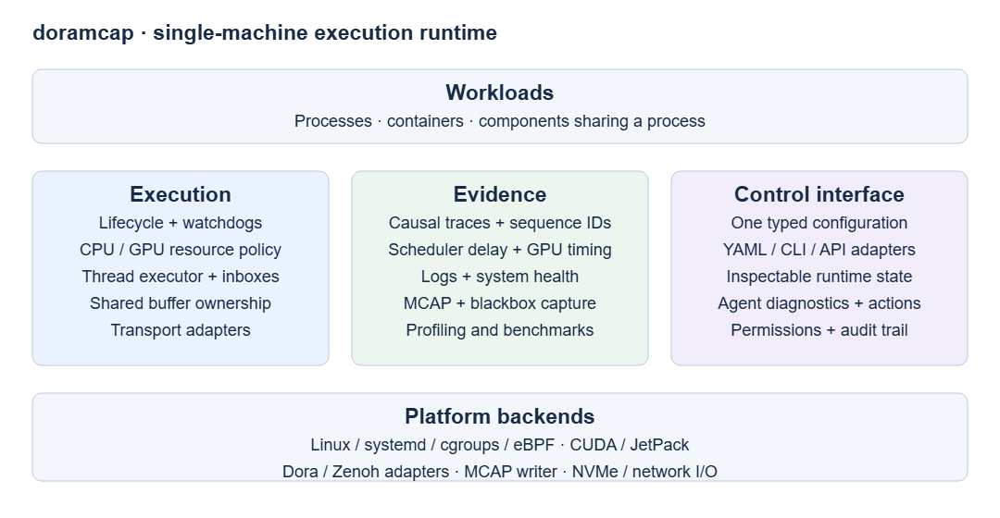

# doramcap: Single-Node High-Performance Runtime

## Personal research requirements and feature roadmap

**Status:** Personal research project — exploratory requirements draft  
**Date:** October 18, 2026  
**Primary platform:** NVIDIA Jetson Thor running Ubuntu 24.04  
**Primary applications:** Robotics, autonomous-vehicle, long-running distributed agent workloads  
**Delivery model:** Device-local operation, with optional off-device analysis and artifact transfer

**Project context:** doramcap is a personal research project. This roadmap records exploratory technical requirements and possible future milestones. Commercial work authorization is pending; delivery phases describe research progression, with commercial commitments reserved for a separately authorized future scope.

## 1. Project objective

Provide a runtime that lets teams configure execution policy, observe actual execution, and explain deviations under realistic CPU, GPU, memory, and storage contention.

The project should make these questions easy to answer:

- Which workload missed its deadline, and where did its time go?
- Did CPU placement, priority, GPU allocation, and memory limits take effect?
- Which competing workload, queue, transfer, or platform condition contributed to a slowdown?
- Can a recording session preserve required evidence within a defined overhead budget?
- Can a failed workload recover while the remaining application follows its declared fallback policy?
- Can developers and local agents inspect a system through a consistent, permissioned interface?

The defining project objective is **configured policy, measured reality, and actionable evidence**.

### 1.1 Intended users and deployment

The intended user is an R&D or platform team operating perception, learned policies, periodic control, and recording together on one Jetson. The team already owns application algorithms and hardware interfaces. It needs reliable execution and diagnosis as applications evolve.

The first supported deployment should have a published hardware/software qualification profile. Jetson model, JetPack release, kernel, CUDA version, storage device, power mode, and cooling configuration belong in that profile.

Existing process-based applications should gain lifecycle management and useful observability before adopting deeper SDK integration.

### 1.2 Scope boundaries

The initial release concentrates on one physical compute system. Multiple processes, containers, users, sessions, and hosted components can share that system.

Cross-machine transport remains an interoperability requirement. Cluster-wide placement, fleet management, full OTA delivery, and broad CXL support belong to later extensions.

Application teams retain ownership of trajectory validity, action-chunk reconciliation, collision checking, and physical safety policy. doramcap supplies execution context, authority hooks, freshness information, failure signals, and evidence that these policies can consume.

Safety certification, deterministic physical replay, and universal hard-deadline guarantees require separate qualification programs.

## 2. Project principles

1. **Reuse proven foundations.** Integrate established open-source lifecycle, messaging, recording, and observability projects wherever they satisfy requirements.
2. **Operate locally.** Essential supervision, recording, inspection, and diagnosis remain available without a hosted service.
3. **Make guarantees explicit.** Each capability reports whether it is enforced, measured, advisory, degraded, or unavailable on the active platform.
4. **Keep overhead bounded.** Monitoring, recording, profiling, and debugging have resource budgets and observable overload behavior.
5. **Preserve application choice.** Existing executables, Dora nodes, containerized workloads, and SDK components share a common operational model.
6. **Allow graph-optional adoption.** Teams can begin with process identities and later add message lineage or declared dependencies.
7. **Separate performance and access isolation.** Resource provisioning and permission boundaries receive distinct requirements and validation.
8. **Expose requested and effective state.** Configuration intent and measured operating state remain separately inspectable.
9. **Prefer evidence over inferred certainty.** Reports label missing data, sampling, clock uncertainty, and incomplete causal links.
10. **Use one control model.** Human tools and agent tools consume the same typed interfaces and authorization rules.

## 3. Vocabulary and common contracts

| Term | Required meaning |
|---|---|
| Workload | A managed execution unit: process, container, or hosted component. |
| Workload instance | One incarnation of a workload, with a unique identity across restarts. |
| Component host | A process containing multiple independently named application components. |
| Session | A bounded operation or experiment with membership, configuration, artifacts, and completion status. |
| Resource profile | Requested CPU, GPU, memory, storage, and instrumentation budgets. |
| Execution contract | Timing, input-age, concurrency, overload, and recovery requirements for a workload. |
| Buffer lease | Permission to access a buffer until an explicit completion condition. |
| Evidence bundle | Correlated configuration, logs, metrics, traces, recordings, and incident context. |
| Platform capability profile | Verified capabilities and limits of a specific hardware/software combination. |

### Common requirements

- **CORE-01:** Assign stable workload identities and unique instance identities. Carry instance boundaries through messages, traces, recordings, and recovery events.
- **CORE-02:** Associate every managed workload with an owner, session membership, resource profile, and effective configuration revision.
- **CORE-03:** Expose a common lifecycle vocabulary: created, starting, ready, running, degraded, stopping, stopped, failed, and recovering.
- **CORE-04:** Represent timestamps with clock-domain information. Preserve capture time, enqueue time, execution time, and persistence time where available.
- **CORE-05:** Publish capability discovery before accepting platform-dependent resource commitments.
- **CORE-06:** Identify rejected, partially applied, and externally modified configuration explicitly.
- **CORE-07:** Support a lightweight adoption tier and a deeper instrumented tier, with documented differences in available evidence.

**Acceptance:** A workload can be followed across start, execution, failure, restart, and session export through an unambiguous identity chain.

## 4. Feature requirements

### 4.1 Lifecycle and session management

- **LIFE-01:** Support persistent workloads that survive logout and resume according to declared boot policy.
- **LIFE-02:** Support transient workloads owned by a development session, experiment, profiler attachment, or agent task.
- **LIFE-03:** Define readiness separately from process existence. Support startup deadlines and application-defined readiness evidence.
- **LIFE-04:** Express startup dependencies, shutdown ordering, graceful-stop budgets, and escalation policy.
- **LIFE-05:** Define a single lifecycle authority for each workload. Integrations with systemd, Dora, and container managers must expose ownership clearly.
- **LIFE-06:** Support restart limits, retry backoff, cooldown, dependency-aware recovery, and operator acknowledgment where requested.
- **LIFE-07:** Preserve restart reasons, exit status, effective configuration, and recent evidence.
- **LIFE-08:** Support session attach/detach, termination, artifact finalization, and cleanup of owned resources.
- **LIFE-09:** Permit profiler and diagnostics attachment within a declared resource and permission budget.
- **LIFE-10:** Support controlled workload replacement with version capture, drain behavior, and rollback eligibility. Fleet package distribution remains a separate integration.

**Acceptance:** A persistent service and a transient experiment can coexist,
recover independently, and produce complete lifecycle histories. Repeated
failures terminate or degrade according to policy.

### 4.2 Heartbeats, watchdogs, and recovery

- **FAIL-01:** Distinguish process liveness, control-channel responsiveness, application progress, and output freshness.
- **FAIL-02:** Support periodic heartbeats and progress-based watchdogs with configurable thresholds and startup grace periods.
- **FAIL-03:** Detect stalled input streams, growing queues, exhausted buffers, and persistent deadline misses.
- **FAIL-04:** Let applications declare fallback responses: hold an application state, shed optional work, switch producer, restart, or stop a session.
- **FAIL-05:** Invalidate stale instance-specific state during recovery. Expose events that allow consumers to discard obsolete work.
- **FAIL-06:** Capture pre-failure and post-failure evidence within a bounded blackbox budget.
- **FAIL-07:** Report supervisor failure and define the resulting behavior of already-running workloads.
- **FAIL-08:** Reconcile orphaned runtime resources after crashes and restarts, subject to verified ownership and outstanding access.

**Acceptance:** Injected crashes, startup hangs, processing stalls, and lost producer streams yield distinct diagnoses and the configured response. Watchdog latency is measured under competing load.

### 4.3 CPU placement, priority, and multithreaded execution

- **CPU-01:** Configure workload and thread placement, including allowed cores and dedicated/shared placement intent.
- **CPU-02:** Request supported scheduling classes and priorities, with permission and capability validation.
- **CPU-03:** Show requested versus effective affinity, scheduling class, priority, CPU quota, and actual CPU residency.
- **CPU-04:** Measure wakeup-to-run delay, runnable waiting, execution time, migrations, preemption, throttling, and deadline misses where platform instrumentation permits.
- **CPU-05:** Provide a CPU workload-distribution view across cores and time, with priority and workload overlays.
- **CPU-06:** Include interference from unmanaged tasks and kernel activity where observable; mark attribution gaps.
- **CPU-07:** Support a multithreaded component executor with bounded concurrency, per-component scheduling intent, and explicit serialization requirements.
- **CPU-08:** Express periodic, event-driven, and background execution classes with defined overload behavior.
- **CPU-09:** Expose long-running callbacks, blocked workers, and executor starvation.
- **CPU-10:** Treat real-time priority as a privileged resource, with admission checks and recovery access for system management.

**Acceptance:** Under controlled CPU interference, the runtime shows where each critical thread actually ran, how long it waited, and which configured constraints applied. Executor tests cover blocking callbacks, work bursts, and oversubscription.

### 4.4 GPU scheduling and resource isolation

- **GPU-01:** Discover supported GPU resource controls per device and software stack.
- **GPU-02:** Represent stream priority, submission admission, concurrency limits, SM provisioning, and hardware partitioning as distinct capabilities.
- **GPU-03:** Express critical and opportunistic GPU workload classes, including allowed concurrency and overload behavior.
- **GPU-04:** Support resource provisioning through available platform mechanisms, including green contexts and hardware partitions where qualified.
- **GPU-05:** Report requested versus effective allocation and the scope of each guarantee.
- **GPU-06:** Distinguish host submission delay, GPU queueing, transfer duration, kernel execution, and completion-observation delay where measurable.
- **GPU-07:** Track host threads responsible for GPU submission so CPU interference can be connected to GPU pipeline stalls.
- **GPU-08:** Define resource behavior across process restart, context failure, device reset, and workload cancellation.
- **GPU-09:** Preserve stream/event ordering and buffer-lifetime dependencies across integrated components.
- **GPU-10:** Report shared-resource interference that remains outside provisioned compute resources, including memory traffic and platform power limits.
- **GPU-11:** Offer separately qualified policies for integrated applications and opaque third-party GPU workloads.

**Acceptance:** Two competing GPU workloads run under a declared capability profile. Reports show effective provisioning and observed interference. Unsupported requests fail validation or require an explicit degraded profile.

### 4.5 Memory, allocators, and shared buffers

- **MEM-01:** Support bounded memory budgets for workloads, inboxes, recording queues, and shared pools.
- **MEM-02:** Allow critical workloads to declare steady-state allocation constraints and preallocated capacity requirements.
- **MEM-03:** Measure allocation pressure, resident memory, page faults, reclaim, and pool exhaustion where available.
- **MEM-04:** Support producer allocation and direct filling of shared buffers, with explicit ownership transfer or leases.
- **MEM-05:** Support application-visible shared rings with slot identity, generation, producer state, consumer ownership, and explicit reuse conditions.
- **MEM-06:** Define ring overflow policies, including reject, block within budget, overwrite eligible data, or shed selected consumers.
- **MEM-07:** Distinguish immutable message samples from mutable latest-value storage and retained frame history.
- **MEM-08:** Support shared CPU and integrated-GPU buffers where qualified, including asynchronous completion and reuse synchronization.
- **MEM-09:** Expose transfer and copy boundaries, fallback counts, copied-byte estimates, and direct-fill eligibility.
- **MEM-10:** Preserve access restrictions across containers, sessions, and users. A buffer descriptor must carry sufficient ownership and generation context for validation.
- **MEM-11:** Support safe reclamation following producer or consumer failure, including abandoned leases and outstanding device work.
- **MEM-12:** Publish compatibility limits for external camera, GPU, and storage buffers.

**Acceptance:** A producer can fill a shared buffer, deliver it to multiple readers, and recycle it after completion. Tests cover a slow reader, a crashed reader, stale descriptors, generation rollover, and allocator exhaustion. Copy counts are measured for qualified paths.

### 4.6 Messaging, inboxes, and transport

- **MSG-01:** Support existing middleware through adapters, with Dora/Zenoh as the first evaluated integration.
- **MSG-02:** Define bounded inbox policies for latest-value streams, FIFO streams, correlated requests, control events, and retained records.
- **MSG-03:** Measure queue depth, oldest-item age, drops, blocked-producer time, and delivery latency.
- **MSG-04:** Support timestamps, sequence identifiers, source instance IDs, and optional causal context across message delivery.
- **MSG-05:** Preserve control and recovery event handling during high-volume data traffic.
- **MSG-06:** Expose ordering, reliability, backpressure, locality, and payload-lifetime semantics for each configured path.
- **MSG-07:** Report effective transport selection, including shared memory, heap-backed delivery, network forwarding, and fallback causes.
- **MSG-08:** Support endpoint authorization and session-scoped access across process and container boundaries.
- **MSG-09:** Preserve cross-machine interoperability with explicit clock uncertainty and transfer costs.
- **MSG-10:** Provide a transport qualification interface for future PCIe and CXL deployments, including discovery, coherency, failure, and ownership requirements.

**Acceptance:** Burst and overload experiments produce explainable queue behavior. A critical control event remains observable while a high-bandwidth stream saturates its own configured capacity.

### 4.7 Recording, MCAP, and blackbox capture

- **REC-01:** Make MCAP a primary interoperable recording artifact for qualified message types.
- **REC-02:** Preserve payload schemas, source identities, sequence IDs, capture and receive timestamps, execution context, and application metadata needed for interpretation.
- **REC-03:** Record exact software versions, effective configuration, hardware profile, power settings, and session membership alongside data.
- **REC-04:** Support direct recording of already encoded payloads where the selected schema and container permit it.
- **REC-05:** Support retained shared-buffer access with explicit recorder leases and bounded impact on producer pools.
- **REC-06:** Support CPU-origin and GPU-origin data with a published copy/transfer budget for each qualified path.
- **REC-07:** Evaluate DMA-capable and direct-storage paths per hardware/software profile. Report actual transfer routes and fallbacks.
- **REC-08:** Provide bounded batching, compression, indexing, and storage-resource policies. Preserve control-workload resource budgets during capture.
- **REC-09:** Distinguish received, queued, written, flushed, and durable data states in recording health and completion reports.
- **REC-10:** Report message loss, sequence gaps, queue overflow, oversized records, encoding failures, and storage failures explicitly.
- **REC-11:** Support quotas, rotation, disk-full behavior, and retention policy.
- **REC-12:** Support a rolling blackbox with configurable pre-trigger and post-trigger capture windows.
- **REC-13:** Support manual, application, watchdog, and agent-authorized capture triggers with a shared session identity.
- **REC-14:** Recover readable data after an interrupted recording and report the completeness of recovered artifacts.
- **REC-15:** Support session catalogs, integrity checks, and resumable off-device artifact transfer.
- **REC-16:** Provide replay that preserves selected payload and timing semantics, with explicit handling of clock domains, missing records, and workload versions.
- **REC-17:** Separate analysis replay, software-in-the-loop replay, and hardware-connected replay through explicit modes and permissions.

**Acceptance:** A specified sensor workload records for the qualification duration within its CPU, memory, storage, and control-latency budgets. Forced termination produces an inspectable recovery report. A slow disk yields visible loss or backpressure according to policy.

### 4.8 Logs, metrics, traces, and latency observability

- **OBS-01:** Correlate stdout/stderr, journal entries, application logs, metrics, traces, and recording sessions.
- **OBS-02:** Support OpenTelemetry-compatible export and interoperable trace artifacts for local analysis.
- **OBS-03:** Trace message chains through fan-out, fan-in, batching, retries, and asynchronous GPU completion where instrumentation exists.
- **OBS-04:** Preserve causal links across workload restart boundaries while exposing the change in instance identity.
- **OBS-05:** Decompose end-to-end latency into capture, queueing, CPU wait, CPU execution, transfer, GPU execution, output dispatch, and storage stages where measurable.
- **OBS-06:** Provide a graph-optional mode that reconstructs observed communication relationships from available evidence.
- **OBS-07:** Label reconstructed, declared, sampled, and unknown portions of a graph separately.
- **OBS-08:** Expose per-stage distributions, tail latency, deadline misses, queue age, and data freshness over time.
- **OBS-09:** Display CPU residency, scheduling delay, GPU activity, memory pressure, power state, and thermal behavior on a correlated timeline.
- **OBS-10:** Support always-on low-overhead observation and bounded escalation into detailed tracing.
- **OBS-11:** Track telemetry drops and instrumentation overhead; preserve an explicit budget for the observer itself.
- **OBS-12:** Produce incident summaries that distinguish measured facts, likely contributors, and unresolved uncertainty.

**Acceptance:** A known injected scheduling delay can be traced from the affected message to the responsible execution interval. The analysis records its instrumentation coverage and avoids unsupported causal certainty.

### 4.9 Profiling, benchmarking, and Jetson qualification

- **PERF-01:** Provide repeatable workload suites spanning CPU load, GPU load, memory traffic, storage pressure, and mixed interference.
- **PERF-02:** Capture the complete qualification environment, including hardware revision, software stack, storage, power mode, clocks, and thermal state.
- **PERF-03:** Measure warmup behavior separately from steady-state and sustained thermally constrained operation.
- **PERF-04:** Support profiler attachment with explicit duration, sampling level, privilege, and overhead limits.
- **PERF-05:** Compare baseline and managed runs using consistent workload inputs and documented run counts.
- **PERF-06:** Produce regression reports for latency distributions, deadline misses, throughput, copy volume, recording loss, and resource usage.
- **PERF-07:** Include failure injection and recovery duration in performance qualification.
- **PERF-08:** Maintain separate Orin and Thor qualification profiles, refined by SKU and software release.
- **PERF-09:** Correlate integrated CPU/GPU memory pressure, frequency changes, power limits, and thermal throttling with application behavior.

**Acceptance:** An independent engineer can reproduce the published benchmark profile and understand discrepancies from captured environment differences.

### 4.10 Multiple components within one process

- **COMP-01:** Host multiple independently named components in one process with separate lifecycle state and execution metrics.
- **COMP-02:** Define callback concurrency, serialization groups, queue ownership, and shared-resource access.
- **COMP-03:** Preserve message lineage and latency visibility across both local function delivery and process boundaries.
- **COMP-04:** Allow component grouping to change while preserving logical identities and application-facing contracts where possible.
- **COMP-05:** Expose the shared crash, address-space, and resource-accounting scope of each host process.
- **COMP-06:** Support draining and component replacement where application lifetime contracts permit it.
- **COMP-07:** Define language-specific constraints and qualify bindings separately.

**Acceptance:** The same small application can run as separate processes and as hosted components. Comparison reports show overhead, attribution precision, scheduling behavior, and failure scope.

### 4.11 Agentic debug interface and permission boundaries

- **AGENT-01:** Expose structured APIs for inventory, effective configuration, health, traces, recordings, and incident evidence.
- **AGENT-02:** Support time-bounded diagnostic sessions with CPU, GPU, memory, disk, and privilege budgets.
- **AGENT-03:** Separate inspection, profiling, configuration changes, restarts, and hardware-affecting actions into explicit permissions.
- **AGENT-04:** Scope access by user, container, session, workload, and artifact sensitivity.
- **AGENT-05:** Audit tool calls, policy decisions, applied changes, and resulting workload state.
- **AGENT-06:** Make operations cancellable and recoverable where their underlying action permits it.
- **AGENT-07:** Provide machine-readable evidence references so generated explanations can link back to measured events.
- **AGENT-08:** Preserve runtime supervision if a diagnostic agent crashes, stalls, or exceeds its budget.
- **AGENT-09:** Redact configured sensitive fields before evidence leaves its authorized scope.
- **AGENT-10:** Use the same policy model for human and agent interfaces.

**Acceptance:** A local agent can identify an injected performance fault, collect a bounded evidence bundle, and propose a policy change. Attempts outside its permissions are rejected and audited.

### 4.12 Configuration and deployment ergonomics

- **CFG-01:** Define one versioned, typed configuration model with YAML, CLI, and programmatic representations.
- **CFG-02:** Publish precedence rules and show the source of each effective value.
- **CFG-03:** Validate resource requests, dependencies, permissions, and platform capabilities before activation.
- **CFG-04:** Provide plan/diff views for changes, including affected workloads and required restarts.
- **CFG-05:** Classify settings as live-changeable, restart-required, or reboot-required.
- **CFG-06:** Record configuration changes in session evidence and support rollback to a compatible revision.
- **CFG-07:** Provide schema evolution, migration guidance, and compatibility checks for saved profiles.
- **CFG-08:** Keep secrets separate from ordinary configuration exports and recording manifests.

**Acceptance:** YAML, CLI, and API requests produce equivalent effective configuration. Conflicts and unsupported requests are explained before activation.

## 5. Open-source reuse strategy

The following projects are building-block candidates with documented capabilities. Inclusion is a reuse preference, subject to integration qualification, licensing review, and measured suitability. doramcap's own requirements remain the acceptance standard.

| Building block | Intended reuse | doramcap responsibility |
|---|---|---|
| Linux + systemd | Persistent/transient service lifecycle and system resource-control integration | Session semantics, lifecycle ownership, readiness, cross-tool coordination, evidence |
| Linux cgroup v2 | CPU, memory, and I/O accounting/control where supported | Resource contracts, effective-state reporting, capability validation, qualification |
| Dora | Application dataflow integration, node lifecycle hooks, event APIs, existing developer workflows | Unified policy, adapter boundaries, additional component hosting, workload evidence |
| Zenoh | Local and network messaging, eligible shared-memory delivery, discovery/routing | Message contracts, inbox policy, ownership integration, performance qualification |
| Apache Arrow | Typed payload representation and cross-language buffer interoperability where appropriate | Schema policy, copy accounting, external-buffer compatibility |
| MCAP | Interoperable timestamped recording container, schemas, indexing/compression features | Session semantics, buffer retention, efficient writer integration, completeness reporting |
| OpenTelemetry | Trace, metric, and log conventions and export interfaces | Robotics identity/causality model, overhead budgets, local evidence correlation |
| Perfetto | Trace visualization, analysis, and Linux execution evidence | Cross-source correlation, runtime views, incident packaging |
| Linux eBPF / established eBPF tooling | Scheduling-delay and system-behavior observation where available | Stable metrics, probe permissions, bounded overhead, kernel compatibility |
| Existing OCI container tooling | Container lifecycle and access boundaries | Integration with resource/session ownership and cross-container data authorization |

CUDA, JetPack, green contexts, and GPU profiling facilities are **vendor dependencies**. Track their compatibility and distribution terms separately from the open-source foundation.

### 5.1 Reuse requirements

- Prefer upstream APIs and extensibility points over maintaining private forks.
- Preserve native debugging and inspection tools where practical.
- Maintain a supported-version matrix and a clear upgrade/rollback path.
- Record third-party versions and relevant configuration in evidence bundles.
- Qualify transport, recorder, and scheduler behavior under overload.
- Keep adapters replaceable so the project's execution contract survives a building-block change.
- Contribute generally useful fixes upstream when feasible.
- Publish licenses, dependency inventory, and security-update ownership.

### 5.2 Known integration gaps from the reviewed Dora snapshot

The review used Dora commit `9bae21efbed5e0d1fc0a2df9143b019e84b51041`. Revalidate these observations when selecting a shipping dependency version.

- The operator runtime rejects multiple operators in one runtime configuration; general component composition needs additional qualification and capability.
- The ordinary recorder encodes received arrays into recording buffers and serializes events. Direct encoded-payload recording deserves separate evaluation.
- MCAP support includes `.drec` export; the reviewed export omits message metadata parameters and uses uncompressed chunks.
- The tensor-pool extension is opt-in, outside the core compatibility guarantee, and documents defects and GPU coverage gaps.
- Transparent SHM behavior depends on locality, route eligibility, allocation capacity, and retained samples. Slow readers can change the effective copy path.

Revisit these integration findings as upstream capabilities evolve.

## 6. Delivery roadmap

Phases are ordered by dependency and evidence. Calendar estimates follow team sizing and the first hardware qualification exercise.

| Phase | User outcome | Primary requirements | Exit gate |
|---|---|---|---|
| P0 — Capability baseline | Understand the target Jetson and current workload behavior | CORE, CFG, PERF, initial OBS | Reproducible baseline and platform capability report |
| P1 — Managed execution | Launch, supervise, and diagnose existing processes locally | LIFE, FAIL, CPU, OBS, CFG | Mixed-load pilot with explicit effective policy and recovery evidence |
| P2 — Recording and shared data | Capture trustworthy sessions with bounded overhead | MEM, MSG, REC, OBS | Sustained recording plus overload and crash-recovery qualification |
| P3 — GPU-aware execution | Provision GPU work and explain contention | GPU, CPU, MEM, PERF | Platform-specific GPU interference and resource-control results |
| P4 — Component composition and agent tools | Host components and support permissioned local diagnosis | COMP, AGENT, extended CFG | Process/component equivalence study and agent permission tests |
| P5 — Deployment extensions | Broaden transports, hardware profiles, and operational integrations | MSG, PERF, lifecycle extensions | Deployment-driven qualification for each added capability |

### P0: Capability baseline

Deliver:

- A primary Jetson profile and explicit capability inventory.
- Workload inventory, identities, version capture, and effective configuration export.
- Baseline CPU/GPU/storage/memory measurements and a minimal timeline.
- A qualification harness with reproducible input and interference workloads.
- A reuse assessment for Dora, Zenoh, MCAP, systemd, and observability tools.

**Gate:** Freeze the first pilot's workload contract, target metrics, test duration, resource budgets, and failure scenarios before optimization begins.

### P1: Managed execution

Deliver:

- Persistent and transient workload lifecycle integration.
- Readiness, startup deadlines, progress watchdogs, and bounded recovery.
- CPU placement and priority controls with requested/effective views.
- CPU distribution and scheduling-delay analysis.
- Logs, health metrics, execution traces, and incident bundles.
- Graph-optional onboarding for existing executables.

**Gate:** Complete the mixed-load pilot with measured supervisory overhead and explainable deadline misses. Workload recovery follows policy under repeated fault injection.

### P2: Recording and shared data

Deliver:

- Native MCAP session capture for the first qualified schemas.
- Complete metadata and software/configuration manifests.
- Bounded recording queues, retention leases, quotas, and storage overload behavior.
- Shared-buffer contracts and an explicit ring-buffer profile.
- Blackbox capture and analysis replay.
- Transparent transport path and copy/fallback observability.

**Gate:** Sustained capture meets the agreed recording budget; interrupted files remain inspectable; gaps and losses are quantified. A stalled recorder preserves the configured critical-workload behavior.

### P3: GPU-aware execution

Deliver:

- Qualified GPU resource profiles for selected Jetson variants.
- Admission and concurrency controls, with hardware-dependent provisioning.
- Stream/event-aware completion and buffer reuse.
- CPU/GPU transfer and execution timeline correlation.
- Measurements of memory-bandwidth, power, and thermal interference.
- Evaluated GPU-origin recording paths with explicit copy and durability semantics.

**Gate:** Publish guarantees separately for each platform profile. Demonstrate behavior under competing GPU load, allocation pressure, and sustained thermal conditions.

### P4: Component composition and agent interface

Deliver:

- Multiple components per process with bounded executor and inbox behavior.
- Logical identity preservation across composition changes.
- Structured local diagnostic APIs and permissions.
- Bounded profiler attachment, evidence collection, and audited remediation.
- Cross-user/container/session access tests.

**Gate:** Compare process and component deployments; document failure-domain changes. A diagnostic agent operates within its declared resource and permission budget during a stressed run.

### P5: Deployment-driven expansion

Candidates:

- Additional Jetson and general Linux compute profiles.
- Qualified PCIe endpoint transport and accelerator interconnects.
- CXL-backed memory or device deployments driven by a specific user platform.
- Broader middleware and container integrations.
- Package-update coordination and fleet-system integration.
- Multi-machine session correlation and artifact aggregation.
- Local agentic applications as a separately qualified workload class.

**Gate:** Each extension requires a concrete deployment, observable user outcome, compatibility matrix, and regression coverage.

## 7. First pilot acceptance contract

### Workloads

Run together on one qualified Jetson:

1. Sensor ingestion with a specified payload distribution and rate.
2. Perception or learned-policy inference.
3. A periodic command-dispatch workload.
4. Continuous recording plus a triggered blackbox window.
5. A controllable CPU/GPU/storage interference workload.
6. A bounded diagnostics session.

Use a hardware-independent command sink for initial runtime qualification. Hardware-connected tests follow the application team's own safety and operating procedures.

### Required measurements

| Measurement | Required reporting |
|---|---|
| End-to-end latency | Stage breakdown, percentiles, maximum observed value, sample count |
| Periodic execution | Target cadence, jitter, missed deadlines, sustained misses |
| CPU behavior | Requested/effective placement and priority, residency, runnable delay |
| GPU behavior | Provisioned resources, queue/transfer/compute timing where available |
| Memory behavior | Resident usage, faults, pool occupancy, lease duration, fallback copies |
| Recording | Source/received/written counts, gaps, storage latency, completeness |
| Recovery | Detection, intervention, readiness restoration, downstream invalidation |
| Platform state | Power, temperature, frequencies, throttling, storage condition |
| Runtime overhead | CPU, memory, I/O, and latency impact by instrumentation level |

Numerical targets must be agreed for the actual hardware and workload before the pilot. Reports include duration, run count, warmup treatment, and instrumentation coverage. Maximum observed latency is an empirical result; a worst-case guarantee requires an additional argument and qualification scope.

### Required scenarios

- Baseline and managed execution with identical application inputs.
- CPU saturation, affinity conflicts, and high-priority interference.
- GPU contention and memory-heavy concurrent activity.
- Recording bursts, slow storage, and disk exhaustion.
- Producer crash, consumer crash, stalled callback, and startup hang.
- Pool exhaustion and retained shared buffers.
- Recorder termination and artifact recovery.
- Thermal saturation after sustained operation.
- Diagnostic attachment under load.
- Permission-denied operations across session and user boundaries.

## 8. Release-wide quality requirements

- **QUAL-01:** Publish supported platform profiles, feature maturity, and known limits.
- **QUAL-02:** Maintain reproducible builds, dependency inventory, and signed release provenance where available.
- **QUAL-03:** Run compatibility tests against supported upstream versions and saved configuration schemas.
- **QUAL-04:** Maintain long-duration and fault-injection qualification alongside functional tests.
- **QUAL-05:** Quantify overhead and instrumentation loss for each supported observation level.
- **QUAL-06:** Document operational recovery from supervisor failure, partial startup, exhausted resources, and incomplete artifacts.
- **QUAL-07:** Preserve local operation during network loss and off-device service outages.
- **QUAL-08:** Support export through documented formats and APIs so users can inspect their evidence independently.

## 9. Project decisions to resolve

| Decision | Why it matters | Required by |
|---|---|---|
| First Jetson SKU and software profile | Determines available GPU, kernel, and storage controls | P0 |
| Pilot workload and latency/overhead budgets | Defines measurable value and qualification cost | P0 |
| Primary adoption mode | Existing processes, Dora integration, or embedded SDK changes onboarding | P0 |
| Lifecycle authority per integration | Prevents conflicting recovery and shutdown decisions | P1 |
| Session and workload identity model | Underpins tracing, recording, recovery, and authorization | P1 |
| First recording schemas | Determines interoperability and payload-preservation requirements | P2 |
| Required crash versus power-loss durability | Determines the recording completion contract | P2 |
| GPU integration depth | Determines the feasible resource-control and timing guarantees | P3 |
| Component language priorities | Determines composition and executor qualification scope | P4 |
| Agent permission and artifact-sharing policy | Determines operational trust boundaries | P4 |

The working module labels **Scheduling, SMM, LMM, Blackbox, Watchdog, and CommsRelay** should map to the requirements above. Expand and agree the meanings of SMM and LMM before turning those labels into public interfaces.

## 10. Reference material

These references support building-block evaluation. Feature requirements in this document describe proposed doramcap behavior.

- [Dora source snapshot](https://github.com/dora-rs/dora/tree/9bae21efbed5e0d1fc0a2df9143b019e84b51041): reviewed lifecycle, transport, operator, and recording surfaces.
- [Dora operator runtime](https://github.com/dora-rs/dora/blob/9bae21efbed5e0d1fc0a2df9143b019e84b51041/binaries/runtime-api/src/lib.rs): current component-hosting boundary.
- [Dora recorder](https://github.com/dora-rs/dora/blob/9bae21efbed5e0d1fc0a2df9143b019e84b51041/binaries/record-node/src/main.rs): recording encoding and write path.
- [Dora MCAP export](https://github.com/dora-rs/dora/blob/9bae21efbed5e0d1fc0a2df9143b019e84b51041/docs/cli.md#dora-recording-export): export behavior and limitations.
- [Dora tensor-pool extension](https://github.com/dora-rs/dora/blob/9bae21efbed5e0d1fc0a2df9143b019e84b51041/libraries/extensions/tensor-pool/README.md): opt-in CPU/GPU buffer integration.
- [Zenoh overview](https://zenoh.io/docs/overview/what-is-zenoh/): pub/sub/query communication model.
- [Apache Arrow format](https://arrow.apache.org/docs/format/Columnar.html): buffer representation and IPC format.
- [MCAP specification](https://mcap.dev/spec): recording container and indexing structures.
- [systemd control-group interfaces](https://systemd.io/CONTROL_GROUP_INTERFACE/): service/scope ownership and resource integration.
- [Linux cgroup v2](https://www.kernel.org/doc/html/latest/admin-guide/cgroup-v2.html): resource accounting and control interfaces.
- [OpenTelemetry signals](https://opentelemetry.io/docs/concepts/signals/): traces, metrics, and logs.
- [Perfetto CPU scheduling](https://perfetto.dev/docs/data-sources/cpu-scheduling): Linux scheduler tracing.
- [CUDA green contexts](https://docs.nvidia.com/cuda/archive/13.1.1/cuda-programming-guide/04-special-topics/green-contexts.html): GPU resource-provisioning semantics.
- [CUDA asynchronous execution](https://docs.nvidia.com/cuda/cuda-programming-guide/02-basics/asynchronous-execution.html): streams, dependencies, and priority behavior.
- [Jetson MIG documentation](https://docs.nvidia.com/jetson/archives/r39.2/DeveloperGuide/SD/MiG.html): hardware-specific GPU partitioning.
- [GPUDirect Storage documentation](https://docs.nvidia.com/gpudirect-storage/index.html): candidate storage-path qualification reference.
