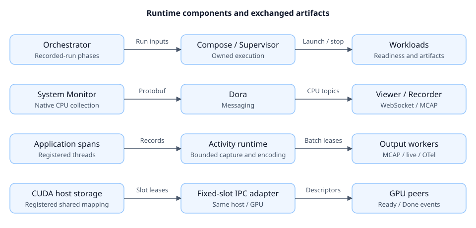

# Runtime roadmap

Status reviewed against the checkout on October 31, 2026. doramcap is a personal
research workspace with working components and demos. Target deployment is one
compute system; Jetson Orin/Thor qualification remains open.

## Current capabilities

“Implemented” describes repository code; platform coverage lives in the linked
evidence. Broad runtime guarantees require the qualification milestones below.

| Area | Implemented scope | Remaining work / evidence |
|---|---|---|
| Lifecycle | Shared recorded-run phases; Compose experiment ownership, readiness and cleanup; Supervisor/System Monitor runner | General workload adoption, persistent boot policy and bounded restart policy. [Lifecycle](../libs/workload-lifecycle/), [Compose](../libs/workload-docker/), [Supervisor](../libs/workload-supervisor/) |
| Sessions | Identity and experiment evidence concept scaffold | Membership, manifest serialization and Rust APIs. [Session design](../libs/session/) |
| CPU | Affinity/RT policy, cgroup bootstrap, native per-CPU accounting and live viewer | Jetson/Linux 6.8 and sustained-load qualification; kernel-thread accounting remains experimental. [Policy evidence](../libs/resources/resource-policy/docs/validation.md), [BPF evidence](../libs/resources/cgroup-bpf/docs/101826-native-kernel-validation.md) |
| Faults | Bounded capture, health/freshness aggregation and Dora watchdog with optional MCAP/OTel outputs | Workload recovery authority and end-to-end restart policy. [Watchdog](../apps/fault-watchdog/) |
| Tracing | Bounded activity capture, MCAP/live/OTel sinks; ancestry and fixed latency measurements in a Dora demo | Multi-host clocks, temporary measurements and broader application integration. [Activity](../libs/activity-tracing/), [dataflow tracing](../apps/dataflow-tracing/) |
| Recording/storage | Independent Dora recorder; embedded monitor recording; bounded io_uring writer, direct I/O, combining, rotation and leased external buffers | Blackbox pre/post-trigger retention, session-wide manifests and storage-overload qualification. [Recorder](../apps/mcap-recorder/), [writer contracts](../libs/storage-persistence/) |
| GPU memory | Guarded CUDA host/managed memory; fixed-slot same-host/GPU SPMC adapter with Ready/Done events | Fixed trusted membership; GPU scheduling, remote payload copying and target qualification remain open. [Host memory](../libs/memory/cuda-host-memory/), [IPC adapter](../libs/memory/cuda-dora-shm/) |
| Configuration | Protobuf/pbtxt composition, validation, provenance and deployment fingerprints; native Compose/Dora formats at boundaries | Mixed-type configuration registries. [Configuration](../libs/pbtxt-config/) |
| Inspection | Project explorer and component dashboards | Unified Console and permissioned agent interface. [Explorer](../apps/project-explorer/), [Console plan](../console/docs/102926-console-mvp.md) |

## Qualification priorities

These milestones summarize remaining work. Component plans retain detailed
implementation history; no milestone below is complete.

### 1. Platform baseline and mixed-load pilot

**Work items**

- [ ] Select a Jetson SKU, JetPack/kernel/CUDA versions, storage, power and cooling profile.
- [ ] Freeze input rates, latency/overhead budgets, run duration and failure scenarios.
- [ ] Combine ingestion, inference, periodic command dispatch, recording and controlled interference.

**Validation**

- [ ] Report latency percentiles/maxima, jitter, missed deadlines and sample counts.
- [ ] Compare requested/effective CPU policy and CPU/GPU/memory/storage contention.
- [ ] Measure instrumentation losses, recording completeness, thermal behavior and recovery time.

Existing evidence: [resource policy](../libs/resources/resource-policy/docs/validation.md)
and [native accounting](../libs/resources/cgroup-bpf/docs/101826-native-kernel-validation.md)
cover selected x86_64/ARM64 cases. ARM64 WSL coverage leaves Jetson qualification open.

### 2. Session and recovery contracts

**Work items**

- [ ] Implement session identity, membership, configuration revision and artifact manifests.
- [ ] Define lifecycle authority, persistent/transient ownership, restart limits and dependency recovery.
- [ ] Carry workload-instance boundaries through faults, traces and recordings.

**Validation**

- [ ] Inject startup hangs, process crashes, stalled progress and repeated failures.
- [ ] Verify readiness, bounded recovery, stale-instance invalidation and independent workload outcomes.
- [ ] Verify orphan reconciliation and cleanup using retained ownership evidence.

Starting points: [session concept](../libs/session/docs/102526-session-concept.md),
[recorded-run driver](../libs/workload-lifecycle/src/recorded_run.rs) and
[Supervisor native tests](../libs/workload-supervisor/tests/native.rs).

### 3. Recording and GPU integration

**Work items**

- [ ] Add bounded blackbox retention and explicit recording overload/durability policy.
- [ ] Integrate GPU buffer lifetimes with recording and expose copy/fallback paths.
- [ ] Evaluate GPU admission, concurrency and supported resource provisioning per platform.

**Validation**

- [ ] Exercise slow/full storage, recorder termination, retained buffers and pool exhaustion.
- [ ] Quantify source/received/written counts, gaps, write latency and artifact recovery.
- [ ] Qualify GPU completion, consumer failure, competing load and sustained thermal conditions.

Starting points: [storage contracts and evidence](../libs/storage-persistence/),
[CUDA IPC validation](../libs/memory/cuda-dora-shm/docs/102126-fixed-slot-ipc.md)
and [GPU content tests](../apps/cuda-shm-demo/).

### 4. Unified inspection and broader adoption

**Work items**

- [ ] Deliver the planned Console preparation/run/result flow.
- [ ] Define bounded component executors, inbox/overload policy and composition identities.
- [ ] Add typed diagnostic APIs, authorization and budgeted profiler/agent attachment.

**Validation**

- [ ] Exercise onboarding and artifact inspection for existing applications.
- [ ] Compare process/component deployments, failure domains and blocked-worker behavior.
- [ ] Test cross-user/container/session permissions and diagnostics under load.

Starting points: [Console plan](../console/docs/102926-console-mvp.md) and
[adoption candidates](../libs/workload-lifecycle/docs/102626-adoption-candidates.md).

## Scope and decisions

- Essential operation stays device-local. Cross-machine transport and correlation
  are extensions; fleet/OTA, CXL and NvSci/NvMedia need concrete deployments.
- Applications own physical safety, action validity and fallback decisions.
  Timing guarantees require a qualified hardware/software profile.
- Open decisions: first pilot/budgets, public identity model, recording schemas
  and durability level, GPU controls, component languages and agent permissions.
- See [vision](vision.md), [research backlog](ideas.md), [ownership conventions](repository-layout.md)
  and [CI operations](../scripts/ci/README.md). Local, ARM64, Dora and CUDA checks
  provide distinct evidence; component tests alone do not establish full qualification.
