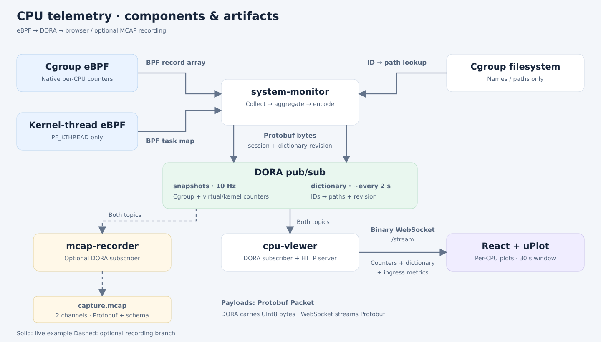

# Dora CPU monitor demos



See [exact binary field definitions](../docs/wire-protocol.md). The dashed MCAP
branch is optional: the live viewer YAML does not launch the recorder.

Use Dora CLI 1.1.0, matching the pinned `dora-node-api`. Build as your regular
user. The native wrapper elevates only the collector, following main's
`AGENTS.md`: it resolves the first Git worktree, verifies the shared
`.sudo-password` is ignored and mode 0600, and passes it only through sudo stdin.
Dora and the localhost web server stay unprivileged.

## Native live viewer

From the checkout root (Node.js 22.12+):

```sh
npm ci --prefix frontend
npm run build --prefix frontend
cargo build -p system-monitor -p cpu-viewer --features system-monitor/dora,system-monitor/bpf,system-monitor/task-bpf
dora run examples/live-cpu-dataflow.yml
```

Open <http://127.0.0.1:8080>. Stop with Ctrl+C. The dataflow uses real eBPF
counters and enables experimental PF_KTHREAD-only accounting with capacity 32768.
`live-cpu-native-dataflow.yml` is an explicit alias. Native requirements are
Linux >=6.8, cgroup v2, kernel BTF, build dependencies and privileged BPF access;
see `crates/cgroup-bpf/README.md` for kernel qualification details.

```text
system-monitor → Dora snapshots (10 Hz) + dictionary (~0.5 Hz) → cpu-viewer
                                                   ↓ binary WebSocket
                                                React + uPlot
```

One chart per CPU automatically shows its eight busiest active cgroups, ranked
by time-weighted activity over five seconds and refreshed once per second.
Charts refresh at 10 Hz and retain 30 seconds, expiring even during silence.
100% means one occupied core. Cgroup counters include descendants, so lines are
not stacked or summed. Root cgroup runtime, first samples and resets show as
gaps. History is bounded by 600 points, 64 CPUs and 8192 cgroup records per
snapshot. Colors remain stable across rankings. Labels show cgroup paths.

The persistent dashed virtual/kernel line uses backend-aggregated PF_KTHREAD
runtime by charged CPU. The BPF probe excludes all non-PF_KTHREAD tasks before
map insertion. Individual task records are not published. This reporting
aggregate may overlap cgroup runtime. Its scope is PF_KTHREAD runtime;
application syscalls and separate IRQ/idle accounting are outside it. Task-map
capacity and losses are visible; records persist until restart and the bounded
map can fill. Remove `--task-capacity 32768` to disable this experimental
diagnostic. See [accounting
nuances](../crates/task-accounting/CPU-ACCOUNTING.md).

The server keeps one latest frame shared across browser clients; slow clients
skip intermediate frames to keep buffering bounded. Browser reconnects are
automatic. Names arrive as separate full dictionary checkpoints about every 2
seconds, with session/revision matching; reconnects receive the cached
checkpoint first. Snapshot payloads are binary on both hops; see
`docs/wire-protocol.md` for the versioned Protobuf schema, 64-bit precision, MCAP
encoding, and standalone output framing.

Ingress metrics count original Dora snapshot plus dictionary bytes; the message
count/rate counts snapshots only, independent of browser count, before
dictionary expansion or WebSocket framing. Rates use completed intervals of at
least one second; cumulative counters begin at viewer startup. These rates
measure application payload bytes. Capture-to-receive latency uses the shared
host wall clock from producer capture to subscriber dequeue, including
collection, publication and queueing. Browser rendering follows receipt.
Latest/mean latency are shown; invalid timestamps are excluded. Stale rates and
latency are hidden after two seconds. Throughput uses monotonic time. Browser
latency uses `/clock` calibration (fastest of three probes every 30 s) and
browser monotonic time, so it does not require matching wall clocks. It is an
estimate: half the probe round trip is shown as timing uncertainty, and network
asymmetry/drift can affect it. It ends at WebSocket callback entry, before
decode/render. Calibration expires after 90 s.

The server binds IPv4 loopback only. Change `--port 8080` in the YAML if needed.
Assets default to this checkout's `frontend/dist`; use `--assets /absolute/path`
when relocating the binary. For frontend development run `npm run dev --prefix
frontend`; Vite proxies WebSocket `/stream` to 8080.

## Synthetic transport test and recording

Select synthetic mode explicitly for transport testing:

```sh
dora run examples/live-cpu-synthetic-dataflow.yml
```

It publishes four CPUs at approximately 50% through the same real Dora and
binary WebSocket path. To record ten synthetic samples to MCAP:

```sh
cargo build -p system-monitor -p monitor-output --features system-monitor/dora,monitor-output/dora
dora run examples/phase0-dataflow.yml
```

The recorder refuses to overwrite `phase0.mcap`. It finalizes when its input
closes. It stores original Protobuf payloads and capture times; MCAP's
32-bit sequence wraps while the payload retains u64. Add the recorder as an
additional Dora subscriber for persistent recording alongside the live viewer.

## Measured MessagePack → Protobuf size difference

A live eBPF sample measured on 2026-10-18 contained 3,080 CPU/cgroup rows,
zero task records and zero inline dictionary entries. The comparison used the
same values in both formats: Protobuf was serialized after removing viewer-only
ingress metrics; MessagePack size was calculated using the previous v1
positional-array layout and compact integer/string/array encoding rules.

| Payload | Previous MessagePack | Protobuf v2 |
|---|---:|---:|
| One numeric snapshot | 58,727 bytes | 64,026 bytes |
| Snapshot payload rate at exactly 10 Hz | 587,270 bytes/s | 640,260 bytes/s |
| Dictionary checkpoint (153 entries, about every 2 s) | 10,179 bytes | 10,442 bytes |

For this sample, snapshots grew **9.02%**, adding **52,990 bytes/s** at 10 Hz.
This explains the observed dashboard increase from roughly 580 KB/s to
630 KB/s; live rates also vary with row counts, counter values and publication
timing. Rates above exclude dictionary traffic, transport framing and MCAP
container/schema overhead; KB denotes 1,000 bytes.

Across the CPU rows, Protobuf used 39,944 bytes for numeric varints, 17,839
bytes for field tags and 6,160 bytes for nested-message headers. MessagePack
used 55,562 bytes for numeric values and 3,080 bytes for row-array headers.
Protobuf's integer savings partially offset its per-field and per-row overhead.
The migration provides explicit schemas, additive-field compatibility and
embedded MCAP descriptors; payload size depends on the representation and data.
Packed numeric columns are a possible future optimization. This measurement
covers payload size only; encoding/decoding CPU performance was not benchmarked.

## Verification

```sh
npm test --prefix frontend
npm run build --prefix frontend
cargo test -p monitor-wire -p monitor-output -p cpu-viewer
# With either live dataflow running (about 32 seconds):
npm run test:live --prefix frontend
```

The live check exercises actual binary messages, the shared frontend decoder,
CPU rates, 30-second eviction, and full name context on browser reconnect.

Protobuf schema: [`telemetry.proto`](../crates/monitor-wire/proto/telemetry.proto).
MCAP embeds its FileDescriptorSet on both channels. Install validation dependencies
with `python3 -m pip install -r examples/requirements.txt` (prefer a virtual environment).
