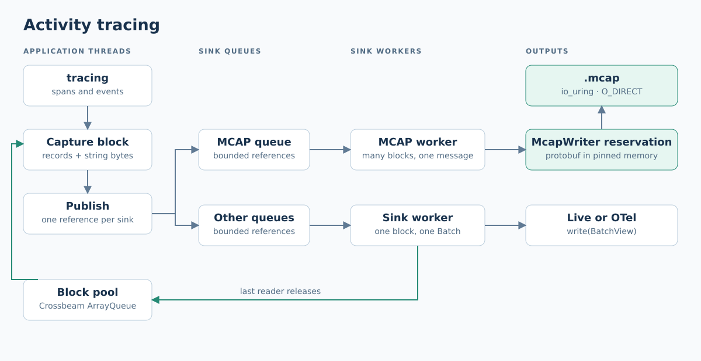

# Activity tracing

Embedded recording of `tracing` spans and events, with bounded capture blocks
and MCAP, WebSocket or OpenTelemetry outputs. Each sink's worker serializes for itself.



[Sink block batching](docs/batch-blocks-flow.svg) ·
[Buffer lifetimes](docs/buffer-lifetimes.svg) ·
[Buffer ownership](docs/external-buffer-ownership.svg) ·
[Roadmap and validation gates](docs/101826-my-roadmpa.md) ·
[Validation evidence](docs/validation.md) ·
[Wire schema](proto/activity.proto)

## Quick start

```rust
use activity_tracing::{Config, Runtime, sinks::McapSink};

# fn main() -> activity_tracing::Result<()> {
let mut runtime = Runtime::start(
    Config::default(),
    vec![Box::new(McapSink::new("activity.mcap"))],
)?;
let handle = runtime.handle();
let registration = handle.register_thread("camera")?;
tracing::subscriber::with_default(handle.subscriber(), || {
    let span = tracing::info_span!(
        target: "activity", "perception.infer",
        task.name = "camera_front", frame_id = 42u64,
    );
    let _entered = span.enter();
    tracing::info!(target: "activity", milestone = "input_ready");
});
drop(registration);
let report = runtime.shutdown()?;
assert!(report.sinks.iter().all(|sink| sink.error.is_none()));
# Ok(())
# }
```

Register every emitting thread, use the `activity` target, and drop registrations
before `shutdown()`. Optional outputs by feature: `McapSink` (`mcap`), `WebSocketSink` (`websocket`) and
`OtelSink` (`otel`). Hosts can also implement `Sink`.

`McapSink` merges already queued blocks and serializes them directly into `McapWriter`'s
pinned buffer. A deadline flushes buffered data after at most 1 s; empty workers wait
on work and shutdown channels. Other sinks receive one `Batch` per block.
Workers build the generated Protobuf `Batch` with repeated records; Prost measures and
encodes it. Message construction allocates on the sink worker.

## Run

```sh
cargo test -p activity-tracing --all-features
cargo run -p activity-tracing --features mcap --example record -- /tmp/activity.mcap
cargo run -p activity-tracing --release --example throughput -- 100000
cargo run -p activity-tracing --release --example throughput -- 100000 1000
```

The [Activity lab](../../apps/activity-demo/) shows live capture and message causality.
