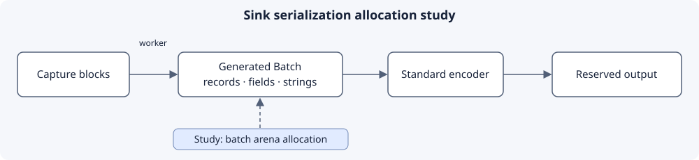

# Sink serialization allocations

Created November 3, 2026. Follow-up to [PR #123](https://github.com/Cutuy/doramcap/pull/123).
This plan defers allocation changes while evaluating protobuf arena allocation.
Keep generated messages with repeated records and standard serialization.

## Current findings

Reviewed PR revision `5faf971c1385b8c06e4826413d7d796ea35db7ad`.

| Allocation site | Current behavior | Evaluation |
|---|---|---|
| `wire::Encoder::new` | Reserves one block of records | Account for merged blocks when choosing capacity |
| `Encoder::plan` | Clears outer vectors; retains their backing storage | Additional outer `reserve` mainly helps initial growth |
| `batch.records.clear()` | Drops records and their nested field vectors | Main per-record allocation source |
| `batch.dictionary.clear()` | Drops owned strings | Dictionary names allocate again each batch |
| `Encoder::append` | Collects a new field vector for each record | A reservation alone still allocates per record |
| `pipeline::deliver` | Collects a new vector of read guards | One temporary allocation per nonempty delivery |
| Worker byte buffer | `resize` retains capacity between messages | Growth allocates; MCAP encodes into a writer reservation |
| Runtime startup | Output, worker and readiness vectors grow with sink count | Reserve known sink count if measurements justify it |

The existing batch object already survives across calls. Further reuse would need
retention of its nested allocations. Such retention also increases worker memory
held after large batches; evaluate it alongside an arena approach.

### Initial measurement

A temporary thread-local counting allocator probe on x86_64 measured **6,000
allocation/reallocation calls for 1,000 warmed messages**. Each message held one
event with `value: u64` and `text: "frame ready"`; its registered thread was named
`worker-allocation-test`. Capture used default configuration and a counting sink.
The probe warmed 16 messages and waited for each delivery to prevent queue loss.
All messages decoded correctly and the sink reported zero dropped blocks.

Counting covered the sink worker from its preceding `poll` through entry to
`write`, excluding the probe's decode/assertion allocations. Command:
`cargo test --release --locked -p activity-tracing --test allocations sink_worker_reuses_serialization_storage_after_warmup -- --nocapture`.
The temporary probe was removed after measurement; milestone 2 adds reproducible
benchmark tooling. This sample measures allocation frequency for one fixed shape.
It establishes no throughput, byte-volume, peak-memory or MCAP allocation result.

Code inspection explains six calls: four nonempty dictionary strings (thread,
event and two field names), one field vector and one read-guard vector. Confirm
attribution with allocation stacks before choosing an implementation.

## Milestone 1 — Allocation inventory (complete)

**Work items**

- [x] Inspect generated batch construction and worker scratch storage.
- [x] Separate startup/growth allocations from recurring nested allocations.
- [x] Record an initial worker allocation count and its scope.

**Validation**

- [x] Verify generated containers: `Vec<Record>`, `Vec<Field>`, `Vec<String>` and `Vec<u8>`.
  Evidence: generated output for locked Prost 0.14.4 at the reviewed revision.
- [x] Exercise the real capture-to-worker path with allocation counting.
  Evidence: release probe passed; 6,000 calls, 1,000 measured messages, zero drops.

## Milestone 2 — Benchmark and arena feasibility

**Work items**

- [ ] Add reproducible Rust benchmark tooling reporting calls, allocated bytes,
  retained capacity, throughput and drops per accepted record.
- [ ] Cover cold/warm workers, 1/64-record blocks, merged queues, changing shapes,
  all eight fields, dictionary growth, string-heavy and oversized messages.
- [ ] Measure the existing Prost path and simple capacity reservations as controls.
- [ ] Evaluate a batch-scoped protobuf arena, reset after synchronous encoding.
  Establish compatibility with generated messages and direct reserved-slice output.
- [ ] Compare existing Prost with Google's Rust protobuf runtime and its upb kernel.
  Present maintained dependencies, code-generation/build requirements and migration
  costs for user evaluation before adoption or a custom allocator implementation.
- [ ] Check nested fields, dictionary string storage, guard-vector allocations,
  reset/destructor behavior and memory retained after a burst independently.

**Validation**

- [ ] Attribute allocation calls and byte volume using allocator stacks.
- [ ] Confirm an arena actually serves nested repeated fields and dictionary bytes.
- [ ] Prove reset happens after encoding releases every arena borrow, including
  size-limit rejection, reservation failure and sink-error paths.
- [ ] Report x86_64 and ARM64 benchmark results with identical workloads.
- [ ] Record a measured design decision and obtain agreement on added complexity.

## Milestone 3 — Implement the selected approach

**Work items**

- [ ] Implement only the agreed allocation changes in a follow-up implementation PR.
- [ ] Preserve generated protobuf types, repeated fields and standard serialization.
- [ ] Document allocation frequency and retained-memory bounds beside the encoder.

**Validation**

- [ ] Compare decoded records, dictionary references, strings, timestamps, sequences
  and losses across changing sizes, partial batches and oversized messages.
- [ ] Preserve allocation-free registered capture; measure worker improvements
  against milestone 2's control and report throughput/drop tradeoffs.
- [ ] Run focused release tests, Clippy, formatting and boundary checks.
- [ ] Run cloud CI and ARM64 native validation at the implementation integration point.

## Runtime constraints and sources

- [Prost generated fields](https://github.com/tokio-rs/prost#generated-code-example)
  use ordinary owned Rust vectors and strings. The locked generated output exposes
  no per-message allocator parameter; an arena cannot be assumed to replace them.
- [Protobuf Rust arena support](https://protobuf.dev/reference/rust/rust-generated/#arena-allocation)
  currently exposes no public arena allocation API. The upb kernel uses arenas
  internally; investigate available ownership/reset controls before selecting it.
- [C++ arena guide](https://protobuf.dev/reference/cpp/arenas/#string-fields)
  documents heap-backed string payloads even with arena messages. Measure actual
  dictionary storage behavior for any runtime under consideration.
