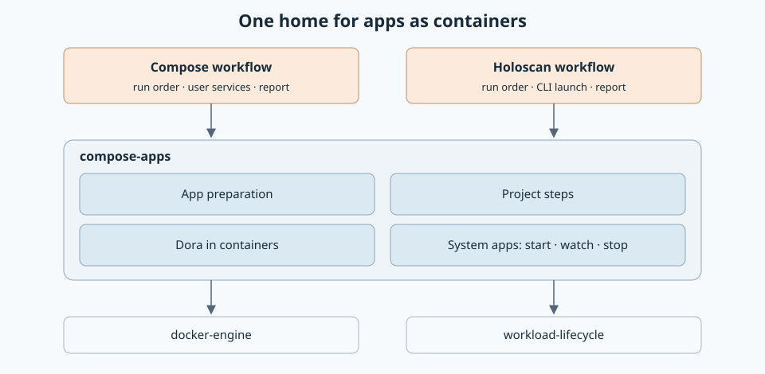

# Apps in Compose containers

Project lifecycle steps, Dora runtime control and preparation of Dora, system and
optional extra app groups. Workflows supply their own run order and finalization.

Services without a `logging` block use Docker's `journald` driver and need a working
systemd journal on the local Docker host. Review and fresh Start preparation
check driver support, the Docker peer's mount namespace and journal connectivity
before mounting folders or creating containers. Explicit logging
stays intact and Review identifies project-managed logs. Capture is best effort
under the host's existing journal rate limits and retention; a noisy container
can cost other containers their output. See the
[run-log design and qualification](../workload-lifecycle/docs/111026-run-logs.md).



```rust,no_run
# async fn example(input: compose_apps::preparation::PrepareInput) -> compose_apps::compose::Result<()> {
use compose_apps::{compose::DockerAdapter, preparation::resolve};
let adapter = DockerAdapter::connect("/var/run/docker.sock").await?;
let resolved = resolve(&adapter, input).await?;
assert!(!resolved.plan.manifest.is_empty());
# Ok(()) }
```

[Architecture](../workload-docker/docs/111126-compose-apps-crate.md) ·
[Compose workflow](../workload-docker) · API: `cargo doc -p compose-apps --no-deps`.
