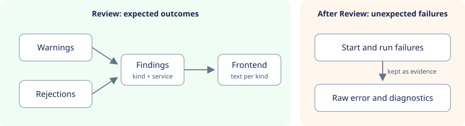
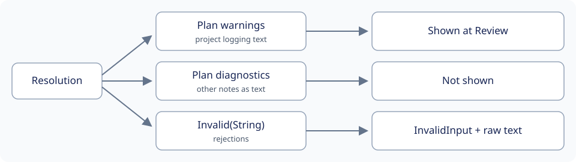

# Review findings

Created November 12, 2026. Status: design agreed; not implemented. The
implementation plan will be added when work starts.

Compose resolution reports two kinds of result to the user at Review: warnings,
where the run can go ahead, and rejections, where it cannot. Both are designed
checks with a known set of cases. Each tells the user what to change in the
project or on the host. They are expected outcomes, so both become **findings**:
a kind and the service or resource it applies to. The frontend owns the text.

Failures after Review are unexpected. They cannot be listed in advance, and a
category gives the user nothing to act on. Console keeps their evidence instead:
the raw error, the diagnostics file and the run's recorded error.

## Today



- Warnings are free text in the frozen plan's `diagnostics`. Console never reads
  them, so Review shows none.
- Rejections are `Error::Invalid(String)`. Console maps them to `InvalidInput`;
  the browser shows a generic message followed by the backend's English text.
  `EmptySelection` is the only rejection with its own kind.

## Findings

One message serves both warnings and rejections:

```proto
message ResolutionFinding {
  enum Kind { KIND_UNSPECIFIED = 0; /* one value per case below */ }
  Kind kind = 1;
  string service = 2;   // empty when the finding is project-wide
  string resource = 3;  // network, volume, path or name, when relevant
}
```

| Result | Carried by | Effect |
| --- | --- | --- |
| Warnings | `repeated ResolutionFinding` in the frozen plan | Review lists them; the run can start |
| Rejection | `Error::Rejected(ResolutionFinding)` | Review fails; resolution still stops at the first one |

The frontend maps each kind to its message in one table shared by warnings and
rejections. New cases add a kind and a message.

### Warning kinds

| Kind | Case |
| --- | --- |
| Host network | The service uses host networking and shares ports. |
| Privileged | The service is privileged; containment is cooperative. |
| Live inputs | Bind or external volume contents are live and survive cleanup. |
| No healthcheck | Readiness is process-level only. |
| Restart overridden | A restart or deploy restart policy was replaced. |
| External resource | An external network or volume is kept and not reset. |
| Project logging | The project configures logging; Console will not collect its logs. |

Compose CLI stderr has no fixed meaning. It stays as detail text beside the findings.

### Rejection kinds

| Kind | Case |
| --- | --- |
| No Compose file | The project names no Compose file. |
| Empty selection | No service is selected. |
| Image not prepared | A service needs a named local image. |
| Anonymous volume | A volume has no retention settings. |
| Image volume | An image-declared volume needs an explicit mount. |
| Zero replicas | Replicas are zero; deselect through profiles. |
| Name occupied | A fixed container name is already in use. |
| Reserved label | The project sets a label Console owns. |
| Unscoped resource | A named network or volume is not declared external. |
| Foreign resource | An existing project resource belongs to another run or controller. |
| No journal | The host lacks the journald driver or a reachable journal. |
| Unresolved environment | Compose could not resolve an environment value. |

## What stays the same

- Engine, I/O, JSON, timeout and output-limit errors inside resolution are
  faults. They keep today's error path, like failures after Review.
- Failures after Review keep their codes (`StaleReview`, `Busy`, `Stopped`,
  `ImageDownload`) and raw detail.
- Policy changes stay in the resolution record.

## Migration

The `warnings` string field from #314 is replaced by `ResolutionFinding`. Its
field number is reserved, and older saved plans read with an empty list. The
free-text `diagnostics` field is removed the same way.

Applicable rules: D-03 (core contracts independent of UI text), D-07 (facts
separate from interpretation), D-08 (saved plans), D-09 (one resolution for
Review and Start).
