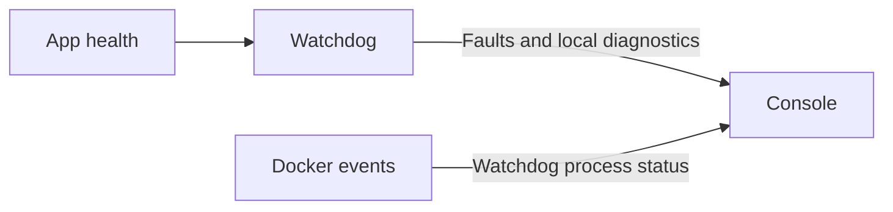
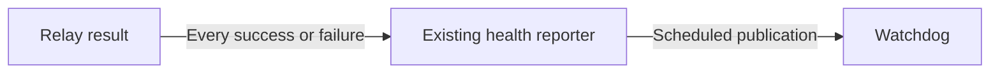
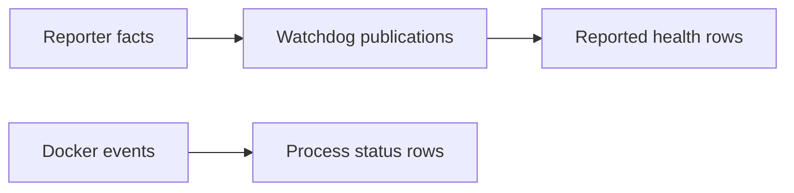
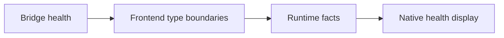

# App health implementation log

Created: 2026-11-15. [Plan](111526-exits-from-docker-events-impl.md).

## Work

| Scope | Agent | Branch | PR |
| --- | --- | --- | --- |
| Plan | Owner | `codex/exec-free-compose-health` | [387](https://github.com/Cutuy/doramcap/pull/387) |
| Milestone 1: remove probes | `pr387_implementation` | `codex/pr387-m1-remove-probes` | [389](https://github.com/Cutuy/doramcap/pull/389) |
| Milestone 2: report health | Same implementation agent | `codex/pr387-m2-bridge-health` | [394](https://github.com/Cutuy/doramcap/pull/394) |
| Protobuf type boundaries | `pr387_runtime_prerequisite` | `codex/pr387-runtime-type-boundaries` | [397](https://github.com/Cutuy/doramcap/pull/397) |
| Live Docker state prerequisite | `pr387_runtime_prerequisite` | `codex/pr387-live-runtime-state` | [391](https://github.com/Cutuy/doramcap/pull/391) |
| Milestone 3: live panel | Same implementation agent | `codex/pr387-m3-live-health-panel` | [399](https://github.com/Cutuy/doramcap/pull/399) |
| Qualification fixtures | `pr387_runtime_prerequisite` | `codex/pr387-demo-qualification-inputs` | [403](https://github.com/Cutuy/doramcap/pull/403) |
| Coordination and review | Root | `codex/pr387-decision-log` | This PR |

Stack: 387 → 389 → 394 → 397 → 391 → 399 → 403 → this coordination PR. Nothing is merged.

## Decisions

### 1. Watchdog self-health — approved

Context: the watchdog already includes its ingress and output diagnostics in fault publications.
Problem: a separate watchdog `health` output would add a feedback path.

- Option: show the watchdog's existing local diagnostics as app health.
- Option: show process/container/service status, keeping diagnostics in the faults view.
- Alternative: add a separate watchdog health output.
- Choice: the owner approved existing behavior or process status, without a new feedback path. The panel uses runtime status; existing diagnostics stay in the faults view.
- Reason: preserves current ownership and avoids a second reporting path.

### 2. Bridge outcomes — owner-directed

Context: the bridge accepts payloads within its existing size limit and skips oversized payloads.
Problem: define health reporting without adding bridge-specific suppression policy.

- Proposed: report relay outcomes with a bridge-specific transition filter.
- Alternative: report initialization only.
- Choice: the owner directed the bridge to always report, without special cases. Each relay outcome uses the existing reporter; its ordinary scheduled drain publishes reports.
- Reason: follows existing reporting semantics and keeps policy out of the bridge.

### 3. Native watchdog display — owner-directed

Context: reporters assign fresh process-incarnation IDs; watchdog publications already contain source connectivity, component labels and condition state.
Problem: a forced join from source incarnations to selected app IDs would require additional attribution metadata or ambiguous label matching.

- Proposed: preserve graph attribution in watchdog publications through another prerequisite.
- Alternative: match existing component labels to app IDs.
- Choice: the owner asked to show what the watchdog received and reported as-is. Show its native source/condition facts alongside Docker process status, preserving source identity without adding attribution metadata.
- Reason: keeps the native fault model and avoids an unnecessary join.

### 4. Buildable stack layers — approved

Context: the runtime observation adds a generated protobuf union. Its public frontend type fix was initially above the runtime PR, leaving that intermediate PR's Node checks failing.
Problem: preserve separate review units while making each layer build independently.

- Recommended: move PR 397 before PR 391 and rebase the dependent branches, then recreate the native stack grouping.
- Alternative: retain the order and its intermediate CI failure.
- Choice: the owner approved repairing the order, preserving all PR numbers and comments.
- Reason: both the type-only layer and runtime layer build; source-tree comparison preserves the validated final implementation.

## Events

- 2026-11-15: inspected plan `33d155fd` against main `9e18b12a` and reused the suggested partial milestone 1 commit.
- 2026-11-15: real Docker evidence established normal stop-before-die ordering; runtime observations retain unknown state until exit evidence arrives.
- 2026-11-15: isolated demo qualification gained its missing shared inputs and waits for output before checking HTTP pages. Fresh acceptance-image builds use an ephemeral host-network selection.
- 2026-11-15: local Rust/Node/MCAP checks, ARM64 worker 721, real Console and Dora/GPU gallery acceptance, and light/dark/narrow Chromium component checks passed.
- 2026-11-15: the approved restack moves frontend type boundaries below runtime facts. Both rewritten layers build, and the final source tree matches the qualified source before documentation bookkeeping. Rewritten heads receive final checks after publication.

## Probe CPU comparison

On 2026-11-15, ARM64 worker job 720 completed three alternating pairs of four idle containers. Each trial warmed up for 2 seconds, then sampled for 10 seconds. The same cached image ran `sleep` in each case; the baseline added `test -s /tmp/app.ready` every 200 ms. The test removed its own containers.

| Mean core CPU | With probes | Without probes |
| --- | ---: | ---: |
| Whole host | 77.5% | 3.4% |
| Container cgroups combined | 27.5% | 0.0% |

The worker has 12 ARM64 vCPUs. Whole-host values use `/proc/stat` deltas in core percent; container values use cgroup `usage_usec`. This isolates probe overhead; it is not an end-to-end measurement of the new health pipeline. Source and raw results remain in worker job directory `/home/doramcap-ci/jobs/pr387-probe-cpu-20261115`.

## Left for the owner

- Review the completed milestone stack before integration.
