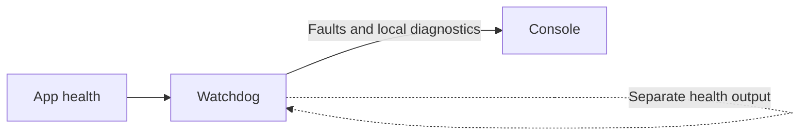

# App health implementation log

Created: 2026-11-15. [Plan](111526-exits-from-docker-events-impl.md).

## Work

| Scope | Agent | Branch | PR |
| --- | --- | --- | --- |
| Plan | Owner | `codex/exec-free-compose-health` | [387](https://github.com/Cutuy/doramcap/pull/387) |
| Milestone 1: remove probes | `pr387_implementation` | `codex/pr387-m1-remove-probes` | Pending |
| Milestone 2: report health | Same implementation agent | Pending | Pending |
| Milestone 3: live panel | Same implementation agent | Pending | Pending |
| Coordination and review | Root | `codex/pr387-decision-log` | This PR |

Each implementation PR targets its preceding prerequisite or milestone. Nothing is merged.

## Decisions

### 1. Watchdog self-health — awaiting owner

Context: the watchdog already includes its ingress and output diagnostics in fault publications.
Problem: the plan calls for every Dora app to publish a `health` output, which would add a self-feedback path for the watchdog.

- Recommended: use the watchdog's existing local diagnostics for its Console row.
- Alternative: add a separate watchdog health output.
- Choice and reason: awaiting the owner; milestone 1 proceeds independently.

## Events

- 2026-11-15: inspected plan head `33d155fdeed06aa439199bbe74f41320f19823f5` against main `9e18b12a6f70a79919f4dfbc6e2811d6ce0a4674`.
- 2026-11-15: assigned milestone 1 to the implementation agent, including review of starting commit `537f5c954972b246a473637414521c9892e5a166`.
- 2026-11-15: identified ready-file consumers in workload tests and demo probes beyond the suggested commit.
- 2026-11-15: traced watchdog publications and Console's existing aggregate fault display; runtime start/exit facts reach final outcomes but need a live transport for the proposed per-app rows.

## Left for the owner

- Resolve watchdog self-health decision 1.
- Review the completed milestone stack before integration.
