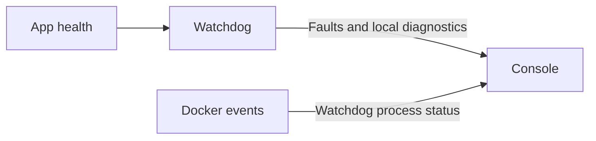
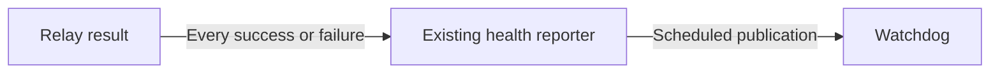
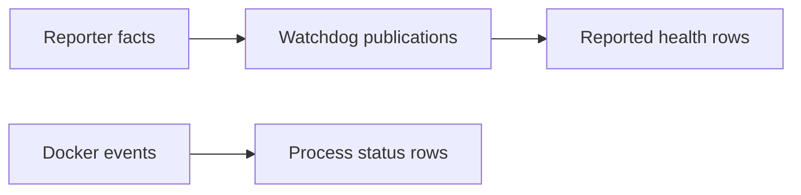

# App health implementation log

Created: 2026-11-15. [Plan](111526-exits-from-docker-events-impl.md).

## Work

| Scope | Agent | Branch | PR |
| --- | --- | --- | --- |
| Plan | Owner | `codex/exec-free-compose-health` | [387](https://github.com/Cutuy/doramcap/pull/387) |
| Milestone 1: remove probes | `pr387_implementation` | `codex/pr387-m1-remove-probes` | [389](https://github.com/Cutuy/doramcap/pull/389) |
| Milestone 2: report health | Same implementation agent | `codex/pr387-m2-bridge-health` | Pending |
| Live Docker state prerequisite | `pr387_runtime_prerequisite` | `codex/pr387-live-runtime-state` | [391](https://github.com/Cutuy/doramcap/pull/391) |
| Milestone 3: live panel | Same implementation agent | Pending | Pending |
| Coordination and review | Root | `codex/pr387-decision-log` | This PR |

Each implementation PR targets its preceding prerequisite or milestone. Nothing is merged.

## Decisions

### 1. Watchdog self-health — approved

Context: the watchdog already includes its ingress and output diagnostics in fault publications.
Problem: a separate watchdog `health` output would add a feedback path.

- Option: show the watchdog's existing local diagnostics as app health.
- Option: show process/container/service status, keeping diagnostics in the faults view.
- Alternative: add a separate watchdog health output.
- Choice: the owner approved existing behavior or process status, without a new feedback path. The panel uses runtime status; existing diagnostics stay in the faults view.
- Reason: preserves current ownership and avoids a second reporting path.

### 2. Bridge outcomes — owner-directed

Context: the bridge accepts payloads within its existing size limit and skips oversized payloads.
Problem: define health reporting without adding bridge-specific suppression policy.

- Proposed: report relay outcomes with a bridge-specific transition filter.
- Alternative: report initialization only.
- Choice: the owner directed the bridge to always report, without special cases. Each relay outcome uses the existing reporter; its ordinary scheduled drain publishes reports.
- Reason: follows existing reporting semantics and keeps policy out of the bridge.

### 3. Native watchdog display — owner-directed

Context: reporters assign fresh process-incarnation IDs; watchdog publications already contain source connectivity, component labels and condition state.
Problem: a forced join from source incarnations to selected app IDs would require additional attribution metadata or ambiguous label matching.

- Proposed: preserve graph attribution in watchdog publications through another prerequisite.
- Alternative: match existing component labels to app IDs.
- Choice: the owner asked to show what the watchdog received and reported as-is. Show its native source/condition facts alongside Docker process status, preserving source identity without adding attribution metadata.
- Reason: keeps the native fault model and avoids an unnecessary join.

## Events

- 2026-11-15: inspected plan head `33d155fdeed06aa439199bbe74f41320f19823f5` against main `9e18b12a6f70a79919f4dfbc6e2811d6ce0a4674`.
- 2026-11-15: assigned the live Docker-state prerequisite to a second agent, to stack between milestones 2 and 3; draft PR 391 is published.
- 2026-11-15: milestone 1 PR 389 ready at `341234aabffc9047d43c31bd091bf6138e9a668e`; implementation agent released its clean lease after focused validation.
- 2026-11-15: assigned milestone 1 to the implementation agent, including review of starting commit `537f5c954972b246a473637414521c9892e5a166`.
- 2026-11-15: identified ready-file consumers in workload tests and demo probes beyond the suggested commit.
- 2026-11-15: traced watchdog publications and Console's existing aggregate fault display; runtime start/exit facts reach final outcomes but need a live transport for the proposed per-app rows.

## Probe CPU comparison

On 2026-11-15, ARM64 worker job 720 completed three alternating pairs of four idle containers. Each trial warmed up for 2 seconds, then sampled for 10 seconds. The same cached image ran `sleep` in each case; the baseline added `test -s /tmp/app.ready` every 200 ms. The test removed its own containers.

| Mean core CPU | With probes | Without probes |
| --- | ---: | ---: |
| Whole host | 77.5% | 3.4% |
| Container cgroups combined | 27.5% | 0.0% |

The worker has 12 ARM64 vCPUs. Whole-host values use `/proc/stat` deltas in core percent; container values use cgroup `usage_usec`. This isolates probe overhead; it is not an end-to-end measurement of the new health pipeline. Source and raw results remain in worker job directory `/home/doramcap-ci/jobs/pr387-probe-cpu-20261115`.

## Left for the owner

- Review the completed milestone stack before integration.
