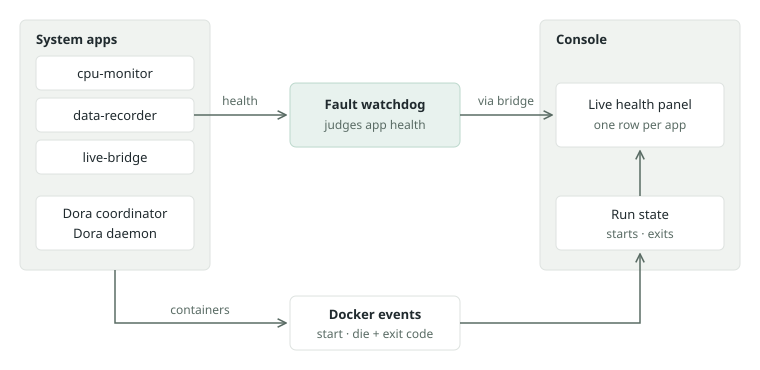

# App health without probes

Created: 2026-11-15. [Implementation](111526-exits-from-docker-events-impl.md).

Our Compose apps used a Docker healthcheck, `test -s <app>.ready`, every 200 ms for the
whole run. Each probe is a `docker exec`, which starts processes through containerd and
runc inside the app's cgroup. On a 2-vCPU ARM64 host, four idle containers with that
probe used 74% of 200% CPU; Top CPU consumers showed the probes as the apps' own load.

## Goal

Monitoring uses event streams only: no subprocess probes and no marker files.

| Question | Source |
|---|---|
| Did an app start, crash or exit? | Docker events: start, `die` with exit code |
| Is a running app healthy? | The app reports to the fault watchdog; the watchdog decides |
| What does the user see? | A live health panel per app in Console |

## Behavior

- Our apps and demos ship no healthcheck and no ready file. A running container counts as started.
- CPU monitor, data recorder and live bridge publish `health` outputs. The watchdog
  tracks their connections, conditions and freshness; its own row uses container state.
- The Dora coordinator and daemon are not Dora nodes and cannot report to the watchdog.
  Their rows, and the watchdog's, show running or exited from Docker events.
- Console shows one live health row per system app, Dora included, next to Top CPU consumers.
- Healthchecks a customer writes in their own Compose files keep their native meaning.
- systemd and supervisord apps are unchanged; they never used probes.

## Tradeoffs

- Console no longer waits for an app's own initialization before starting dependents.
  Dora apps attach through the daemon, so start order between them does not affect delivery.
- App health needs the watchdog and live bridge selected; without them, Console still reports exits.
- A Dora daemon that loses its coordinator while still running is not shown; that needs
  its own event source.
