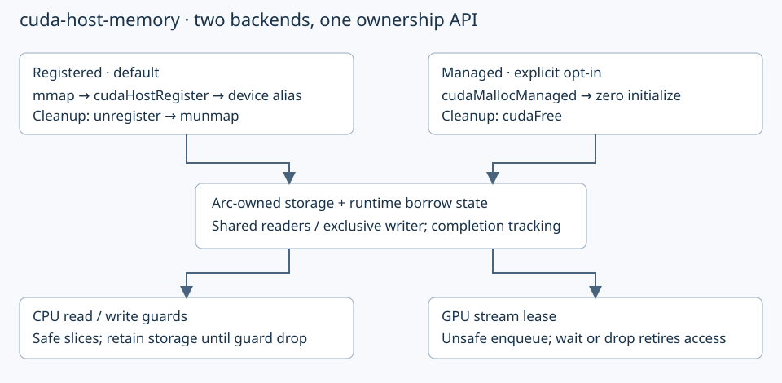

# cuda-host-memory

CPU/GPU-accessible storage with runtime borrow checking.

- Default: `mmap → cudaHostRegister → cudaHostGetDevicePointer`.
- Opt-in: `cudaMallocManaged`, with the same CPU guards and stream leases.

```rust,ignore
let memory = HostMappedMemory::new_with_mode(context, bytes, AllocationMode::Managed)?;
```

Managed mode requires CUDA managed-memory and `concurrentManagedAccess` support;
otherwise construction returns `ManagedMemoryUnsupported`. Pages may migrate.



```sh
cargo run -p cuda-host-memory --example non_default_stream
cargo run -p cuda-host-memory --example concurrent_read
cargo run -p cuda-host-memory --example concurrent_read -- --managed
cargo test -p cuda-host-memory --all-targets
cargo test -p cuda-host-memory --test ownership -- --ignored --test-threads=1
cargo test -p cuda-host-memory --test completion_failure -- --ignored --exact completion_failure_quarantines_all_access
cargo test -p cuda-host-memory --doc
```

- Demo: CPU initializes 1 MiB; two kernels update it on an explicit nonblocking
  stream; CPU verifies every byte after stream synchronization. No explicit payload copy.
- Concurrent demo: GPU signals progress while CPU reads the same bytes; writer
  attempts return `Busy`. Toolkit headers are required (`CUDA_HOME`, default
  `/usr/local/cuda`).
- Requires a CUDA-capable GPU, driver, CUDA runtime and NVRTC shared libraries.
  Bindings target CUDA 12.9; libraries load at runtime. If needed, set
  `LD_LIBRARY_PATH=/usr/local/cuda/lib64:$LD_LIBRARY_PATH`.
- `read()` / `write()` return safe CPU guards. `gpu(stream, Access)` reserves
  GPU access before enqueueing. Conflicting leases return `Busy`.
- Guards own the mapping. GPU leases wait on explicit `wait()` or drop,
  including unwind; completion failure quarantines storage. Drop can block.
- Only `GpuLease::enqueue` is unsafe: arbitrary kernels must obey bounds,
  declared access mode and the supplied stream. No public raw-pointer accessor.
- Both allocation modes are zero-initialized. Managed cleanup uses `cudaFree`;
  registered cleanup unregisters and unmaps.
- Whole-buffer reservations apply within one process; IPC and asynchronous
  retirement remain future work.
- APIs and safety contracts: [Rust documentation](src/lib.rs).
- [Coverage and validation](docs/102026-host-mapped-memory.md#coverage-review--2026-10-21),
  [saved architecture discussions](docs/design-history/README.md).
