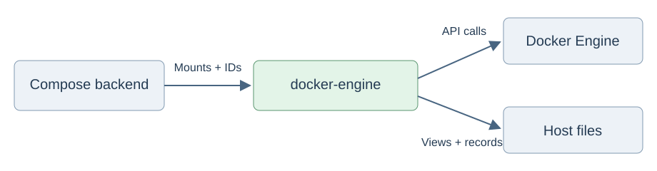

# Docker Engine operations

Share Docker connections, cleanup of owned resources and automatic filesystem capture across workload backends.



```rust,ignore
let engine = docker_engine::Engine::connect("/var/run/docker.sock").await?;
let owned = engine.resources(controller_label, reservation_name);
let stopped = owned.quiesce(stop_seconds).await?;
```

Backends resolve mounts, verify container ownership and choose the container removed last.
Filesystem operations retain the existing recording schema and require stopped writers for finalization.

See the [API](src/lib.rs), [filesystem capture](src/filesystem.rs) and [view preparation](src/overlay.rs).
Build the mounted-filesystem tests with `cargo test --profile ci --locked -p docker-engine --test overlay --no-run`, then run the produced test executable with mount capabilities.
