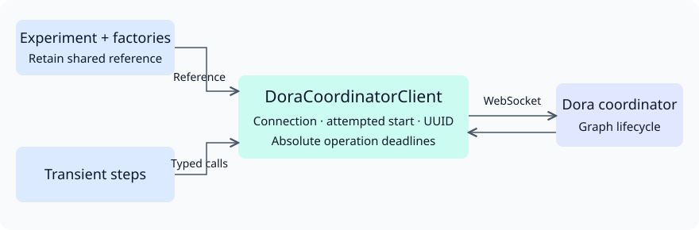

# Dora coordinator client

Created: 2026-11-09.

[PR #210](https://github.com/Cutuy/doramcap/pull/210) approves a dedicated client
crate, reused per-experiment connection, typed factory injection and existing
startup/stop budgets. The client retains graph-start intent and UUID through
cancellation; a cancelled request discards its socket. Native process ownership
and evidence finalization stay with the backend.

Dora's typed JSON messages travel over WebSocket. Requests are serialized and
bounded by caller-supplied absolute deadlines. Hello checks compatibility on each
new connection. A later operation may reconnect; uncertain mutations are never
replayed. Cleanup reconciles an unknown UUID through the exact experiment name,
stops the owned graph, then requests coordinator destruction.

The startup daemon-registration query uses the approved 100 ms sampling exception.
[Its replacement TODO and implementation milestones](110926-coordinator-client-impl.md)
track event-driven readiness and the separate Compose/systemd adoption PRs.
The standalone library is qualified independently in PR #251.
