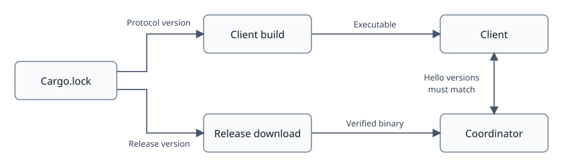

# Matched Dora runtime versions

Created: 2026-11-10. [Implementation](111026-matched-runtime-versions-impl.md).

Cargo permits Dora 1.x upgrades. The committed lockfile records each build's exact
dependencies. The client's resolved `dora-message` version selects the released
runtime; packaging verifies the official archive digest and executable version.
The same artifact must pass native client qualification before image publication.

Every WebSocket connection exchanges Hello before control traffic. The coordinator
must report exactly the protocol version compiled into the client, including after
reconnect. A mismatch closes the connection and reports both versions. Existing
native cleanup and graph-identity rules continue to apply.

The lockfile owns the selected version. Release tooling owns binary selection and
verification; the client owns the runtime check. Missing releases, architectures
or digests fail packaging. There is no version override or mixed-version fallback.

This establishes reported protocol-version equality. Native tests exercise the
control/session behavior of the selected artifact; they do not establish schema
identity for differently modified binaries that report the same version.
