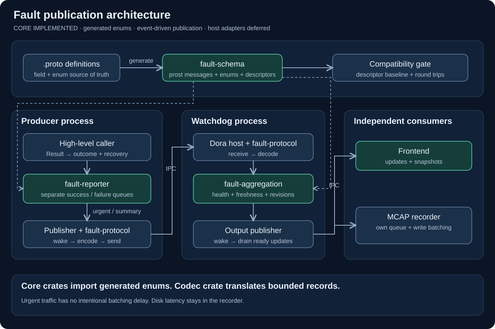
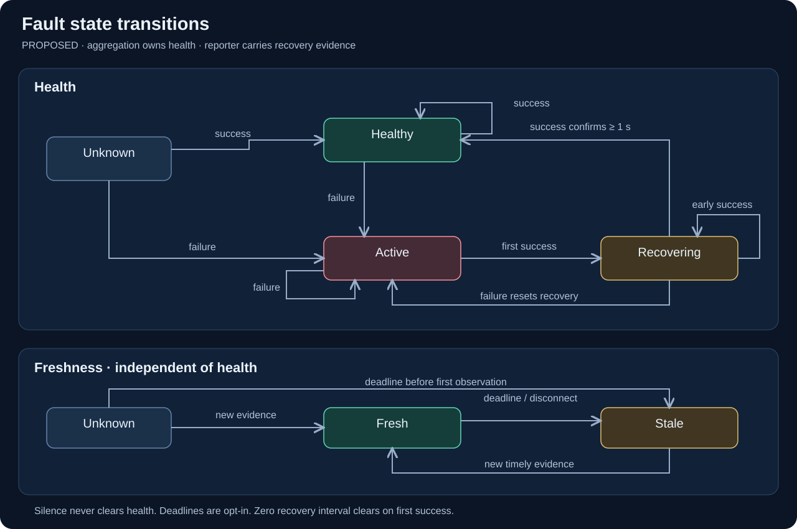
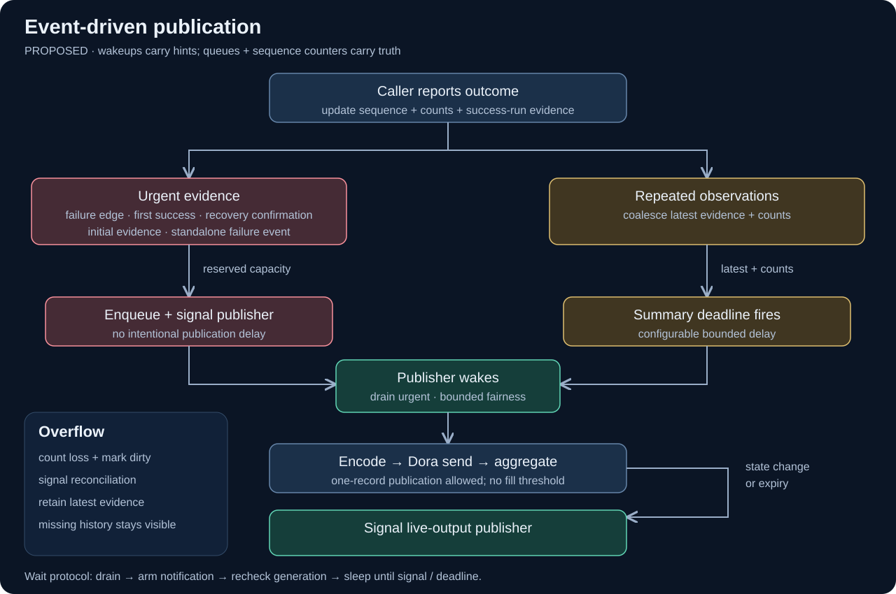

# Event-driven fault publication

Created 2026-10-20. **Core implemented.** This design provides prompt notification, transition-aware scheduling and generated-enum ownership to the existing fault crates.

## Milestones

- [x] Extract `fault-schema`: `.proto` files, generated enums/messages and descriptors; no core-crate dependencies.
- [x] Reuse generated enums in reporter/aggregation; reject unspecified/unknown wire values at boundaries.
- [x] Retain bounded internal records; keep checked field translation in `fault-protocol`.
- [x] Add publisher notification with a generation counter and lost-wakeup-safe waiting.
- [x] Reserve urgent capacity independently in success and failure queues.
- [x] Classify urgent evidence and coalesce repetitions with configurable deadlines.
- [x] Wake output publication on health/freshness changes; keep recorder write batching independent.
- [x] Add a versioned descriptor baseline and compatibility checks.

## Validation

- [x] Exercise report/wait races; no pending work may sleep through a notification.
- [x] Measure capture-to-encoded-publication and aggregation-to-encoded-output latency under idle, burst and sustained load.
- [x] Verify success floods cannot consume failure capacity and failure floods cannot starve recovery.
- [x] Verify recovery confirmation bypasses success limiting and wakes the publisher.
- [x] Verify overflow counters, dirty-state reconciliation and explicit historical gaps.
- [x] Test all health/freshness transitions, deadline expiry and event-only failures.
- [x] Reject enum renumbering, field reuse, incompatible type changes and unreserved deletions.
- [x] Complete ARM64 CI job 91; local conversion tests and strict Clippy passed.

## State transitions

Aggregation remains authoritative for health. Reporter urgency derives from observation evidence; it does not maintain a second authoritative health machine. Share the recovery-evidence predicate between classification and aggregation.

- First failure activates immediately. Repeated failures update counts.
- First success after failure starts recovery. A later success spanning one second confirms recovery by default.
- Failure resets recovery evidence. Early successes keep recovery pending; silence never clears health.
- A deadline gap resets an incomplete success run. Evidence of a previously confirmed recovery survives snapshots.
- Deadlines are disabled by default. Enabled deadline expiry or disconnect marks evidence stale while retaining health.
- New timely evidence restores freshness. Initial evidence is unknown; an enabled deadline can expire before the first observation.
- Event-only failures generate urgent records without creating a latched condition.

## Event-driven workflow

| Evidence | Scheduling |
|---|---|
| Initial observation | Urgent |
| First failure / failure interrupting recovery | Urgent |
| First success after failure | Urgent |
| Success confirming recovery | Urgent; bypass success limiter |
| Standalone failure event | Urgent |
| Repeated success with unchanged state evidence | Optional coalescing; bounded summary deadline |
| Repeated failure | Separate bounded repeat lane; wake immediately |
| Queue overflow | Increment loss; mark reconciliation pending; signal |
| Aggregated transition or freshness change | Signal output publisher immediately |

Each success/failure queue has reserved urgent capacity and separate bounded summary state. A finite failure-service quota gives waiting recovery evidence a turn. Success repetition coalescing is configurable; failure repetitions remain unthrottled in their bounded repeat lane. Diagnostics remain in cumulative evidence and published summaries.

Notifications are wake hints. Queues, dirty state and generation counters determine pending work. The publisher drains, arms its notification, rechecks generation/pending work and only then waits for a signal or the nearest deadline. A bounded Crossbeam channel carries wake hints; an atomic generation detects drain/wait races. `Publisher::wait` handles ready work, dirty state, close and the nearest summary deadline.

Urgent publication has no intentional batch-fill delay. One record is a valid Protobuf publication; already-ready records may share the send. Full urgent capacity exposes loss and requests a snapshot; a snapshot restores current evidence and cannot reconstruct every transient event.

The host owns transport and schedules draining in its existing event loop. `Publisher` is a drain handle; a dedicated thread is unnecessary. The frontend path proceeds independently of MCAP buffering/flush. Storage failure reporting follows the existing recursion-suppression policy. Saturation and transport outage prevent a universal latency guarantee; measure latency and expose queue/drop counters before selecting deployment budgets.

## Schema consistency

`fault-schema` owns generated enums/messages and descriptor artifacts. Reporter and aggregation depend on it for enum types; `fault-protocol` depends on schema plus both cores for record translation. This dependency direction avoids a cycle.

Generated Protobuf enum fields arrive as numeric values; conversion validates them before creating core records. Bounded text, IDs and time representations stay internal. Descriptor compatibility tests check field numbers/types/cardinality, oneof membership, enum numbers and reservations. Round-trip tests cover representation differences.

## Evidence

2026-10-20: current polling APIs, duplicate internal/proto enums and existing conversion tests informed this design. SVG syntax and local links passed validation; all three diagrams were rendered and visually inspected. That initial review preceded implementation; measurements below cover the implemented core.

## Implementation evidence

2026-10-20: 46 focused tests passed across the four crates. Coverage includes 1,000 report/wait races, idle summary flush, urgent/repeat isolation, finite failure priority, recovery confirmation, dirty snapshot requests, generated-enum rejection and descriptor mutation tests. The scoped capture test observed zero allocations for 30,000 calls including overflow. Strict all-target/all-feature Clippy and formatting passed.

Dependencies: user approved `crossbeam-channel`; lockfile resolves 0.5.17. `fault-schema` reuses the existing Prost/vendored-protoc toolchain. The v1 descriptor baseline preserves the prior wire contract.

| Local release measurement | Idle | Burst overload | Sustained |
|---|---:|---:|---:|
| Capture → encoded reporter, p99 | 20.0 µs | 2.57 ms | 89.3 µs |
| Aggregation ingest → encoded output, p99 per ready batch | 19.2 µs | 263 µs | 22.8 µs |
| Admitted / attempted | 1,000 / 1,000 | 768 / 10,000 | 2,000 / 2,000 |

Reproduce: `cargo run --locked --release -p fault-protocol --example latency`. One producer/worker; 64 urgent slots per outcome; idle waits for each publication, sustained inputs are spaced 100 µs, burst has no pacing. Timings exclude IPC, MCAP and viewer delivery; they describe this x86_64 smoke run, not deployment guarantees. The overload case reported 9,232 dropped observations and requested snapshot reconciliation.

Capture-only benchmark: p99 102 ns drained, 82 ns burst, 67 ns overload, 58 ns success-limited. Default four-lane payload storage: 376,832 bytes, plus queue/condition metadata. Historical transient losses remain explicit even after state reconciliation.

## Host integration TODOs

- [ ] Add Dora ingress/egress, acknowledgments/retry bounds and reconnect snapshots.
- [ ] Run live output independently of recorder buffering; enforce sink-specific backpressure.
- [ ] Measure IPC-to-viewer and IPC-to-MCAP latency in the demo apps.

These host tasks remain outside the approved core-crate scope. `Notification` supports one logical waiting consumer. Aggregator hosts capture a generation before draining, schedule `advance(next_deadline)`, and release their own lock before waiting. Keep a returned reconciliation snapshot until publication succeeds. Output revisions remain ordered; oldest-drop overflow increments statistics and requests a current snapshot.

ARM64 CI job **91** succeeded on 2026-10-20. Snapshot: `/home/doramcap-ci/jobs/b7a347a6871f4eacac981efdbb50c1d8`. Workspace default/all-feature tests, native validation and the worker’s existing Dora recording checks passed. This includes the tightened wakeup regression and uniquely named reporter benchmark. Runtime and test sources are unchanged since submission; only documentation evidence was updated afterward. Updated SVGs were rendered and visually checked; local documentation links and SVG XML passed validation.
