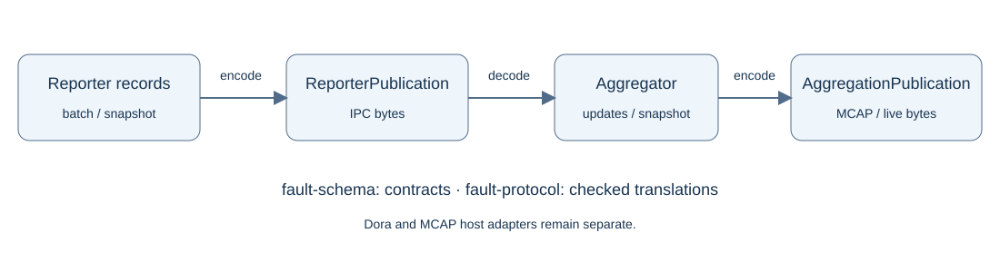

# Fault publication contract

Created 2026-10-20. Package `doramcap.fault.v1`, envelope version `1`. `fault-schema` owns schemas and generated bindings. Core crates reuse its enums; `fault-protocol` translates bounded records.

## Milestones

- [x] Define common identities, policies, observation evidence and counters.
- [x] Define reporter IPC batches and registration/reconciliation snapshots.
- [x] Define aggregation update batches and full consumer snapshots.
- [x] Implement bidirectional record conversion and versioned byte codecs.
- [x] Export descriptor sets and root names for MCAP schema registration.
- [ ] Integrate Dora publication/subscription and MCAP host adapters (separate work).

## Validation

- [x] Round-trip reporter publications through decoding into aggregation.
- [x] Round-trip stored aggregation updates and snapshots without field loss.
- [x] Reject invalid enums, IDs, presence, timestamps, counts and revisions.
- [x] Verify disabled options, explicit zero, Unicode, counter limits and duration overflow.
- [x] Verify frame/record limits, unsupported versions and additive unknown fields.
- [x] Decode fixture publications with official `protoc` using only the exported descriptor set.
- [x] Verify ARM64 CI result and record evidence.

## Reporter IPC

| Message | Content |
|---|---|
| `ReporterPublication` | Version, optional publication wall time, one batch or snapshot |
| `ReporterBatch` | Source instance, source-local emission time, observations, cumulative losses |
| `ReporterSnapshot` | Source instance, emission time, definitions and optional latest evidence, losses |
| `Observation` | Key, sequence, outcome, cumulative counts, failure times, success-run evidence, diagnostic, trace context |

Publish an initial snapshot before batches so the receiver knows condition definitions. Reconnect and periodic snapshots restore current evidence after loss. Queue reordering and duplicate transport delivery remain aggregation concerns. Absence from a snapshot never clears a condition.

## Aggregation output

| Message | Content |
|---|---|
| `AggregationPublication` | Version, optional publication wall time, aggregator-local emission time, updates or snapshot |
| `UpdateBatch` | Aggregator epoch, revision-ordered updates, cumulative aggregation statistics |
| `Update` | Epoch/revision, kind, source connectivity/losses, optional condition state and triggering observation |
| `AggregationSnapshot` | Epoch, revision watermark, statistics, sources and current condition states |

Updates include registration, observation, transition, reconciliation, late history, event-only failures, freshness, source lifecycle and retirement. Late observations are preserved separately from current state. Revision gaps and changed epochs tell consumers to resnapshot. Empty update batches and empty initial snapshots are valid.

Use the same aggregation envelope for live publication and MCAP persistence. Store snapshots periodically to bound replay work. The host chooses channels, record batching, recording rotation and durability policy.

## Encoding rules

- One Protobuf message per IPC payload or MCAP message, without a length prefix.
- Source/epoch IDs: exactly 16 bytes, unsigned big-endian, nonzero. Condition ID zero is valid.
- Trace/span IDs: exactly 16/8 bytes when trace context is present.
- Text: at most 192 UTF-8 bytes per field; component and code are nonempty.
- Enum zero is unspecified and rejected. Legitimate unknown health/freshness have explicit nonzero values.
- Nested messages are required unless schema comments mark them optional. For `Update`, source-wide records omit key/state/observation; condition records include key/state.
- Optional scalar presence distinguishes absent from zero. `recovery_ns` must be present: zero disables hysteresis. Absent deadline/success interval disables that option; present zero is invalid.
- Durations and monotonic offsets are unsigned nanoseconds. Conversion rejects Rust durations exceeding `u64` nanoseconds instead of truncating.
- `published_unix_ns` is optional host-supplied metadata. Source/aggregator monotonic offsets have distinct epochs; they are not globally comparable timestamps. Exact cross-source event-time correlation needs a host clock-mapping policy.
- Snapshot condition states preserve their revisions; updates preserve late evidence and loss counters. Snapshots omit internal deduplication/expiry bookkeeping and are not full runtime checkpoints.

## Limits and evolution

The byte codecs default to an 8-MiB frame limit and 32,768 records. Frame size is checked before Protobuf decoding; cardinality is checked before translation into core records. A snapshot counts sources plus conditions against the aggregation limit. Configure tighter limits for the deployment.

Prost decoding allocates temporary message trees; the frame cap is not an exact heap-allocation budget. The core reporter's allocation guarantees apply before serialization. Direct `Wire` conversion assumes caller-controlled collection sizes; use publication codecs at transport boundaries.

Keep field numbers stable; reserve removed names/numbers. Additive unknown fields are ignored. Unknown enum values, unknown envelope versions and unsupported payload alternatives fail explicitly. Encoding a decoded record does not preserve unknown fields; raw archival relays should retain original bytes.

## Evidence

2026-10-20: `prost`, `prost-build` and vendored protoc reuse existing workspace dependencies; `Cargo.lock` resolves prost 0.14.4. Ten protocol tests and the 26 core tests passed under all features. Strict all-target/all-feature Clippy passed. The fixture example generated reporter snapshot/batch and aggregation update publications; official protoc decoded all three using `fault_descriptor.bin`.

ARM64 CI job **89** succeeded on 2026-10-20. Snapshot: `/home/doramcap-ci/jobs/338a80545338400ea9feaab95a8fd1c7`. Workspace default/all-feature tests and native validation passed, including the new protocol tests. No runtime sources changed after submission.
