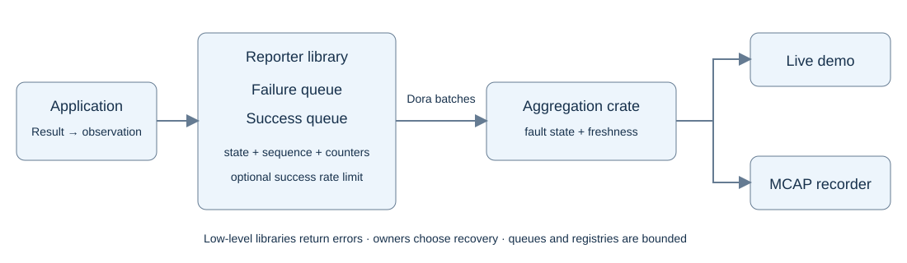
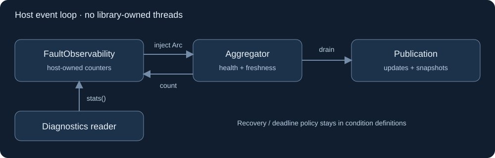

# Fault aggregation crate

Created 2026-10-20. Implementation: `libs/fault/aggregation`. A deterministic library hosted by `apps/fault-watchdog`; Dora, sockets and MCAP remain app/adapter responsibilities.

## Milestones

- [x] Agree on shared schema and condition/source identity contracts.
- [x] Implement ingest, duplicate rejection and bounded reordering policy.
- [x] Implement fault state, repetition counts and freshness independently.
- [x] Implement source snapshots, restart reconciliation and output revisions.
- [x] Implement bounded registries, retention and overload summaries.
- [x] Expose transitions, summaries and snapshots for independent consumers.

## Validation

- [x] Exercise failure → repeated failure → success, duplicate success and event-only errors.
- [x] Reorder success/failure queues; verify older observations never overwrite newer state.
- [x] Deliver success before an older failure; preserve historical failure visibility without reactivating it.
- [ ] Test missed deadlines, delayed packets, clock skew and stale-to-fresh recovery.
- [x] Test reconnect snapshots, duplicate retries and new source instances.
- [x] Restart the aggregator and rebuild state from producer snapshots.
- [x] Exhaust source/condition/history bounds and verify explicit overload accounting.
- [ ] Verify independent frontend/recorder backpressure and snapshot reconciliation in app integration.

## State model

Keep condition state and evidence freshness separate.

| Input | State effect |
|---|---|
| First failure | Active; emit raised transition |
| Repeated failure | Active; accumulate count and latest evidence |
| First success after failure | Recovering; keep fault active |
| Success after recovery interval | Healthy; emit cleared transition |
| Repeated success | Healthy; refresh evidence and counts |
| Deadline / source disconnect | Evidence stale; retain last known condition state |
| Standalone failure event | Append event; no latched condition |

Initial condition state is unknown until evidence arrives. A deadline miss is represented as staleness; policy may additionally raise a distinct monitoring fault. Never clear existing faults because a source disappears.

## Ordering and history

- Compare per-condition sequences within a source instance. Duplicate IDs have no repeated state effect.
- Independent queues can reorder records. Older records cannot regress current state, but late failure occurrences must remain available as historical evidence.
- Specify a bounded deduplication/reordering window. Outside it, label late records and uncertainty rather than claiming exact counts.
- Use producer cumulative counters/watermarks to reconcile repetition summaries without double counting.
- Snapshot reconciliation changes current state without inventing missing historical transitions. Emit an explicit reconciliation record when history is incomplete.
- Use a new aggregator epoch after restart and monotonic output revisions within that epoch. Viewers resnapshot on an epoch change or revision gap.

## Freshness and clocks

Use injected monotonic time for expiry tests. Track source connectivity separately from condition observation age. Repeated publication of an unchanged snapshot must not refresh the original observation time.

Define a wire age representation, such as observation age at batch emission, and include an explicit transport-delay allowance. Cross-host wall-clock timestamps support display/correlation; freshness requires a documented delay/skew policy. Delayed evidence must not silently certify current health.

## Bounds and outputs

Configure maximum sources, conditions per source, diagnostic sizes, deduplication window and history retention. Prefer explicit admission rejection over silent eviction of active faults. Publish capacity/loss indicators.

The library accepts observations/snapshots and time advancement, then returns bounded output records. No library-owned I/O or hidden runtime. The hosting app supplies scheduling and independent bounded output queues:

- Frontend: snapshot followed by revisioned updates; resnapshot after gaps.
- Recorder: transitions, historical events, repetition/loss summaries and reconciliation records.
- Optional OTel adapter: structured logs/events with trace correlation.

Recorder health returns through normal reporting. Suppress recursive reports caused by writing recorder-failure records to the same failed sink; retain counters and local fallback. External supervision covers failures of the watchdog/Dora itself.

## Evidence

2026-10-20: specification drafted; no runtime claims validated.

## Implemented scope and evidence

2026-10-20: Crossbeam approved by the user; `crossbeam-queue = "0.3.12"` resolves to existing lockfile version 0.3.14. Shared records are Rust types owned by `fault-reporter`. Transport/schema adapters, demo apps and MCAP integration are deferred by agreement.

Defaults: deadlines disabled, success limiting disabled, recovery interval one second. First failure activates immediately; recovery requires a later success observation spanning the interval. Timers never clear faults. Per-condition evidence includes counts, first/last failure times and longest success span since the latest failure.

Local validation: `cargo test -p fault-reporter -p fault-aggregation --locked` passed 26 tests, including concurrent producers, all permutations of a four-observation sequence, dropped failures, idle coalescing, stale evidence, restart reconciliation and output bounds. Scoped allocation test observed zero allocations across 30,000 report calls including queue overflow. Strict all-target/all-feature Clippy passed.

Transport deadlines/retries remain host responsibilities. `tick`, `batch`, `snapshot`, `close` and `final_snapshot` provide the core handoff; no hidden worker or unbounded transport retry exists. Producer callbacks use short per-condition mutexes and can wait for concurrent callers/snapshots.

Output retention is a bounded oldest-drop queue with revision gaps and cumulative loss stats. The host fans out to independent consumers. Retired sources emit a `Retired` update; stale/active conditions are never evicted automatically. Definition changes require a new source instance.

ARM64 CI job **88** succeeded on 2026-10-20. Snapshot: `/home/doramcap-ci/jobs/5a6e4601ccb2492dbb129969463b355a`. It exercised the implemented core with 25 new tests, workspace default/all-feature tests and native validation. The subsequent independent-source restart regression passed locally (26 total), as did the runnable lifecycle example, final formatting and strict Clippy. Runtime source was unchanged after submission.

2026-10-20 follow-up: [fault-protocol](../../protocol/README.md) now provides the requested Protobuf definitions and checked bidirectional translation. Dora transport and storage host adapters remain deferred.

## Event-driven follow-up

- [x] Import generated health/freshness/update enums and share the recovery predicate.
- [x] Signal ready output; expose `next_deadline` for idle freshness expiry.
- [x] Request full output reconciliation after bounded history overflow.

Evidence: [event-driven implementation and measurements](../../protocol/docs/102026-event-driven-faults.md). The host keeps live publication independent of recorder buffering.

## Injected observability

- [x] Move counters and diagnostic reads into host-owned `FaultObservability`.
- [x] Require `Arc<FaultObservability>` in `Aggregator::new`; remove `Aggregator::stats`.
- [x] Preserve domain output APIs and wire snapshot metadata.
- [x] Update examples for host-owned diagnostics and event-loop draining.
- [x] Verify counter isolation, retained diagnostics and stored metadata; run ARM64 CI.

The host supplies a fresh observability instance per aggregator epoch. Domain policy remains in condition definitions. Standard-library atomics support the existing counters; no dependency is added. `Publisher` is a drain handle with optional blocking convenience, and creates no thread.

2026-10-20 evidence: 47 focused tests passed, including injected-instance isolation, retained diagnostics after aggregator drop and stable snapshot metadata. Strict all-target/all-feature Clippy, formatting, documentation links and SVG validation passed; the new diagram was rendered and visually checked. ARM64 CI job **92** succeeded for snapshot `/home/doramcap-ci/jobs/0ecc4726e37d425488ec51be5554ce0b`, including workspace default/all-feature tests and native validation. Only documentation evidence changed after submission.

## API documentation

- [x] Reduce README to purpose, architecture SVG, minimal example and reference links.
- [x] Put behavior, parameters, returns/errors, ownership and scheduling contracts in Rust doc comments.

2026-10-20 evidence: strict rustdoc (`RUSTDOCFLAGS="-D warnings" cargo doc --locked --no-deps -p fault-reporter -p fault-aggregation`), both runnable crate examples, formatting and local documentation links passed. This follow-up changes documentation only.
