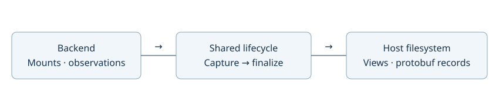

# Host filesystem capture

Share Linux directory views, metadata records and write-back/discard across workload backends.



```rust,ignore
let plan = host_filesystem::overlay::resolve(input).await?;
// Validate backend mount options before preparing views.
let views = host_filesystem::overlay::prepare(plan).await?;
```

Stop every writer and save the file report before finalizing views. Failed finalization retains upper data for recovery; reset discards it without replay.

See [view APIs](src/overlay.rs), [metadata APIs](src/filesystem.rs) and the [shared lifecycle](../workload-lifecycle/src/capture.rs). Preparation walks no host folders. Collection retains one upper and its deleted lower paths in memory; direct output traversal and protobuf records stream without capture limits. Unix filenames and symlink targets retain their bytes.

Build native tests unprivileged with `cargo test --release --locked -p host-filesystem --test overlay --no-run`, then elevate only the produced executable. Tests require Linux mount capabilities and rsync.
