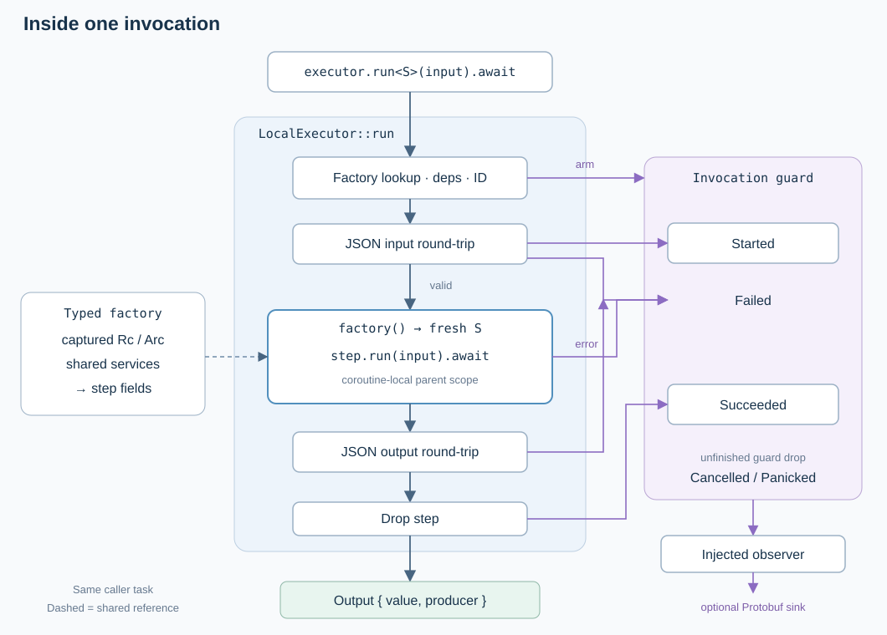

# Orchestrator

Observable async Rust steps for procedural workflows. Factories create fresh step
instances with typed injected services. Inputs and outputs always round-trip through JSON.



```rust
use orchestrator::{LocalExecutor, Result, Step};
use std::rc::Rc;

struct Add { increment: Rc<u32> }
impl Step for Add {
    type Input = u32;
    type Output = u32;
    async fn run(&mut self, input: u32) -> Result<u32> {
        Ok(input + *self.increment)
    }
}

# async fn example() -> Result<()> {
let increment = Rc::new(10);
let mut executor = LocalExecutor::default();
executor.register::<Add>(move || Add { increment: increment.clone() });
let first = executor.run::<Add>(2).await?;
let second = executor.run::<Add>(first).await?;
assert_eq!(*second.value(), 22);
# Ok(())
# }
```

Run the simulated cleanup example: `cargo run -p orchestrator --example experiment`.
Use a current-thread Tokio runtime. External Python/Node steps use the JSON stdio
adapter in `orchestrator::process`; they require their interpreter on the host.

[Design and validation](docs/102626-function-steps.md) ·
[Experiment lifecycle](../workload-lifecycle/docs/102626-experiment-workflow.svg) ·
[Input lifetime](docs/102926-refactor-engineer.svg).
API contracts live in Rust documentation (`cargo doc -p orchestrator --no-deps`).

Historical real-Docker validation and evidence are documented in
[milestones and findings](docs/102626-docker-monitor-e2e.md).

For live workflow telemetry, pass `telemetry::TelemetryObserver` to
`LocalExecutor::new`. Its nonblocking sink receives Protobuf events from
`workflow_protocol`; clones expose delivery-loss counters.
[Orchestrator lab](../../apps/orchestrator-demo/) visualizes real Docker experiments.
