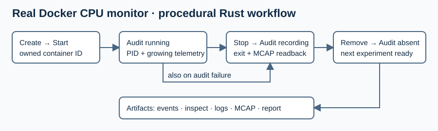

# Docker CPU monitor end-to-end validation

Created: 2026-10-26. Scope: run the existing native `system-monitor` through
procedural Rust steps against a real local Docker daemon.

## Milestones and validation

- [x] Package the locally built BPF monitor and runtime libraries in a Docker image.
  Evidence: successful native build and local scratch-image run on 2026-10-26;
  [image identity and results](102626-docker-monitor-results.json).
- [x] Implement create/start, running/readiness audit, stop, recording audit and removal.
  Evidence: retained `events.jsonl`, Docker inspections and process listings for
  all three attempts. The original fixture has since been retired.
- [x] Validate two sequential successful experiments and an injected audit failure.
  Evidence: final local run `/tmp/doramcap-docker-e2e-102626-4` passed. Each
  attempt recorded 24 contiguous native snapshots, zero drops, a clean exit and
  finalized MCAP; distinct container/session IDs and no owned containers remained.
- [x] Run local formatting/lint/tests.
  Evidence: workspace formatting, orchestrator all-feature tests and all-target
  Clippy with `-D warnings` passed on 2026-10-26.
- [x] Complete ARM64 regression validation.
  Evidence: job 134 succeeded on 2026-10-26 at 15:39 PDT, snapshot
  `e45de5adb3264f13a4c9ea2d3c180fe6`; workspace default/all-feature checks,
  tests, example builds and native validation passed. Subsequent changes only
  document evidence. Actual Docker execution above was on x86_64.

## Boundaries

Use Docker CLI with Tokio; evaluate `bollard` when a reusable Engine API adapter
is needed. Reuse existing `mcap` and telemetry decoder crates for validation.
The fixture packages trusted locally built binaries and their dynamic libraries;
it requires no downloaded base image. It is architecture-specific.

Use `CAP_BPF`, `CAP_PERFMON`, `CAP_SYSLOG`, a 256 MiB memlock limit, and
read-only host kernel/cgroup access. The trusted fixture uses
`seccomp=unconfined`: Docker's default policy denied recorder io_uring setup.
This is a test exception; a production syscall policy remains future work. Keep Docker
socket access in the host test runner. The workload receives no Docker socket.
Build unprivileged, elevating only Docker access and the test executable if needed.
No account/group or daemon configuration changes are required.

The workflow performs cleanup after normal failures, retains step events and
recordings, and verifies ownership before removal. Abrupt runner termination still
requires manual cleanup; no crash recovery is promised. This validates one native
monitor as a foreign container, before general Compose adoption or robotics pilots.

## Run and inspect

The original Python launcher and Rust example have been retired. The maintained
[Compose integration tests](../../workload-docker/tests/docker.rs) cover recording
and lifecycle behavior; native monitor and recorder tests cover additional telemetry checks.

The historical run required a local Linux Docker daemon, Linux >=6.8 with BTF/cgroup v2,
BPF-capable Clang, libelf/zlib development files and the repository Rust toolchain.
`CLANG`, `CFLAGS`, `LIBRARY_PATH` and `LD_LIBRARY_PATH` can select local build tools.
This machine reused `/tmp/doramcap-native/root`; no system packages were installed.

The former launcher built unprivileged, packaged the executable and dynamic libraries,
recorded image identity, ran the workflow, and removed its image. Each attempt
retains `events.jsonl`, running/stopped inspections, process listing, monitor logs,
Protobuf output, MCAP, readback report and execution/cleanup outcomes.
The three attempts use fresh container and monitor session identities. Stop and
remove are each called twice to exercise idempotence. An expected audit failure
is accepted only when cleanup and recording checks still pass.

## Findings and limits

- First run: Docker default seccomp denied io_uring initialization. The container
  exited visibly; the workflow retained evidence and removed the owned container.
- The monitor's MCAP writer emits an unindexed file. The audit validates the footer,
  trailing magic and complete message stream; an optional summary is not required.
- Audit requires advancing native per-cgroup/per-CPU counters, contiguous sequence
  numbers, dictionary metadata, no dropped batches, clean exit and stable file size.
- This was an opt-in real-Docker test. Ordinary Cargo tests and ARM64 CI do not
  automatically run Docker. Cross-architecture Docker execution,
  production seccomp, Compose import and 4 GB memory qualification remain open.
- Host BPF observation requires broader visibility than an ordinary application
  container. This run does not establish isolation guarantees for untrusted code.
