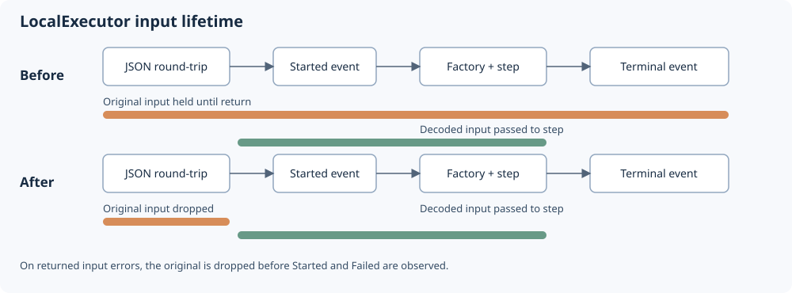

# Orchestrator / executor refactor review

Created 2026-10-29. Initial review followed by user-authorized implementation.
Implementation: RF-001 lifetime fix and RF-002/RF-003 contract documentation/tests.
Baseline: `ee39a0dab85fd0b2c3acb564be039bd99844bc41`, plus inherited working changes.
The executor is `src/executor.rs` within `orchestrator`; no separate executor crate exists.

## Scope and baseline

- Reviewed all six `src/*.rs` files and all three integration-test files.
- Traced callers in `workload-docker` recorded Compose and cleanup workflows,
  the simulated/Docker examples, and the live worker and frontend event model.
- Governing inputs: root `AGENTS.md`, `requirements.md`, and
  [approved execution design](102626-function-steps.md).
- Environment: x86_64 Linux, Rust/Cargo 1.99.1. Tests built and ran unprivileged.
- Implementation branch: `codex/refactor-orchestrator-executor`, based on
  `codex/on-demand-apps` ([parent PR](https://github.com/Cutuy/doramcap/pull/1)).
- Acquisition copied existing app deployment/registry and workload-docker edits.
  No inherited diff touched `libs/orchestrator` or `workflow-protocol`.
  Consumer observations describe that inherited checkout; recheck against later changes.

## Coverage queue

| Target | Status | Evidence / limits |
| --- | --- | --- |
| Executor, input/output lineage, factories, guard | Reviewed | 10 existing step tests; lifetime and panic probes |
| Process adapter and direct-child ownership | Reviewed | 2 existing tests; cancellation/reaping and exact stream-bound probes |
| Event observer and wire conversion | Reviewed | 4 existing tests; shared-observer identity probe; protocol tests |
| Worker → frontend identity contract | Reviewed | Both ends inspected; unique per-run labels protect current worker |
| Simulated start → observe → cleanup | Reviewed | Executed example; ordinary cleanup ordering inspected |
| Real Docker startup, stop, evidence retention | Queued | Source traced; Docker/capability E2E not rerun |
| 4 GB target memory qualification | Queued | Existing design gate remains open; no peak RSS measurement here |

Reviewed means the stated scope was inspected; findings and environment limits remain open.

## Milestone 1 — Component pass

**Work items**

- [x] Trace execution, serialization, dependencies, cancellation and instance lifetime.
  Evidence: `src/executor.rs:214–355`, `src/lib.rs:23–44`; existing step tests passed.
- [x] Inspect process validation, concurrent I/O, capture bounds and cleanup.
  Evidence: `src/process.rs:80–176`; existing and isolated process probes passed.
- [x] Inspect event conversion and observer isolation/loss accounting.
  Evidence: `src/event.rs`, `src/telemetry.rs`; four existing telemetry tests passed.

**Validation**

- [x] `cargo test -p orchestrator --offline`: 16 integration tests passed.
- [x] Isolated probes confirmed original-input retention and serializer-panic ordering.
- [x] Process probes passed: direct child disappears from `/proc` after cancellation;
  stdout/stderr accept exactly 3 bytes and reject a 3-byte stream at a 2-byte bound.

## Milestone 2 — Interaction and journey pass

**Work items**

- [x] Compare executor identity and sequence guarantees with consumers.
  Evidence: `src/executor.rs:145–160,231–246`, `src/telemetry.rs:38–81`,
  `apps/orchestrator-demo/frontend/src/model.ts:3–12`.
- [x] Trace cleanup responsibility from generic executor to concrete workflows.
  Evidence: `examples/experiment.rs:46–57` and
  `libs/workload-docker/src/workflows/recorded_compose.rs:283–469`.
  Concrete callers await cleanup after ordinary execution failure; the generic
  executor documents that cancellation cannot await resource cleanup.

**Validation**

- [x] Shared-observer probe confirmed distinct sequences with colliding
  `(session, executor, invocation)` keys from two same-label executors.
- [x] Check current caller protection: worker creates per-run session labels
  (`apps/orchestrator-demo/server/src/bin/worker.rs:94–108,178–191`);
  `ComposeRunner` applies the supplied run ID (`recorded_compose.rs:114–116`).
- [x] `cargo test -p workflow-protocol --offline`: 2 compatibility tests passed.
- [x] `cargo run -p orchestrator --example experiment --offline`: completed
  observation and awaited stop successfully.
- [ ] Re-run real Docker failure/recovery and native capability qualification.
  Deferred: this review executed only local executor/process/codec checks.

## Milestone 3 — Implement the reviewed opportunities

**Work items**

- [x] RF-001: release the original input after the JSON boundary attempt.
  Evidence: explicit drop in `src/executor.rs`; API docs state the earlier
  destructor timing. Decoded values, factories and wire layout retain their contracts.
- [x] RF-002: document one contributing executor per session namespace and test callers.
  Evidence: `with_label`, `Invocation::session` and `TelemetryObserver` docs;
  shared-stream telemetry test and worker session uniqueness test.
- [x] RF-003: document and test boundary panic event sequences.
  Evidence: `tests/boundaries.rs` covers input/output encoding and decoding panics,
  original-input destructor panic, continued unwinding and single body execution.

**Validation**

- [x] Demonstrate RF-001 regressions before the fix.
  Evidence: both lifetime tests failed on the original executor; the two codec
  panic tests passed. The successful-input case reached the factory with the
  original still alive; invalid-input callbacks observed it still alive.
- [x] Validate corrected lifetime, lineage, capture, cancellation and panic behavior.
  Evidence: `cargo test -p orchestrator -p workflow-protocol --offline` passed
  22 orchestrator integration tests and 2 protocol compatibility tests.
- [x] Validate worker stream namespace admission.
  Evidence: `cargo test -p orchestrator-demo --bin worker --offline` passed
  3 tests. Hosted and standalone session labels are distinct for all 999
  tested same-timestamp run indices.
- [x] Check workspace formatting.
  Evidence: `cargo fmt --all -- --check` passed.
- [x] Complete strict Clippy, Rustdoc and simulated lifecycle checks.
  Evidence: `cargo clippy -p orchestrator -p orchestrator-demo --all-targets --offline -- -D warnings`,
  `RUSTDOCFLAGS='-D warnings' cargo doc -p orchestrator --no-deps --offline`,
  and `cargo run -p orchestrator --example experiment --offline` all passed.
- [x] Verify the publication tree independently of inherited checkout edits.
  Evidence: all 27 orchestrator/protocol/worker tests passed again on the clean
  refactor branch; workspace formatting and strict Clippy for the changed crates
  (`--no-deps --all-targets`) passed. The broader Clippy command finds an unchanged
  `collapsible_if` warning at `workload-docker/src/workflows/recorded_compose.rs:361`
  in the parent branch. The earlier full lint pass included inherited fixes.
- [ ] Submit the trusted snapshot to the ARM64 serial worker and verify its result.
  Deferred at the user's request on 2026-10-29. The initial direct submission
  rejected three inherited internal deployment symlinks. A byte-verified export
  materialized those files; job 437 (`c0dfce8728af4639b967f920bdf8cbe9`)
  stopped at formatting before Rust tests. That formatting is corrected and
  verified locally. No further ARM64 runs were requested or submitted.

## Opportunities

Evidence locations below refer to the original review baseline. Implementation
and acceptance evidence are recorded in milestone 3.

### RF-001 — Release the original input after boundary validation

Priority: first. Kind: supported structural improvement. Confidence: high.
Status: verified locally. Relevant requirements: SE-007, SE-012, SE-014.

- Trigger: a large serialized input enters an async step that remains pending.
- Evidence: `src/executor.rs:223,255–274` borrows `input.value` for round-trip
  validation and keeps the original `Input` alive across the step await.
  An isolated 1 MiB input probe observed the original's drop flag still false
  after the decoded step yielded; it became true when `run` returned.
- Cost: the original payload allocation remains alongside decoded input during
  execution. Concurrent invocations multiply this retention. No OOM or production
  RSS improvement is claimed; input size remains deliberately unrestricted.
- Smallest change: give the original value an explicit preparation scope and
  release it after successful/failed round-trip preparation. Keep mandatory JSON
  decoding, dependency validation, factory ordering and payload capture behavior.
- Tradeoff: dropping user input earlier changes destructor timing; review custom
  input ownership and panic behavior. No dependency or new abstraction is needed.
- Acceptance: a lifetime test observes release before body entry/pending; existing
  normalization, invalid-input/factory, lineage, cancellation and capture tests pass.
  Measure representative peak RSS separately before claiming a memory reduction.

### RF-002 — Specify the telemetry namespace for multiple local executors

Priority: second. Kind: supported contract hardening. Confidence: high.
Status: verified locally, including the caller's unique-label invariant.
Relevant requirements: SE-011, SE-014, SE-016.

- Trigger: two executors publish into one stream with the same caller label,
  including the default `local` label.
- Evidence: every executor starts IDs at 1 and emits executor identity `local`
  (`src/executor.rs:148–150,231–246`). A shared observer supplies unique sequence
  numbers but leaves the invocation lookup key identical. The frontend filters
  by session and indexes by invocation, so those events describe one merged row.
- Current reach: the inspected worker assigns a fresh session for each runner call.
  No collision was observed in its normal path. Remote/multiple-executor support
  is deferred in the approved design; do not introduce that feature during this fix.
- Smallest change: document the supported one-executor-per-session stream invariant
  beside the label and telemetry APIs, and cover the consuming adapter's unique-run
  identity invariant. If shared sessions become required, agree an explicit executor
  identity and update consumers together; changing map keys alone cannot recover it.
- Tradeoff: a future executor identity change touches event interpretation, clock
  epochs and dependency references. Preserve today's wire fields and recorded data.
- Acceptance: caller tests show separate runs cannot share lookup identities;
  shared-observer tests preserve sequence gaps and terminal-state delivery.

### RF-003 — Define lifecycle observations for boundary panics

Priority: third. Kind: supported contract hardening. Confidence: high behavior,
low demonstrated frequency. Status: verified locally; boundary tests passed.
Relevant requirement: SE-016.

- Trigger: user-defined input `Serialize` or `Deserialize` panics.
- Evidence: the guard exists before `roundtrip`, while `Started` is emitted after it
  (`src/executor.rs:249–264,328–339`). A serializer-panic probe produced exactly
  `[Panicked]`; the step factory/body was not entered.
- Impact: full observer streams can contain a terminal invocation without a start,
  even without transport loss. The current frontend already supports missing starts;
  no crash or resource leak was observed.
- Smallest change: document and test this case alongside factory/body panic and
  cancellation contracts. Preserve panic unwinding. Change event timing only if
  consumers explicitly require paired starts, because start payload availability
  and callback order are existing behavior.
- Acceptance: input encode/decode and output boundary panic cases have explicit
  event sequences; existing observer-isolation and cancellation tests still pass.

## Validation evidence and continuation

Temporary probe source: `/tmp/orchestrator-refactor-probes-102926/src/lib.rs`.
It asserts observed current behavior; successful probes do not mean fixes were made.
The five probes passed with:

```sh
CARGO_TARGET_DIR=/home/cutuy/doramcap/.git/agent-pool/worktrees/1/target \
  cargo test --manifest-path /tmp/orchestrator-refactor-probes-102926/Cargo.toml --offline
```

The temporary harness uses the existing orchestrator, workflow-protocol, Serde and
Tokio dependencies. It is outside the repository; recreate/preserve it before relying
on it in a later environment. No dependency was added to the project.

RF-001, RF-002 and RF-003 are implemented and verified locally.
The original review probes above describe the pre-refactor baseline. Durable
acceptance coverage now lives in `tests/boundaries.rs`, `tests/telemetry.rs` and
`apps/orchestrator-demo/server/src/bin/worker.rs`.

The next review pass should exercise real Compose failure/cancellation through
cleanup and evidence sealing, then revisit memory qualification with a representative
workload. Track those cross-component checks alongside their owning workload-docker
milestones. No peak RSS or production memory improvement has been measured here.

ARM64 qualification is deferred at the user's request. Real Docker E2E and 4 GB
target qualification remain open. Publication includes the refactor, its tests,
and this review record; inherited deployment/registry changes are preserved separately.
