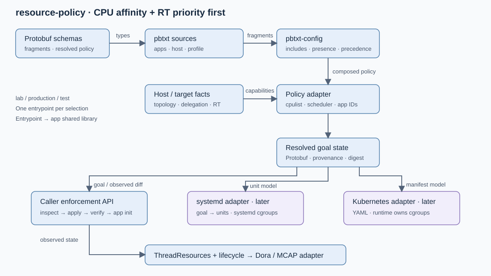

# Resource policy: implementation plan

Crate: `libs/resource-policy` (`resource_policy` in Rust). It owns resource goals, validation, reconciliation APIs, and backend contracts. `libs/pbtxt-config` owns shared App/Fragment/Deployment schemas and composition. Initial enforcement covers Linux CPU placement and real-time scheduling. Future adapters generate orchestration configurations; future policies cover GPU, memory bandwidth, and budgets.

Initial CPU/RT implementation is available. Existing applications and Dora dataflows retain their current launch behavior. Completed items link to [validation evidence](validation.md); unchecked items identify remaining qualification or future integration scope.

## M1 — Evaluate dependencies and define contracts

- [x] Present dependency choices for user evaluation before adoption or custom implementation:
  - Existing `prost` / `prost-build`: generated types and binary encoding.
  - [`prost-reflect`](https://docs.rs/prost-reflect/latest/prost_reflect/): descriptor-backed pbtxt parsing and reflection.
  - [`nix`](https://github.com/nix-rust/nix): Linux process/affinity primitives; verify scheduler API coverage.
  - [`cgroups-rs`](https://github.com/kata-containers/cgroups-rs): assess cgroup v2 placement, delegation, lifecycle, and RT compatibility coverage.
  - [`figment`](https://docs.rs/figment/latest/figment/): compare a descriptor-preserving provider against a focused typed resolver; evaluate presence, replacement, and diagnostics before choosing.
- [x] Create the crate and its manifest together; move this plan and SVG into its owned documentation when scaffolding begins.
- [x] Separate shared App/Fragment/Deployment schemas in `pbtxt-config` from resource-policy goals. Keep observed CPU/scheduler values in Rust `ThreadResources`.
- [ ] Define stable app ID, deployment/session ID, and instance ID. Registry entries identify app instances; model executable, shared-library, and image references separately from resource policy. A future launcher entrypoint links or loads one app library per isolated process and applies policy before app initialization.
- [x] Define CPU placement using a required resolved Protobuf string `placement.cpus` in Linux cpulist notation: `"0"`, `"1-3"`, or `"4,5-7,9-11"`. Initially accept decimal IDs and inclusive ranges separated by commas; reject empty selections, reversed ranges, malformed tokens, and overflow. Normalize repeated/overlapping ranges into a set and canonical cpulist; explicitly document support boundaries for extended kernel bitmap syntax. Reject missing placement in resolved goals. Reserve future allocation-request policies for orchestrator-specific support.
- [x] Evaluate maintained cpulist parsing crates before implementing parsing; require dynamic CPU-set support beyond fixed `CPU_SETSIZE`, bounded parsing, and canonical formatting.
- [x] Define optional `rt_priority`: absent inherits during composition; unresolved absence defaults to 0; 0 resolves to `SCHED_OTHER`; 1–99 resolves to `SCHED_RR`, checked against host limits.
- [x] Make clear that CPU placement permits overlap unless exclusivity is explicitly requested in a future policy. It does not reserve bandwidth or remove host IRQ contention.
- [x] Define goal-state APIs around a parsed Protobuf or validated immutable in-memory policy: inspect → plan changes → apply → verify. Reapplying a satisfied goal succeeds without unnecessary mutations; report requested state, observed state, and remaining differences.
- [x] Separate thread affinity/scheduling from process-wide cgroup membership. Define current-thread enforcement and a single-threaded process-bootstrap path; applying policy to existing threads requires explicit coordination and cannot atomically cover concurrent thread creation.
- [x] Document initial scheduler/affinity inheritance for application threads/children and the application's ability to change thread policy subject to permissions. Goal-state application is explicit; a continuous reconciliation loop is a future opt-in facility.

Validation gates:
- [ ] Record dependency evaluation and user selection, compatible versions, licenses, and maintenance evidence.
- [x] Round-trip fixture messages through Rust and a second language; verify field presence, cpulist strings, and zero priority.
- [ ] Review schema evolution rules, unknown-field rejection for authored configs, and portable versus host-specific validation.

## M2 — Compose pbtxt configurations through `pbtxt-config`

- [x] Support app, host, and use-case fragments, with explicit `lab`, `production`, and `test` entrypoints; a single file follows the same resolution path.
- [x] Resolve includes relative to their containing file. Detect cycles, missing inputs, and excessive include depth/size; define repeated-include behavior deterministically.
- [x] Apply includes in declared order, then the containing fragment. Merge applications by ID; reject duplicate declarations within one fragment.
- [x] Preserve scalar presence. Replace an explicitly supplied cpulist selection as a unit. Require explicit placement after composition; reject missing or empty resolved CPU sets.
- [x] Validate partial fragment structure before merging and complete policy semantics after merging. Record source paths and override provenance without relying on generic Protobuf merge semantics.
- [x] Produce an immutable resolved deployment plus a reproducible digest of normalized policy; specify ordering and hashing so map iteration cannot change the digest.
- [x] Add a library example for validate/resolve/print; defer a production CLI and application adoption.

Validation gates:
- [x] Test nested includes, precedence, cycles, unknown app IDs/fields, missing inputs, explicit zero, cpulist replacement, missing goal rejection, and deterministic output.
- [x] Cover single IDs, ranges, mixed ranges, overlap normalization, malformed/oversized input, large CPU IDs, and equivalent cpulist digests.
- [x] Demonstrate equivalent single-file and composed deployments.
- [x] Verify parser diagnostics and provenance identify the offending source and field; document any source-location limitations.

## M3 — Implement Linux preparation and enforcement

- [x] Probe cgroup v2 delegation, available/effective CPU and NUMA sets, scheduler limits, and permissions. Surface RT/cgroup CPU-controller incompatibility explicitly.
- [x] Prepare one leaf cgroup per app instance under a caller-owned delegated hierarchy, with valid parent/controller setup and memory-node placement.
- [x] Expose explicit caller-oriented operations for current-thread affinity/scheduling and process cgroup placement. Inspect current state and compute changes from the resolved goal; keep parsing and planning side-effect free.
- [x] Implement a process-bootstrap sequence: validate → prepare cgroup → attach calling process → apply calling-thread affinity/scheduler → verify → return control to the entrypoint → initialize app library. Require bootstrap before worker creation. Dynamic library constructors may execute at load time, so enforce before loading libraries that can start work; statically linked pre-main work requires a documented startup contract or earlier external enforcement.
- [x] Apply affinity/cpuset constraints and set `SCHED_OTHER/0` or `SCHED_RR/priority`; verify actual values against the goal. Report parent restrictions or CPU hotplug that prevent convergence.
- [x] Define partial-application behavior: return completed steps, observed state, and recovery guidance; attempt only safe, owned rollback. Linux updates across cgroup, affinity, and scheduling are not atomic. A bootstrap failure prevents entry into application code.
- [x] Define ownership and cleanup for preparation failure, app initialization failure, normal exit, restart, and surviving descendants. Never remove another owner's cgroup or silently kill descendants. Process cgroup membership applies to all threads; thread scheduling remains per-thread.
- [x] Return instance handles and effective-policy reports. Default to applying only differing settings. A future spawn/exec helper can reuse these primitives; its gated-child/async-signal-safe launch mechanics belong to that later integration.

Validation gates:
- [ ] Test actual startup affinity and scheduler policy, descendant inheritance, disallowed CPUs, permission denial, partial failure, and cleanup.
- [ ] Verify idempotent reapplication, explicit drift detection/reapplication, and failed convergence reporting. Use a sample app-library entrypoint to verify policy before initialization; cover thread/process scope and the single-threaded bootstrap precondition.
- [x] Verify ordinary-policy reset from an RT launcher, parent restrictions, and threads created by the application.
- [x] Run bounded RT contention tests with a watchdog on a housekeeping CPU; assert behavior without fragile timing thresholds.
- [x] Build unprivileged; elevate only native test executables. Read the main checkout's `.sudo-password` through stdin under the repository credential rules; stop on missing credentials or authentication failure.
- [x] Submit trusted source through `scripts/ci/submit.py` to ARM64 CI and record its serial-queue result; add explicit resource-policy native coverage where the existing suite does not invoke it.
- [x] Record NVIDIA/Linux target qualification separately from x86 and ARM64 WSL evidence.

## M4 — Define deployment adapter contracts

- [ ] Represent target capabilities and required/preferred guarantees. Reject unsupported required policies during generation.
- [x] Specify in-process bootstrap, systemd, and Kubernetes ownership boundaries. Runtime-managed applications consume their assigned boundary; process cgroup preparation requires delegation. An entrypoint under an orchestrator inspects/verifies externally applied policy and changes only explicitly delegated settings.
- [ ] Define typed output models and reviewable generation diagnostics. Generated artifacts carry source-policy identity; target patches are declared inputs.
- [x] Translate the same resolved goal state into systemd units as an alternative enforcement path. Specify systemd mappings: `AllowedCPUs`, optional `CPUAffinity`, and scheduler policy/priority; identify parent restrictions and RT prerequisites.
- [x] Specify Kubernetes mappings for future CPU allocation requests. Exact host CPU IDs and RT policy require explicit backend support; standard CPU requests cannot stand in for either.
- [x] Map independently isolated Dora nodes/runtime processes to deployment units. Multiple app libraries in one process share its process-level cgroup boundary; separate processes are required for independent app cgroups. Shared in-process operators share a resource boundary; document daemon/recorder placement separately.

Validation gates:
- [ ] Review a capability matrix and fixtures showing supported, unsupported, and explicitly degraded translations.
- [ ] Verify no generator claims a guarantee stronger than the target supports.
- [ ] Keep generator implementation and deployment activation deferred to a separately selected milestone; the first release exposes contracts and fixtures only.

## M5 — Qualify and document the initial library

- [x] Provide pbtxt examples for two apps and three profiles, a caller-oriented API usage example, and a future shared-library entrypoint lifecycle guide.
- [x] Measure configuration resolution and launch overhead separately; keep text parsing and reflection outside application execution loops.
- [ ] Define requested/effective policy and lifecycle records for future Protobuf IPC/MCAP publication without wiring existing apps.
- [x] Document future GPU, bandwidth, exclusivity, and budgeting capabilities as extension points with explicit unsupported status.

Validation gates:
- [x] Run workspace formatting, default/all-feature Clippy and relevant tests; record exact commands and outcomes.
- [x] Record native and ARM64 evidence, configuration compatibility results, and unresolved target limitations.
- [x] Confirm existing app launch paths and dataflows are unchanged. Run Dora end-to-end checks separately if subsequent adapter work changes those paths.
- [ ] Review public API, examples, failure behavior, and documentation before enabling adoption work.

## Evidence

See [validation evidence](validation.md) for platform commands, results, dependency choices, and remaining scope. The generated resource-only systemd directives are implemented; complete unit/manifest generation remains future work.
