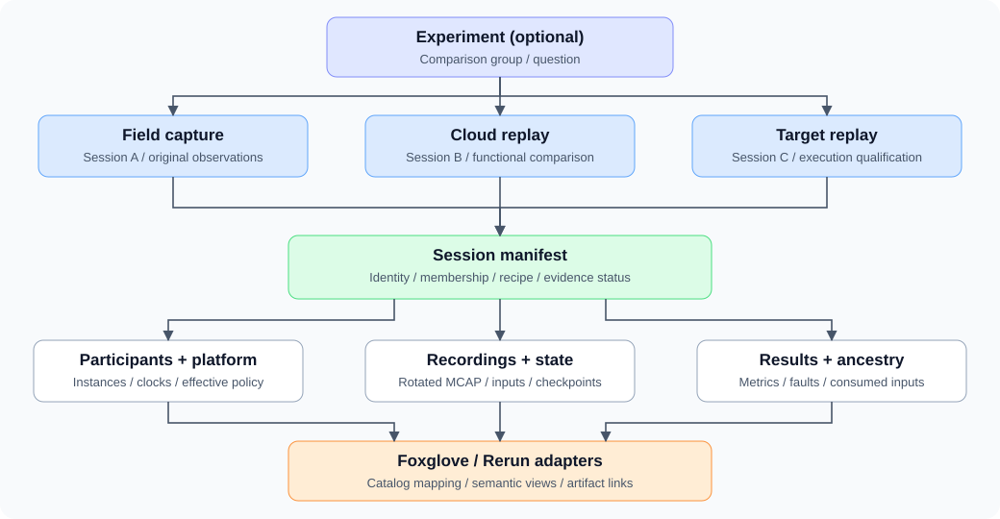

# Session concept

Created October 25, 2026. Status: proposed contracts; runtime APIs and adapters remain future work.

## Granularity

A **session** is one bounded execution attempt: a field capture, cloud resimulation,
or target-hardware resimulation. It owns the identity and evidence boundary used
for tracking, recording, reproduction, analysis, and queries.

| Identity | Scope |
|---|---|
| Experiment ID (optional) | A question or comparison grouping related sessions |
| Session ID | One execution attempt, unique across devices and imports |
| Workload instance ID | One incarnation of a participant, including restarts |
| Artifact ID | One recording file, manifest, checkpoint, or derived result |

- One session can span processes, devices, topics, and rotated files.
- Each replay or independent retry receives a new session ID and source-session links.
- A participant restart can remain in its session; it receives a new instance ID.
- Resuming an interrupted session requires explicit host reconciliation of ownership and evidence.
- The lifecycle coordinator drives session transitions and assigns identity before participants emit evidence.

## Architecture and ownership

| Component | Responsibility |
|---|---|
| `session` | Identity contracts, membership, manifest, source links, outcome and evidence status |
| Lifecycle coordinator | Drive session transitions and participant management; report outcomes to the session |
| Application / launcher | Apply policy, define experiment acceptance and delegate participant operations |
| `pbtxt-config` / resource policy | Effective configuration fingerprints and requested/applied policy |
| Activity, provenance, fault and resource crates | Domain evidence with identities, clocks, gaps, and counters |
| Recorders / storage | Payload persistence, rotation, finalization, durability reporting |
| Replay runner | Restore inputs/state, drive time and execution, produce a new session |
| Foxglove / Rerun adapters | Map session artifacts and semantics into external catalogs and views |

Existing component-local session fields retain their wire contracts. The manifest
maps them to the common session and participant identities; migration requires
explicit schema/version work. Payload-buffer leases remain owned by memory and storage crates.

## Evidence manifest

The manifest is the join point between data, execution, and reproduction.
Paths and display names supplement stable identities and content digests.

| Evidence | Required meaning |
|---|---|
| Identity | Schema version, session ID, optional experiment ID, execution mode, source sessions |
| Membership | Devices, workloads, unique instances, join/leave/restart boundaries |
| Recipe | Code/build, container, model, normalized config and calibration artifact digests |
| Inputs and state | Input artifact digests, selected ranges, checkpoints, seeds and preprocessing recipe |
| Time and delivery | Clock domains/mappings/uncertainty, playback pacing, ordering and inbox policies |
| Platform and policy | Hardware/software profile, requested/effective resources, observed power/thermal conditions |
| Artifact inventory | IDs, roles, locations, digests, schema versions, time coverage and source links |
| Results | Metrics, acceptance criteria/tolerances, evaluator version, verdict and evidence references |
| Completeness | Expected/observed counts, gaps, truncation, unavailable evidence, finalization and durability |

Fields carry availability and applicability explicitly. A session can be useful
with partial evidence; reproduction eligibility depends on the declared mode and inputs.
Secrets remain outside exported manifests and ordinary configuration attachments.

During capture, publish versioned provisional manifest revisions. Finalization
seals an immutable revision identifying the exact artifact set and its completeness.
Later analysis produces a new linked revision or artifact with its own recipe;
queries can pin a manifest revision/digest. Mutable catalog membership alone cannot
identify a frozen experiment.

## Lifecycle and completion

```text
created -> running -> finalizing -> completed | failed | aborted
```

Execution outcome, evidence completeness, and persistence guarantees are separate
fields. Successful computation can have incomplete recordings. A failed workload
can produce complete diagnostic evidence. An unfinalized capture remains provisional.

The lifecycle coordinator records participant exit and sink outcomes using the
session contracts. It distinguishes write completion, file finalization, and the
storage adapter's durability contract.
Timeouts and missing participants remain visible in the final evidence report.

## Reproduction modes

| Mode | Purpose | Controls and evidence |
|---|---|---|
| Field capture | Preserve an observed run | Original inputs, actual consumed generations, configuration, runtime evidence |
| Cloud replay | Compare functional behavior | Pinned inputs/state/recipe, logical time, ordering, seeds, numeric tolerances |
| Target replay | Qualify deployment behavior | Same recipe plus qualified hardware, paced arrivals, effective policy, interference and timing distributions |

Every replay identifies its source manifest revision and input artifacts.
Closed-loop experiments also identify simulator/world/sensor models and initial state.
A recording provides observations; a replay runner supplies execution semantics.
Exact scheduling reproduction and bitwise numerical equivalence require separate
qualification. Missing inputs, clocks, or initial state must constrain the reported claim.

## Inspection and query contract

- Filter by session, experiment, source session, device, instance, execution mode and outcome.
- Join artifacts through explicit identity, time coverage, and schema version.
- Follow output ancestry to actual consumed generations through `step-provenance`.
- Preserve source event time, clock mapping, gaps and loss through every conversion.
- Label query resampling, interpolation, and latest-value selection in derived results.
- Compare metrics only with their evaluator version, units and acceptance criteria.

## Foxglove and Rerun boundaries

| Consumer | Proposed mapping |
|---|---|
| Foxglove, one device | MCAP Metadata record named `foxglove`: `sessionKey = session_id`; unique `key` per file |
| Foxglove, multiple devices | One Foxglove session per device; project-unique keys derived from session/device IDs; preserve common session ID separately |
| Rerun | Explicit mapping from our session/artifact IDs to recording, segment and layer identities |
| Both | Preserve our manifest and source/digest mappings independently of catalog-generated IDs |

Foxglove groups recordings from one device; its session keys are unique within a
Project. Opening local files uses explicit file selection. Import adapters resolve
catalog membership. Shared metadata does not discover sibling files on disk.

Standard sensor schemas support existing visualizers. Runtime batches, dictionaries,
ancestry and loss need semantic adapters. Our optimized index-free MCAP capture
requires chunking/indexing before Foxglove index-in-place use. RRD conversion or
MCAP repacking creates a derived artifact with the original capture as its source.

## Implementation choices to evaluate

Before selecting dependencies or defining public types, evaluate `uuid` for identity,
`prost` for versioned Protobuf manifests, and `sha2` for artifact digests. These are
candidates for user evaluation; this scaffold adopts none. Reuse existing config
fingerprints where their documented scope matches the evidence requirement.

## References

- [Foxglove sessions](https://docs.foxglove.dev/docs/data/sessions)
- [Foxglove import metadata](https://docs.foxglove.dev/docs/data/primary-sites/manage-data)
- [Foxglove index-in-place requirements](https://docs.foxglove.dev/docs/data/primary-sites/storage-mode)
- [Rerun catalog model](https://rerun.io/docs/concepts/query-and-transform/catalog-object-model)
- [Platform requirements](../../../docs/roadmap.md)

## Dora payload and transport reference

[Component diagram: Protobuf, Arrow IPC, and Zenoh shared memory](dora-protobuf-zenoh-shm.svg).
Shows the native local SHM path in Dora v1.1.0 and distinguishes our CUDA-registered pool.
Source: [Dora node API](https://github.com/dora-rs/dora/blob/v1.1.0/apis/rust/node/src/node/mod.rs).
