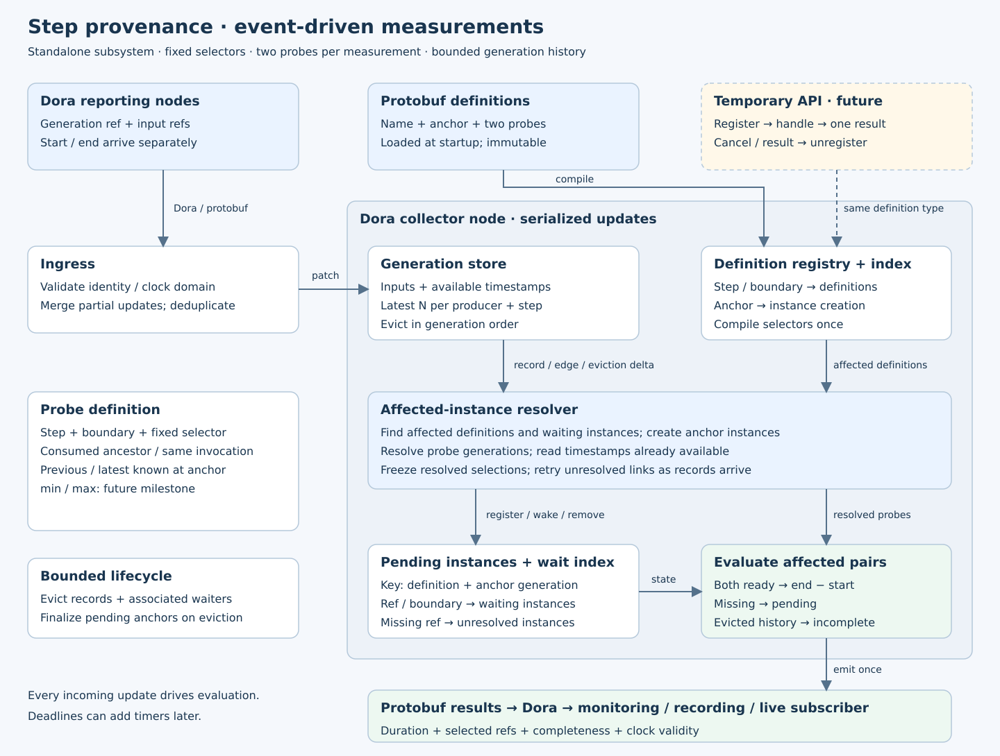

# Step provenance and latency measurements

Created: 2026-10-20. Status: core implemented; Dora integration and static binding pending. Component: `libs/step-provenance`.

## M1 — Contracts and dependency review

- [x] Define protobuf records: generation reference, input references, independent start/end patches, clock domain.
- [x] Define protobuf measurements: stable name, anchor, two probes, fixed selector enums, missing-data policy.
- [x] Define protobuf results: selected references, duration, completeness, clock validity.
- [x] Scope identity by producer epoch, step, and user generation ID; support globally unique IDs. Define generation ordering separately from opaque IDs.
- [x] Use one dependency list per output generation; dependencies may vary between generations.
- [x] Specify duplicate/conflicting patch handling, immutable completed results, schema evolution, and unknown enum rejection.
- [x] Evaluate existing `prost` / `prost-build` and `pbtxt-config` tooling with the user before implementation or dependency adoption.
- [x] Evaluate optional activity-context identity reuse; keep the step model independently usable.
- [x] **Validation gate:** record schema round-trip, timestamp-presence, restart identity, and compatibility evidence.

Evidence (2026-10-20): `tests/engine.rs` covers protobuf presence/unknown fields,
version/enum rejection, immutable metadata, and restart IDs. Existing `prost`
tooling reused; `pbtxt-config` deferred. Activity-context reuse evaluated in
[contracts](contracts.md#protocol-and-reuse).

## M2 — Bounded generation graph

- [x] Merge partial records and resolve explicit input references across producers.
- [x] Keep N latest generations per producer and step; use generation order independently of arrival order.
- [x] Preserve unresolved edges until resolution or eviction; reject cycles and records older than the retained boundary.
- [x] Evict records, associated indexes, and pending anchor instances; report incomplete measurements when required history expires.
- [x] Define handling of unbounded missing references and producer churn; configure overall resource limits.
- [x] **Validation gate:** exercise out-of-order patches, shared inputs, prior-state edges, eviction, and bounded pending-state growth.

Evidence (2026-10-20): retention, shared-state ancestry, cycle rejection,
never-received history expiry, atomic rejection, and bounded-waiter tests pass.
`Engine::lineage` returns source roots and explicit missing/expired boundaries.

## M3 — Event-driven pair measurements

- [x] Load immutable definitions at startup; compile `(step, boundary) → affected definitions` indexes.
- [x] Key instances by definition and anchor generation; index concrete `(generation reference, boundary) → waiting instances` and unresolved references.
- [x] Support fixed selectors: consumed ancestor, same invocation, previous generation, latest known at anchor.
- [x] Define invocation matching, previous-generation ordering, ambiguous ancestry behavior, and the exact anchor event.
- [x] Freeze resolved selections; latest-known uses the collector's anchor-time snapshot. Replay preserves that event order.
- [x] On each record/edge update, resolve affected instances and read already-cached timestamps; emit once both probes are ready.
- [x] Expose pending counts and emit incomplete results explicitly; validate clock comparability before subtraction.
- [x] Finalize on required-history or anchor eviction. Wall-clock deadlines remain a future option.
- [x] **Validation gate:** cover both timestamp arrival orders, late dependency records, reused frames, selector stability, duplicates, and eviction finalization.

Evidence (2026-10-20): 18 tests pass with
`cargo test --locked -p step-provenance --all-features`; strict Clippy passes with
`cargo clippy --locked -p step-provenance --all-targets --all-features -- -D warnings`.
Tests cover all 24 partial/dependency arrival permutations and prove unrelated
steps leave the evaluation count unchanged. [Selector contracts](contracts.md#probe-selection).

## M4 — Dora integration and monitoring

The [demo plan](../../../apps/dataflow-tracing/docs/102026-dataflow-tracing.md)
records the approved architecture and implementation evidence.

- [x] Carry output references with application Dora messages; publish protobuf step patches to a collector node.
- [ ] Add a Dora result-output consumer. The demo currently streams protobuf results from the collector over WebSocket; core evaluation stays transport-independent.
- [x] Define queue limits, backpressure/report loss behavior, and result-consumer retention separately from graph retention.
- [x] Add a multi-process camera/lidar → detection → control example with independently reported boundaries.
- [ ] **Validation gate:** record Dora end-to-end lineage and latency evidence, including delayed/lost reports and process restarts.
- [x] **Validation gate:** run applicable Rust tests and verify the serial ARM64 CI job (job 72); provenance-specific Dora end-to-end results remain a separate gate.

## M5 — Static dependency binding

- [ ] Define topology and binding rules in protobuf configuration.
- [ ] Resolve bindings at application input selection into concrete input references; feed the same graph and measurement engine.
- [ ] Support explicit invocation matching and declared generation offsets; define latest-input semantics before adding that rule.
- [ ] **Validation gate:** show equivalent records/results for explicit and static reporting, including reused inputs.

## Future milestones

- [ ] **Temporary measurements:** register an immutable definition through the same registry; return a handle; unregister on one result or cancellation. Specify retained-history scope and registration race semantics.
- [ ] **Validation gate:** verify cancellation cleanup, no stale index entries, and results equivalent to persistent definitions.
- [ ] **Aggregations:** add min/max timestamp probes with explicit matching scope and required-branch completeness.
- [ ] **Validation gate:** verify earliest camera/lidar start to latest detection/mapping/localization end without mixing invocations.

## Evidence

M1–M3 local evidence is recorded above. ARM64 retry on 2026-10-20:

- Job **70**: full-workspace CI failed during Clippy in `resource-policy`. Its Rust code expects `proto::Placement` / `.cpus`; the schema defines `policy::Placement` as a oneof. Native tests were not reached.
- Job **71**: focused `step-provenance` validation passed on aarch64: strict all-target/all-feature Clippy, 18 default-feature tests, and 18 all-feature tests.
- Snapshot: `/home/doramcap-ci/jobs/06a3824793264fb3a99d5bbc837a4afe`.
- Job **72**: full workspace CI passed after correcting the stale resource-policy schema to the documented `Placement` message. Workspace default/all-feature Clippy and Rust tests, native cgroup/accounting/allocation/resource-policy checks, Python/Rust interoperability, storage/activity smoke tests, and existing Dora recording checks passed.
- Corrected snapshot: `/home/doramcap-ci/jobs/a89fe65641e840cea751e4a6ea4f716d`; completed 2026-10-20 02:51 America/Los_Angeles.
- Verified job states and `pueue log --full 70`, `71`, and `72`. Provenance-specific Dora integration and its end-to-end gate remain pending.
